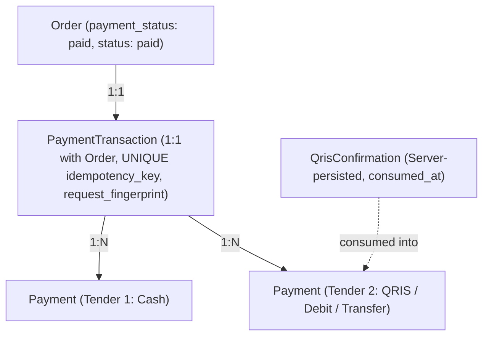
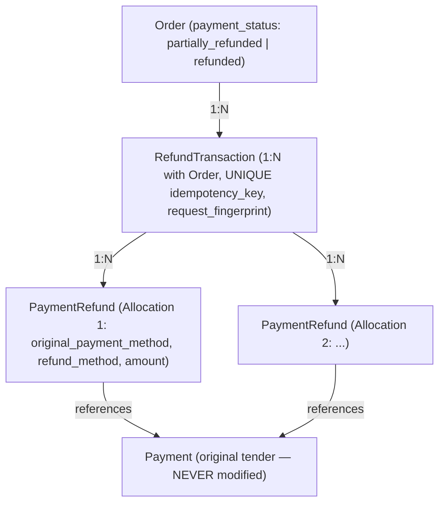

# Temu Pulang — Architecture & System Design Specification

## 1. System Overview

**Temu Pulang** is a local-first Point of Sale (POS) and operations management platform designed for a Food & Beverage establishment.

### Technology Stack:
- **Framework**: Laravel 13.x (PHP 8.5)
- **Frontend / UI**: Livewire 4.x + Alpine.js + Tailwind CSS 4.x
- **Database**: MySQL 8.x (with isolated SQLite in-memory for testing)
- **Deployment & Network Context**: Local Area Network (LAN) on-premise operation with zero cloud dependency for core transaction flow.

---

## 2. Model Organization

The application's Eloquent models are organized cleanly within `app/Models`:

```
app/
├── Models/
│   ├── User.php                      # Staff & admin accounts with role integration & soft deletes
│   ├── Role.php                      # Access roles (Owner, Cashier; Supervisor reserved for future phases)
│   ├── Permission.php                # Granular permissions grouped by domain
│   ├── ActivityLog.php               # Audit log trail with polymorphic subjects
│   ├── ShopSetting.php               # Singleton/branch store settings, receipt, hardware config
│   ├── ApplicationSetting.php        # Key-value typed configuration store
│   ├── Category.php                  # Product menu categories
│   ├── CategoryTranslation.php       # Category localization (EN / ID)
│   ├── Product.php                   # Menu items (supports both variant and non-variant items)
│   ├── ProductTranslation.php        # Product localization (EN / ID)
│   ├── ProductVariant.php            # SKU-level variant options (sizes, portions)
│   ├── VariantTranslation.php        # Variant localization (EN / ID)
│   ├── ModifierGroup.php             # Customization rules (sugar, ice, add-ons)
│   ├── ModifierGroupTranslation.php  # Modifier group localization (EN / ID)
│   ├── Modifier.php                  # Individual customization options (free or paid)
│   ├── ModifierTranslation.php       # Modifier option localization (EN / ID)
│   ├── IngredientCategory.php        # Phase 6: Ingredient categorisation
│   ├── Ingredient.php                # Phase 6: Raw material with DECIMAL(12,3) stock and milli-unit helpers
│   ├── IngredientBalance.php         # Phase 6: Per-branch on-hand stock (NULL branch = single store)
│   ├── RecipeItem.php                # Phase 6: Bill of Materials — ingredient per product/variant
│   ├── ModifierRecipeItem.php        # Phase 6: Ingredient delta triggered by modifier selection
│   ├── StockMovement.php             # Phase 6: Append-only audit ledger (no updated_at, DomainException guard)
│   └── Concerns/ (or Traits/)
│       └── HasTranslations.php       # Transparent multi-language resolution trait
```

---

## 3. Authorization & Access Control Design

Authorization employs a lightweight, high-performance Role-Based Access Control (RBAC) architecture integrated directly with Laravel's native `Gate` facilities.

### 3.1. Roles & Initial Separation
1. **Owner (`owner`)**:
   - The proprietor and administrator.
   - Holds unrestricted access across the entire application.
   - Granted master bypass in `AppServiceProvider`:
     ```php
     Gate::before(function (User $user, string $ability) {
         if ($user->hasRole('owner')) {
             return true;
         }
         return $user->hasPermission($ability) ? true : null;
     });
     ```
2. **Cashier (`cashier`)**:
   - Operational staff operating the POS terminal.
   - Allowed abilities:
     - `pos.access` (Open and operate POS register)
     - `pos.orders.create` (Take and punch in customer orders)
     - `pos.orders.view` (View shift orders)
     - `products.view` (Browse menu catalog)
     - `inventory.view` (Check item/ingredient availability)
     - `reports.view` (Shift summary view)
   - Explicitly restricted from:
     - `products.manage` (Cannot modify prices, create, or delete products)
     - `reports.sensitive.view` (Cannot see profit margins or audit logs)
     - `refunds.process` (Cannot issue refunds without manager/owner approval)
     - `settings.manage` (Cannot modify receipt headers, taxes, or printers)

### 3.2. Auditing Strategy
All security-sensitive operations (shift open/close, discounts, overrides, catalog modifications) are recorded via `ActivityLog::record(...)`, preserving:
- Operating `user_id`
- Action string identifier
- Polymorphic subject reference (`subject_type`, `subject_id`)
- Contextual snapshot (`properties` JSON)
- Client IP address and User Agent

---

## 4. Translation Strategy

To avoid black-box package bloat and performance penalties, translations are implemented via the `HasTranslations` trait and normalized translation tables.

### Mechanics:
1. Every localized entity (`Category`, `Product`, `ProductVariant`, `ModifierGroup`, `Modifier`) has a corresponding `*_translations` table.
2. The trait implements:
   - Dynamic resolution: `$model->name` inspects the loaded relationship or queries the active locale (`app()->getLocale()`).
   - Multi-tier fallback: `active locale (id)` -> `fallback locale (en)` -> `first available translation`.
   - Direct translation accessor: `$model->translate('en')->name`.
   - Mutation helper: `$model->setTranslation('name', 'id', 'Nama Baru')`.
3. Performance: In list/index queries, translations can be eager-loaded with `->with('translations')` to prevent N+1 queries.

---

## 5. Monetary Calculation & Precision Guidelines

1. **Rupiah Integer Storage**:
   - All product prices, variant prices, modifier upcharges, and monetary adjustments are stored as whole integer numbers (`BIGINT UNSIGNED`).
   - Example: Rp 25.000 is stored as `25000`.
   - Floating-point data types (`FLOAT`, `DOUBLE`) are strictly forbidden for monetary storage.
2. **Taxes & Percentages**:
   - Tax rates and service charge rates are stored as basis points in integer columns (system defaults are `0` = 0.00%; e.g. `1000` = 10.00%, `500` = 5.00%). Configurable exclusively by the Owner.
   - Calculations use standard integer rounding `round(($subtotal * $rate) / 10000)` to ensure penny-perfect financial reconciliation.

---

## 6. Multi-Branch Expansion Architecture

Although Temu Pulang initiates as a single-branch LAN deployment, the database is architecturally forward-compatible with multi-branch expansion:
- `branch_id` nullable indexed foreign keys exist on `users`, `shop_settings`, and `shifts`.
- During Phase 1-3, `branch_id` is null or defaults to branch 1 without imposing tenancy overhead.
- When expanding to multiple physical outlets, models can implement a global scope or query filter on `branch_id`.
- **Phase 6 extension**: `ingredient_balances` and `stock_movements` carry `branch_id` with the same NULL = single-store convention. The `ingredient_balances.branch_slot` generated column (`COALESCE(branch_id, 0)`) enforces NULL-safe unique stock rows per branch.

---

## 7. Shift Management Architecture (Phase 3)

The shift lifecycle is encapsulated in `App\Services\ShiftService` and adheres to a strict single-active-shift operational rule.

### 7.1. State Lifecycle
```
[ OPEN ] ──(Close Action)──> [ CLOSED ]
```
- **Lifecycle Rule**: A closed shift is strictly immutable and cannot be reopened. Any discrepancies or post-close corrections must be logged via audited adjustment records.
- **Concurrency Control**: Concurrency is guarded via pessimistic database locking (`lockForUpdate()`) and atomic transactions (`DB::transaction(...)`) to eliminate race conditions and prevent multiple concurrent active shifts in a single branch.

### 7.2. Expected Cash & Discrepancy Formula
```
Expected Cash = Opening Cash (Float)
              + Manual Cash Inflows
              - Manual Cash Outflows
              + Net Cash Sales (Tendered - Change)
              - Cash Refunds
Discrepancy   = Actual Cash Counted - Expected Cash
```
- **Derivation from Immutable Records**: Cash sales are derived directly from `Payment` records (`payment_method = 'cash'`), eliminating duplicate manual `CashMovement` entries.
- **Cash Change Handling**: Cash change returned to customers is accounted for; only net cash (`amount = tendered_amount - change_amount`) increments the expected drawer balance.
- **Non-Cash Isolation**: Non-cash payments (`qris`, `debit`, `credit`, `transfer`) are tracked separately and never increment the physical cash drawer.
- **Cash Refund Support**: Implemented in Phase 5 (Tasks 5.3 & 5.4); cash refunds (`PaymentRefund.refund_method = 'cash'`) directly decrease expected cash drawer balance via `ShiftService::totalCashRefunds()`.
- If `discrepancy != 0`, a detailed closing note is mandatory. Neither the application nor the database silently adjusts balances.

---

## 8. Cash Movement Ledger Architecture (Phase 3)

The cash drawer ledger is managed by `App\Services\CashMovementService`.

### 8.1. Invariant Rules
1. Each movement must reference an active `open` shift. Movements against closed shifts are forbidden.
2. Movement types are strictly `in` (cash inflow) or `out` (cash outflow).
3. Amounts must be integer Rupiah greater than zero (`BIGINT UNSIGNED`).
4. Silent edits and raw deletes are prohibited.
5. Corrections are handled through immutable reversal records (`reverseMovement(...)`), maintaining a bilateral audit link (`reversed_movement_id`) and recording the authorizing user.

---

## 9. Shop Settings Architecture (Phase 3)

Shop settings are managed by the Owner-only Livewire component `App\Livewire\Settings\ShopSettingsManager`.

### 9.1. Sections & Capabilities
- **Profil Usaha**: Name, address, phone, email, and receipt logo upload.
- **Jam Operasional**: 7-day schedule with open/close hours (supporting schedules crossing midnight) and a configurable `business_day_start_time` (e.g. 04:00) using the `Asia/Jakarta` timezone.
- **Pajak & Finansial**: Confirmed defaults are **0% Tax** and **0% Service Charge**, stored as basis points integer (`0` = 0.00%, `1000` = 10.00%).
- **Printer Thermal USB**: Direct USB connection mode (`printer_connection = 'usb'`), 58mm / 80mm paper widths, display name identifier, and optional kitchen printer toggle. IP address and port fields are non-mandatory and set to null for USB mode. (*Note: Physical Windows ESC/POS driver integration, raw printing helper, and receipt printing spooler were delivered in Phase 5 Task 5.5.*)
- **QRIS Payment Image (Phase 5 Task 5.6 Part 2A)**: Owner-only upload, preview, replacement, and removal of the shop's QRIS image under the `QRIS` tab. Validates real file MIME types (`image/png`, `image/webp`) via `finfo`, enforces a 2 MB maximum, stores files on the `public` disk under `storage/app/public/qris`, deletes superseded files on replace or remove, persists the path in `application_settings` (`payment.qris_image_path`), and logs updates via `ActivityLog`. `CashierPos` displays the configured QRIS image and prominent amount to pay in the QRIS checkout modal, or a localized notice if none is configured.

---

## 10. Activity Log & Audit Trail (Phase 3)

The audit log viewer is implemented in `App\Livewire\ActivityLogs\ActivityLogIndex` with strict Owner-only access (`role:owner`).

### 10.1. Characteristics
- **Immutability**: Logs cannot be modified, edited, or deleted through application routes.
- **Module Categorization**: Every log record contains a dedicated `module` column (`auth`, `shifts`, `cash_movements`, `settings`, `catalog`, etc.).
- **Filtering**: Live search, filtering by user, filtering by module, and date range filtering with newest-first ordering.
- **Context Inspection**: Rich JSON modal for inspecting before/after property snapshots and client IP addresses.

---

## 11. Menu Management & Order Engine Architecture (Phase 4)

Phase 4 establishes the core transactional order engine and catalog management backoffice.

### 11.1. Menu Management Backoffice (Owner Only)
- **Category Management (`App\Livewire\Menu\CategoryManager`)**: Complete CRUD, automatic slug generation, bilingual names and descriptions (`id` / `en`), sort order customization, and soft-delete protection.
- **Modifier Management (`App\Livewire\Menu\ModifierManager`)**: Configurable modifier groups (e.g. Level Gula, Jenis Susu, Topping), min/max selection bounds, required toggle, and nested modifier options repeater with integer Rupiah pricing (`0` for free options).
- **Product Management (`App\Livewire\Menu\ProductIndex` & `App\Livewire\Menu\ProductForm`)**: 4-tab workflow (Informasi Dasar & Harga, Konten Dwibahasa, Varian Menu, and Grup Modifier). Supports local image storage (`storage/app/public/products`) and instant catalog availability toggle (`is_sold_out`).

### 11.2. Transactional Order Engine (`App\Services\OrderService`)
- **Daily Sequential Numbering (`TP-001`, `TP-002`)**: Serialized concurrency-safe counter calculation resetting daily based on `ShopSetting::business_day_start_time` (`06:00:00`, `Asia/Jakarta`). Orders placed past midnight (00:00 - 05:59) are attributed to the previous calendar day's business day.
- **Frozen Line-Item Snapshots (`order_items`, `order_item_modifiers`)**: Stores historical copy of product name, variant name, modifier group name, modifier name, SKU, and unit prices. Historical orders remain permanently verifiable even if catalog products are later modified, price-adjusted, or soft-deleted.
- **Financial Immutability**: All monetary calculations are performed in whole integer IDR (`BIGINT UNSIGNED`). `Order::booted()` strictly blocks modifications to financial fields once processed.
- **Order Lifecycle State Machine**:
  ```mermaid
  stateDiagram-v2
      [*] --> awaiting_payment: Order Intake (POS)
      awaiting_payment --> paid: Payment Confirmed
      awaiting_payment --> cancelled: Cancelled (Owner Only)
      paid --> queued: Kitchen Routing
      queued --> preparing: Cooking / Assembling
      preparing --> ready: Plated / Packaged
      ready --> completed: Delivered / Handed over
      completed --> [*]
      cancelled --> [*]
  ```
  *(Note on Cancellation Protection: Ordinary cancellation via `advanceStatus()` or `cancelOrder()` is strictly restricted to unpaid orders (`draft`, `awaiting_payment`). Paid or in-kitchen orders cannot be cancelled without an authorized refund workflow, delivered in Phase 5 via `RefundService`).*
- **Daily Sequential Numbering Integrity**:
  - Enforced at both application and database tiers.
  - Concurrency is serialized via `ShopSetting::where('is_active', true)->lockForUpdate()`.
  - Database-level UNIQUE constraints on `(business_date, daily_sequence)` (`uniq_orders_biz_date_seq`) and `(business_date, daily_order_number)` (`uniq_orders_biz_date_num`) physically reject duplicate call numbers for the same accounting day.
- **Checkout Idempotency Lifecycle**:
  - In `CashierPos`, an idempotency UUID is generated once when checkout is opened for an active cart.
  - Retried submissions, modal re-openings, or network retries for the same cart reuse the same key, ensuring `OrderService` safely returns the existing order rather than creating a duplicate.
  - The key is cleared upon successful order creation or when the cart is emptied, giving the next order a fresh idempotency key.
- **Active Shift Concurrency & TOCTOU Protection**:
  - Order creation in `OrderService` validates shift status inside the `DB::transaction(...)` using `Shift::where('id', $shift->id)->lockForUpdate()->first()`.
  - If a shift is closed between client intake and transaction execution, the order is rejected cleanly.
- **Kitchen Queue Board (`App\Livewire\Orders\OrderIndex`)**: Real-time order dispatch interface featuring 10s Livewire polling, status tabs, order detail inspection, and status advancement actions.

---

## 12. Payment & Settlement Engine Architecture (Phase 5)

Phase 5 introduces financial settlement, multi-tender transactions, server-authoritative QRIS verification, and persistent print spooling.

### 12.1. Transactional Model Hierarchy


### 12.2. Settlement Service (`App\Services\PaymentService`)
1. **Single and Split Payments**:
   - Supports single-tender settlements and multi-tender split payments (`cash`, `qris`, `debit`, `credit`, `transfer`).
   - Exact settlement validation: sum of tender amounts must strictly equal `$order->total_amount`.
2. **Strict Integer Rupiah**:
   - Monetary values are validated as strict integers (`is_int()`) greater than 0. Floats and strings are strictly rejected.
3. **Cash Tendered & Change**:
   - `tendered_amount >= amount`.
   - `change_amount = tendered_amount - amount`.
   - Non-cash tenders require `tendered_amount === amount` and `change_amount === 0`.
4. **Server-Authoritative QRIS Verification & Cashier Ownership**:
   - Cashiers record incoming merchant confirmations via `createQrisConfirmation(...)`.
   - Stored in `qris_confirmations` with cashier user ID, expected integer amount, server timestamp, and `pending` status.
   - During settlement, the confirmation is locked (`lockForUpdate()`), validated against the target order and tender amount, and checked for cashier ownership (`$qris->user_id === $cashier->id || $cashier->hasRole('owner')`).
   - Transitions atomically to `consumed` with `consumed_at`. Re-use of consumed confirmations or unauthorized cross-cashier processing is strictly rejected.
5. **Canonical Idempotency & Request Fingerprinting**:
   - Deterministic SHA-256 fingerprint generated from `order_id`, `shift_id`, `cashier_user_id`, `total_amount`, and sorted normalized tender attributes (including `qris_confirmation_id`s).
   - Stored on `payment_transactions.request_fingerprint`.
   - Retries with the same idempotency key and matching canonical fingerprint safely return the existing transaction.
   - Reused keys across different shifts, different cashiers, or modified payloads throw `ConflictHttpException` (HTTP 409).
6. **Concurrency Locking & Sequential Numbering**:
   - Pessimistic write locks (`lockForUpdate()`) acquired on active Shift, Order, and `ShopSetting`.
   - Daily sequence resets per business day (evaluating `business_day_start_time`).
   - Formatted as `PAY-YYYYMMDD-0001` with database-level composite unique constraints on sequence (`uniq_pay_trx_biz_date_seq`) and transaction number (`uniq_pay_trx_biz_date_num`).
   - *Testing distinction*: Single-threaded unit/feature tests verify sequential generator logic; parallel concurrency guarantees rely on these parent row locks and database-level unique constraints.
7. **Append-Only Immutability**:
   - `PaymentTransaction::booted()` and `Payment::booted()` block updates and deletions via `DomainException`.
   - Child `Payment.order_id` is assigned explicitly by `PaymentService` to satisfy foreign key constraints without exposing the column to mass assignment.
8. **Audit Trail**:
   - Logs `ActivityLog::record(action: 'payment.settled', module: 'payments', ...)`.
9. **POS Checkout UI (`App\Livewire\Pos\CashierPos`)**:
   - Single-tender payment modal supporting Cash (Alpine-formatted integer `cashGiven` input with `id-ID` thousand separators, `Uang Pas`, and up to 4 integer-computed quick-cash suggestions via `suggestCashAmounts()`), QRIS (displays `payment.qris_image_path` + prominent amount to pay, or localized notice if unset), and Debit.

---

### 12.3. Refund Engine (`App\Services\RefundService`)

#### Architecture Overview


#### Authorization
- **Owner-only**: `$authorizer->isOwner()` checked before any DB lock is acquired.
- Cashier callers receive `InvalidArgumentException` immediately.

#### Supported Refund Methods
| Method | Requires Shift | Affects Expected Cash |
|---|---|---|
| `cash` | ✅ Active open shift | ✅ Deducts from expected cash |
| `qris_reversal` | ❌ No | ❌ No physical cash impact |
| `manual_transfer` | ❌ No | ❌ No physical cash impact |

#### Canonical Request Fingerprint (SHA-256)
```json
{
  "order_id": int,
  "authorizer_user_id": int,
  "total_refunded_amount": int,
  "allocations": [{"payment_id": int, "amount": int, "refund_method": string}],
  "reason": string
}
```
Allocations are sorted by `[payment_id, amount, refund_method]` before hashing to prevent order-dependent false mismatches.

#### Deadlock-Safe Locking Order (within DB::transaction)
1. `Shift::lockForUpdate()` — if any cash allocation exists.
2. `Order::lockForUpdate()`.
3. `Payment::lockForUpdate()` — all target payment rows in ascending `id` order.

#### Allocation Aggregation Rules
- Duplicate entries for same `payment_id` with the **same** refund method → **combined** (amounts summed) into a single `PaymentRefund` row.
- Duplicate entries for same `payment_id` with **different** refund methods → **rejected** (`InvalidArgumentException`).

#### Balance Validation Chain
1. `Payment::remainingRefundableBalance()` = `amount - SUM(payment_refunds.amount for this payment)`.
2. Aggregated allocation for each payment must not exceed its remaining balance.
3. Total cumulative refund for the order must not exceed `SUM(Payment.amount)`.

#### Order Status Transition Logic
| Condition | `payment_status` | `status` |
|---|---|---|
| `total_refunded < total_paid` | `partially_refunded` | Unchanged |
| `total_refunded >= total_paid` AND order is `completed` | `refunded` | Remains `completed` |
| `total_refunded >= total_paid` AND order is NOT `completed`/`cancelled` | `refunded` | → `cancelled` (with reason, `cancelled_by_user_id`, `cancelled_at`) |

**Note**: Cancellation of fully-refunded paid/queued/preparing/ready orders is performed via `DB::table('orders')->update(...)` (bypassing `cancelOrder()` which blocks paid+ statuses) with full `OrderStatusHistory` records.

#### Cash Drawer Integration
- `PaymentRefund` rows where `refund_method = 'cash'` are picked up by `Shift::totalCashRefunds()`.
- Expected cash formula: `Opening + Manual In - Manual Out + Cash Sales - Cash Refunds`.
- No duplicate `CashMovement` entries are created for refund payouts.

#### Immutability
- `RefundTransaction::booted()` and `PaymentRefund::booted()` block updates and deletions via `DomainException`.
- Original `Payment` and `PaymentTransaction` records are **never touched** by `RefundService`.

#### Daily Sequence Numbering
- Locks active `ShopSetting` row to serialize concurrent access.
- Queries `MAX(daily_sequence)` from `refund_transactions` for the given `business_date`.
- Format: `RFD-YYYYMMDD-0001`. Database-level composite unique constraints enforce collision prevention.

#### Owner-Only Refund UI (`App\Livewire\Orders\OrderRefund`, Phase 5 Task 5.6 Part 3)
- Accessible at `/orders/{order}/refund` under `role:owner` middleware (plus `isOwner()` re-checks in `mount()` and `submitRefund()`). Hidden from Cashiers in `OrderIndex`.
- Displays order summary, each payment's `remainingRefundableBalance()`, Alpine-formatted integer Rupiah inputs, `refund_method` selector (`cash`, `qris_reversal`, `manual_transfer`), and required reason.
- Generates a stable `idempotencyKey` once per form mount and preserves it on retries; passes the active open `Shift` only when at least one `cash` allocation exists.
- Maps known `RefundService` domain/conflict errors to localized keys (`messages.refund.*`) and logs unexpected exceptions via `Log::error` without exposing raw exception text.

---

## 13. Printing Infrastructure & Spooler Architecture (Task 5.5)

### 13.1. Physical Context & Single-Terminal Architecture
- **Hardware Profile**: Single Windows 11 host PC running Laravel POS with one USB thermal receipt printer (e.g., `POS80 Printer` over virtual USB port `CP001`).
- **Windows Spooler RAW Gateway**: Because thermal receipt printers connected over virtual USB cannot be addressed via raw COM/LPT paths, raw ESC/POS byte streams are sent to the Windows Print Spooler using the Win32 Spooler API (`OpenPrinter`, `StartDocPrinter`, `StartPagePrinter`, `WritePrinter`, `EndPagePrinter`, `EndDocPrinter`, `ClosePrinter`).
- **Native Helper (`storage/bin/tp-rawprint.exe`)**: A lightweight C# utility compiled using the native host `.NET Framework 4.0` compiler (`csc.exe`). It accepts `--printer="..."` and `--file="..."` arguments and returns standardized exit codes:
  - `0`: Complete document accepted by Windows Spooler (`completed`).
  - `1-4`: Safe failures before data transmission (`failed`, safe for manual retry).
  - `5-7`, `99`: Ambiguous / partial transmission or timeout (`uncertain`, never auto-retried).

### 13.2. ESC/POS Generation & Rendering Layer
- **`App\Services\Printing\EscPosBuilder`**: Pure PHP builder for 80mm thermal printers (48 columns). Encapsulates initialization (`ESC @`), alignment (`ESC a`), bolding (`ESC E`), feed control (`ESC d`), line rules, and two-column justification.
  - Multi-byte UTF-8 code points are transliterated or sanitized via PCRE with `/u` modifier prior to binary command concatenation.
  - Excluded from v1 scope: Paper cutter (`GS V`) and cash drawer kicks (`ESC p`).
- **`App\Services\Printing\ReceiptRendererService`**: Renders standard customer receipts with store branding, cashier name fallback chain (`cashier_name` -> `user->name` -> `Kasir Tidak Diketahui`), frozen order tax snapshots, tendered cash breakdown, and `*** SALINAN / REPRINT ***` watermark for reprints.
- **`App\Services\Printing\KitchenTicketRendererService`**: Renders kitchen/bar tickets showing items, variants, modifiers, and special preparation instructions without any financial totals or prices.

### 13.3. Print Lifecycle & Service Layer (`App\Services\PrintService`)
- **Queueing (`queueOrderReceipt`)**: Called upon payment settlement. Creates pending print jobs for customer receipt and optionally kitchen ticket if `kitchen_printer_enabled` is active.
- **Payment & Print Atomicity**: Queuing is safely isolated such that even if printing or queueing fails, the committed payment and order settlement are never rolled back.
- **Reprint Workflow (`queueReprint`)**: Explicit reprints create a new distinct `PrintJob` record marked with `is_reprint = true` and referencing `original_print_job_id`. The original job is immutable and audited via `ActivityLog`.
- **Manual Retry (`retryFailedJob`)**: Only jobs with status `failed` (safe failures) can be retried. Attempting to retry `uncertain` or `completed` jobs throws `DomainException`.
- **Owner Resolution (`resolveUncertainJob`)**: Ambiguous `uncertain` jobs require owner intervention to mark as `completed` or `failed` with audit logging, exposed via the Owner-only Livewire UI `App\Livewire\Printing\PrintJobIndex` (`/printing/jobs`).

### 13.4. Print Worker & Crash Recovery (`App\Console\Commands\PrintWorkerCommand`)
- **Worker Execution (`php artisan print:work`)**: Designed to run as a single-instance background worker managed by Windows Task Scheduler ("Do not start a new instance" policy).
- **Claim-Token Fencing**: Jobs are claimed inside a transaction using `lockForUpdate()`. The worker generates a unique UUID `claim_token` and records `locked_at`. All database updates (`completed`, `failed`, `uncertain`) are fenced with `WHERE claim_token = :token`. Stale workers that lose ownership cannot corrupt the job state.
- **Startup Crash Recovery**:
  - Before claiming new `pending` jobs, the worker inspects existing `processing` jobs.
  - If a processing job has been locked for >= 60 seconds (stale threshold), it is marked `uncertain` with an explanatory `last_error`.
  - Stale jobs are never automatically reprinted to prevent duplicate paper output.

---

## 14. Inventory Management Architecture (Phase 6)

Phase 6 adds raw-material inventory tracking, product Bill of Materials (BOM), and an append-only stock movement ledger. Task 6.1 delivers the database foundation and models only. Deduction logic, UI, and service layer are planned for subsequent tasks.

### 14.1. Data Models (Task 6.1 — Delivered)

| Model | Table | Purpose |
|---|---|---|
| `IngredientCategory` | `ingredient_categories` | Categorisation of raw materials |
| `Ingredient` | `ingredients` | Raw material master data with milli-unit helpers, soft deletes |
| `IngredientBalance` | `ingredient_balances` | Per-branch on-hand stock; NULL branch = single store |
| `RecipeItem` | `recipe_items` | BOM: ingredient consumed per product/variant unit |
| `ModifierRecipeItem` | `modifier_recipe_items` | Ingredient delta when a modifier is selected (`add`/`replace`) |
| `StockMovement` | `stock_movements` | Append-only stock ledger with idempotency and balance snapshots |

### 14.2. Decimal Quantity Precision

All inventory quantities use `DECIMAL(12,3)` in the database and are cast as PHP `'string'` in Eloquent models to prevent silent float conversion. Integer milli-unit arithmetic is used for all calculations:

```php
// 1 unit = 1,000 milli-units
Ingredient::toMilli('1.750')   // → 1750  (string parsing, no (float) cast)
Ingredient::fromMilli(1750)    // → '1.750'
```

This matches the existing monetary pattern (`BIGINT` IDR integers) — no floating-point math anywhere in inventory calculations.

### 14.3. NULL-Safe Unique Constraints

Standard MySQL `UNIQUE INDEX` on a nullable column treats `NULL != NULL`, making it ineffective for enforcing single-store uniqueness. Two tables use `GENERATED ALWAYS AS (COALESCE(col, 0)) STORED` to collapse `NULL → 0`:

| Table | Generated Column | Unique Key |
|---|---|---|
| `ingredient_balances` | `branch_slot = COALESCE(branch_id, 0)` | `uk_branch_ingredient (branch_slot, ingredient_id)` |
| `recipe_items` | `variant_slot = COALESCE(product_variant_id, 0)` | `uk_recipe_item (product_id, variant_slot, ingredient_id)` |

This follows the identical pattern already in production for `shifts.active_branch_slot`.

### 14.4. Stock Movement Idempotency

`stock_movements.idempotency_key` (VARCHAR 100, nullable) enables idempotent stock deductions during payment retries:

- `UNIQUE KEY uk_stock_idempotency_ingredient (idempotency_key, ingredient_id)` — rejects duplicate deductions for the same key+ingredient pair.
- MySQL `UNIQUE` with `NULL` values allows unlimited NULL-keyed rows, so non-keyed manual adjustments freely insert with `idempotency_key = NULL`.
- Order deductions use the payment transaction ULID as the key, ensuring payment retry loops cannot double-deduct stock.

### 14.5. StockMovement Append-Only Guard

`StockMovement::booted()` registers model event listeners that throw `DomainException` on any `updating` or `deleting` event. Combined with no `updated_at` column (`UPDATED_AT = null`), movements are structurally and application-level immutable. Corrections are made by inserting new signed adjustment records (positive or negative quantity).

### 14.6. Inventory Management UI Components (Task 6.2 — Delivered)

The Owner backoffice interfaces for inventory and recipe management are implemented as full Livewire components:

| Component | Route | View | Description |
|---|---|---|---|
| `App\Livewire\Inventory\IngredientManager` | `/inventory/ingredients` | `livewire/inventory/ingredient-manager.blade.php` | CRUD for ingredients & categories, opening balance posting, min-stock alerts, search/filter |
| `App\Livewire\Inventory\RecipeManager` | `/inventory/recipes` | `livewire/inventory/recipe-manager.blade.php` | Catalog-wide recipe composition overview, real-time COGS and gross profit margin reporting |
| `App\Livewire\Inventory\StockAdjustmentManager` | `/inventory/stock` | `livewire/inventory/stock-adjustment-manager.blade.php` | Owner-only Stock In, Adjustment (`counted`/`difference`), and Wastage interface with milli-unit precision |
| `App\Livewire\Menu\ProductForm` | `/menu/products/{id}/edit` | `livewire/menu/product-form.blade.php` | Tab 5 ("Resep Bahan / BOM"): per-product base recipe and per-variant override management |
| `App\Livewire\Menu\ModifierManager` | `/menu/modifiers` | `livewire/menu/modifier-manager.blade.php` | Recipe delta configuration per modifier option (`add` / `replace` actions, target and replacement ingredients) |

**Delivered Phase 6 Services (Task 6.3):**
- `App\Services\Inventory\StockAdjustmentService`: Atomic `stockIn()`, `recordWastage()`, and `adjust()` (`counted` and `difference` modes) using `Ingredient::toMilli()` / `fromMilli()` integer arithmetic, `lockForUpdate()` on `ingredient_balances`, `(idempotency_key, ingredient_id)` deduplication, and typed exceptions (`InvalidStockQuantityException`, `InsufficientStockException`, `StockReasonRequiredException`).

### 14.7. Planned Phase 6 Services (Not Yet Implemented)

| Service | Responsibility |
|---|---|
| `App\Services\Inventory\InventoryService` | Coordinator: resolves recipe, locks balances, delegates to sub-services |
| `App\Services\Inventory\RecipeResolutionService` | Merges base recipe + variant overrides + modifier deltas into final ingredient list |

**Planned locking strategy**: Sort ingredient IDs in ascending order before acquiring `lockForUpdate()` on `ingredient_balances` rows — prevents deadlocks when multiple concurrent deductions share ingredients.
