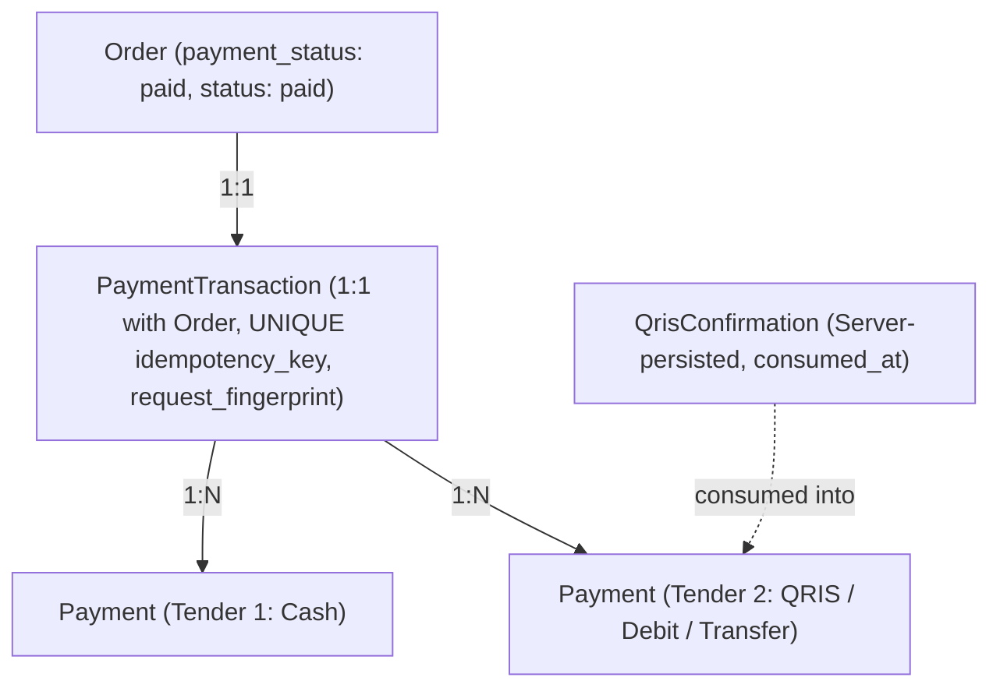
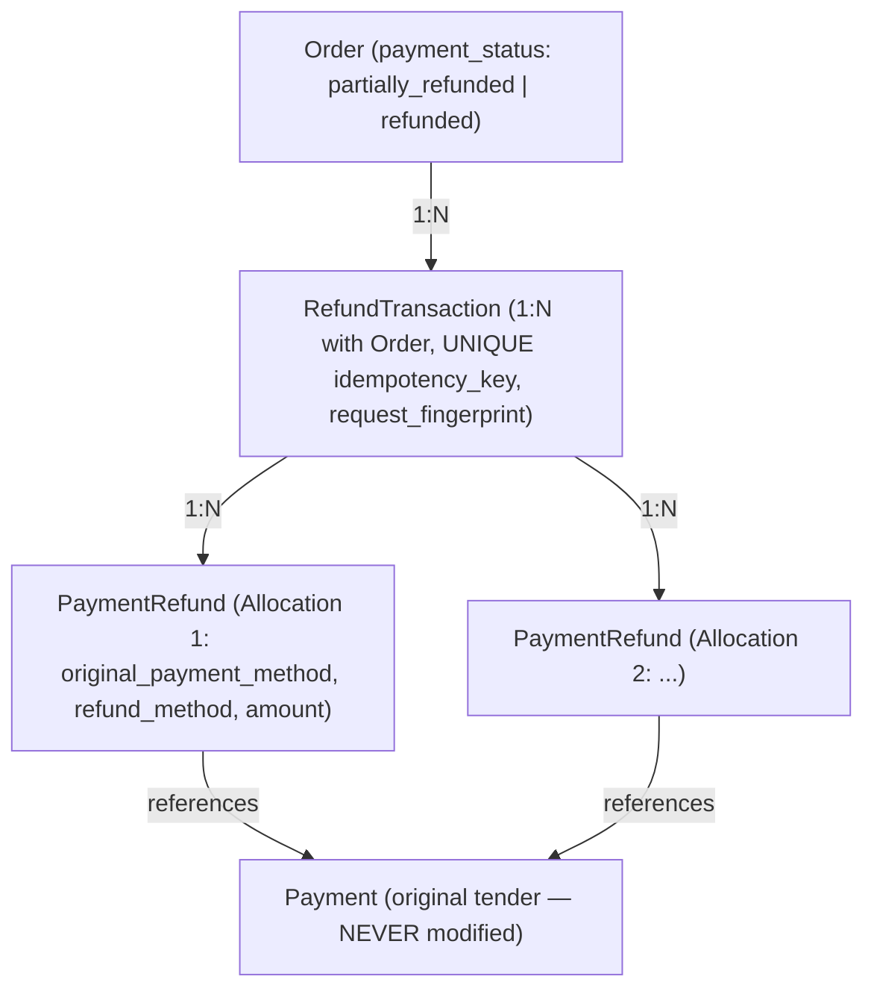

# Temu Pulang — Architecture & System Design Specification

## 1. System Overview

**Temu Pulang** is a local-first Point of Sale (POS) and operations management platform designed for a Food & Beverage establishment.

### Technology Stack:
- **Framework**: Laravel 13.x (PHP 8.5)
- **Frontend / UI**: Livewire 4.x + Alpine.js + Tailwind CSS 4.x
- **Database**: MySQL 8.x (with isolated SQLite in-memory for testing)
- **Deployment & Network Context**: Local Area Network (LAN) on-premise operation with zero cloud dependency for core transaction flow.

---

## 2. Model Organization

The application's Eloquent models are organized cleanly within `app/Models`:

```
app/
├── Models/
│   ├── User.php                      # Staff & admin accounts with role integration & soft deletes
│   ├── Role.php                      # Access roles (Owner, Cashier; Supervisor reserved for future phases)
│   ├── Permission.php                # Granular permissions grouped by domain
│   ├── ActivityLog.php               # Audit log trail with polymorphic subjects
│   ├── ShopSetting.php               # Singleton/branch store settings, receipt, hardware config
│   ├── ApplicationSetting.php        # Key-value typed configuration store
│   ├── Category.php                  # Product menu categories
│   ├── CategoryTranslation.php       # Category localization (EN / ID)
│   ├── Product.php                   # Menu items (supports both variant and non-variant items)
│   ├── ProductTranslation.php        # Product localization (EN / ID)
│   ├── ProductVariant.php            # SKU-level variant options (sizes, portions)
│   ├── VariantTranslation.php        # Variant localization (EN / ID)
│   ├── ModifierGroup.php             # Customization rules (sugar, ice, add-ons)
│   ├── ModifierGroupTranslation.php  # Modifier group localization (EN / ID)
│   ├── Modifier.php                  # Individual customization options (free or paid)
│   ├── ModifierTranslation.php       # Modifier option localization (EN / ID)
│   ├── IngredientCategory.php        # Phase 6: Ingredient categorisation
│   ├── Ingredient.php                # Phase 6: Raw material with DECIMAL(12,3) stock and milli-unit helpers
│   ├── IngredientBalance.php         # Phase 6: Per-branch on-hand stock (NULL branch = single store)
│   ├── RecipeItem.php                # Phase 6: Bill of Materials — ingredient per product/variant
│   ├── ModifierRecipeItem.php        # Phase 6: Ingredient delta triggered by modifier selection
│   ├── StockMovement.php             # Phase 6: Append-only audit ledger (no updated_at, DomainException guard)
│   └── Concerns/ (or Traits/)
│       └── HasTranslations.php       # Transparent multi-language resolution trait
```

---

## 3. Authorization & Access Control Design

Authorization employs a lightweight, high-performance Role-Based Access Control (RBAC) architecture integrated directly with Laravel's native `Gate` facilities.

### 3.1. Roles & Initial Separation
1. **Owner (`owner`)**:
   - The proprietor and administrator.
   - Holds unrestricted access across the entire application.
   - Granted master bypass in `AppServiceProvider`:
     ```php
     Gate::before(function (User $user, string $ability) {
         if ($user->hasRole('owner')) {
             return true;
         }
         return $user->hasPermission($ability) ? true : null;
     });
     ```
2. **Cashier (`cashier`)**:
   - Operational staff operating the POS terminal.
   - Allowed abilities:
     - `pos.access` (Open and operate POS register)
     - `pos.orders.create` (Take and punch in customer orders)
     - `pos.orders.view` (View shift orders)
     - `products.view` (Browse menu catalog)
     - `inventory.view` (Check item/ingredient availability)
     - `reports.view` (Shift summary view)
   - Explicitly restricted from:
     - `products.manage` (Cannot modify prices, create, or delete products)
     - `reports.sensitive.view` (Cannot see profit margins or audit logs)
     - `refunds.process` (Cannot issue refunds without manager/owner approval)
     - `settings.manage` (Cannot modify receipt headers, taxes, or printers)

### 3.2. Auditing Strategy
All security-sensitive operations (shift open/close, discounts, overrides, catalog modifications) are recorded via `ActivityLog::record(...)`, preserving:
- Operating `user_id`
- Action string identifier
- Polymorphic subject reference (`subject_type`, `subject_id`)
- Contextual snapshot (`properties` JSON)
- Client IP address and User Agent

---

## 4. Translation Strategy

To avoid black-box package bloat and performance penalties, translations are implemented via the `HasTranslations` trait and normalized translation tables.

### Mechanics:
1. Every localized entity (`Category`, `Product`, `ProductVariant`, `ModifierGroup`, `Modifier`) has a corresponding `*_translations` table.
2. The trait implements:
   - Dynamic resolution: `$model->name` inspects the loaded relationship or queries the active locale (`app()->getLocale()`).
   - Multi-tier fallback: `active locale (id)` -> `fallback locale (en)` -> `first available translation`.
   - Direct translation accessor: `$model->translate('en')->name`.
   - Mutation helper: `$model->setTranslation('name', 'id', 'Nama Baru')`.
3. Performance: In list/index queries, translations can be eager-loaded with `->with('translations')` to prevent N+1 queries.

---

## 5. Monetary Calculation & Precision Guidelines

1. **Rupiah Integer Storage**:
   - All product prices, variant prices, modifier upcharges, and monetary adjustments are stored as whole integer numbers (`BIGINT UNSIGNED`).
   - Example: Rp 25.000 is stored as `25000`.
   - Floating-point data types (`FLOAT`, `DOUBLE`) are strictly forbidden for monetary storage.
2. **Taxes & Percentages**:
   - Tax rates and service charge rates are stored as basis points in integer columns (system defaults are `0` = 0.00%; e.g. `1000` = 10.00%, `500` = 5.00%). Configurable exclusively by the Owner.
   - Calculations use standard integer rounding `round(($subtotal * $rate) / 10000)` to ensure penny-perfect financial reconciliation.

---

## 6. Multi-Branch Expansion Architecture

Although Temu Pulang initiates as a single-branch LAN deployment, the database is architecturally forward-compatible with multi-branch expansion:
- `branch_id` nullable indexed foreign keys exist on `users`, `shop_settings`, and `shifts`.
- During Phase 1-3, `branch_id` is null or defaults to branch 1 without imposing tenancy overhead.
- When expanding to multiple physical outlets, models can implement a global scope or query filter on `branch_id`.
- **Phase 6 extension**: `ingredient_balances` and `stock_movements` carry `branch_id` with the same NULL = single-store convention. The `ingredient_balances.branch_slot` generated column (`COALESCE(branch_id, 0)`) enforces NULL-safe unique stock rows per branch.

---

## 7. Shift Management Architecture (Phase 3)

The shift lifecycle is encapsulated in `App\Services\ShiftService` and adheres to a strict single-active-shift operational rule.

### 7.1. State Lifecycle
```
[ OPEN ] ──(Close Action)──> [ CLOSED ]
```
- **Lifecycle Rule**: A closed shift is strictly immutable and cannot be reopened. Any discrepancies or post-close corrections must be logged via audited adjustment records.
- **Concurrency Control**: Concurrency is guarded via pessimistic database locking (`lockForUpdate()`) and atomic transactions (`DB::transaction(...)`) to eliminate race conditions and prevent multiple concurrent active shifts in a single branch.

### 7.2. Expected Cash & Discrepancy Formula
```
Expected Cash = Opening Cash (Float)
              + Manual Cash Inflows
              - Manual Cash Outflows
              + Net Cash Sales (Tendered - Change)
              - Cash Refunds
Discrepancy   = Actual Cash Counted - Expected Cash
```
- **Derivation from Immutable Records**: Cash sales are derived directly from `Payment` records (`payment_method = 'cash'`), eliminating duplicate manual `CashMovement` entries.
- **Cash Change Handling**: Cash change returned to customers is accounted for; only net cash (`amount = tendered_amount - change_amount`) increments the expected drawer balance.
- **Non-Cash Isolation**: Non-cash payments (`qris`, `debit`, `credit`, `transfer`) are tracked separately and never increment the physical cash drawer.
- **Cash Refund Support**: Implemented in Phase 5 (Tasks 5.3 & 5.4); cash refunds (`PaymentRefund.refund_method = 'cash'`) directly decrease expected cash drawer balance via `ShiftService::totalCashRefunds()`.
- If `discrepancy != 0`, a detailed closing note is mandatory. Neither the application nor the database silently adjusts balances.

---

## 8. Cash Movement Ledger Architecture (Phase 3)

The cash drawer ledger is managed by `App\Services\CashMovementService`.

### 8.1. Invariant Rules
1. Each movement must reference an active `open` shift. Movements against closed shifts are forbidden.
2. Movement types are strictly `in` (cash inflow) or `out` (cash outflow).
3. Amounts must be integer Rupiah greater than zero (`BIGINT UNSIGNED`).
4. Silent edits and raw deletes are prohibited.
5. Corrections are handled through immutable reversal records (`reverseMovement(...)`), maintaining a bilateral audit link (`reversed_movement_id`) and recording the authorizing user.

---

## 9. Shop Settings Architecture (Phase 3)

Shop settings are managed by the Owner-only Livewire component `App\Livewire\Settings\ShopSettingsManager`.

### 9.1. Sections & Capabilities
- **Profil Usaha**: Name, address, phone, email, and receipt logo upload.
- **Jam Operasional**: 7-day schedule with open/close hours (supporting schedules crossing midnight) and a configurable `business_day_start_time` (e.g. 04:00) using the `Asia/Jakarta` timezone.
- **Pajak & Finansial**: Confirmed defaults are **0% Tax** and **0% Service Charge**, stored as basis points integer (`0` = 0.00%, `1000` = 10.00%).
- **Printer Thermal USB**: Direct USB connection mode (`printer_connection = 'usb'`), 58mm / 80mm paper widths, display name identifier, and optional kitchen printer toggle. IP address and port fields are non-mandatory and set to null for USB mode. (*Note: Physical Windows ESC/POS driver integration, raw printing helper, and receipt printing spooler were delivered in Phase 5 Task 5.5.*)
- **QRIS Payment Image (Phase 5 Task 5.6 Part 2A)**: Owner-only upload, preview, replacement, and removal of the shop's QRIS image under the `QRIS` tab. Validates real file MIME types (`image/png`, `image/webp`) via `finfo`, enforces a 2 MB maximum, stores files on the `public` disk under `storage/app/public/qris`, deletes superseded files on replace or remove, persists the path in `application_settings` (`payment.qris_image_path`), and logs updates via `ActivityLog`. `CashierPos` displays the configured QRIS image and prominent amount to pay in the QRIS checkout modal, or a localized notice if none is configured.

---

## 10. Activity Log & Audit Trail (Phase 3)

The audit log viewer is implemented in `App\Livewire\ActivityLogs\ActivityLogIndex` with strict Owner-only access (`role:owner`).

### 10.1. Characteristics
- **Immutability**: Logs cannot be modified, edited, or deleted through application routes.
- **Module Categorization**: Every log record contains a dedicated `module` column (`auth`, `shifts`, `cash_movements`, `settings`, `catalog`, etc.).
- **Filtering**: Live search, filtering by user, filtering by module, and date range filtering with newest-first ordering.
- **Context Inspection**: Rich JSON modal for inspecting before/after property snapshots and client IP addresses.

---

## 11. Menu Management & Order Engine Architecture (Phase 4)

Phase 4 establishes the core transactional order engine and catalog management backoffice.

### 11.1. Menu Management Backoffice (Owner Only)
- **Category Management (`App\Livewire\Menu\CategoryManager`)**: Complete CRUD, automatic slug generation, bilingual names and descriptions (`id` / `en`), sort order customization, and soft-delete protection.
- **Modifier Management (`App\Livewire\Menu\ModifierManager`)**: Configurable modifier groups (e.g. Level Gula, Jenis Susu, Topping), min/max selection bounds, required toggle, and nested modifier options repeater with integer Rupiah pricing (`0` for free options).
- **Product Management (`App\Livewire\Menu\ProductIndex` & `App\Livewire\Menu\ProductForm`)**: 4-tab workflow (Informasi Dasar & Harga, Konten Dwibahasa, Varian Menu, and Grup Modifier). Supports local image storage (`storage/app/public/products`) and instant catalog availability toggle (`is_sold_out`).

### 11.2. Transactional Order Engine (`App\Services\OrderService`)
- **Daily Sequential Numbering (`TP-001`, `TP-002`)**: Serialized concurrency-safe counter calculation resetting daily based on `ShopSetting::business_day_start_time` (`06:00:00`, `Asia/Jakarta`). Orders placed past midnight (00:00 - 05:59) are attributed to the previous calendar day's business day.
- **Frozen Line-Item Snapshots (`order_items`, `order_item_modifiers`)**: Stores historical copy of product name, variant name, modifier group name, modifier name, SKU, and unit prices. Historical orders remain permanently verifiable even if catalog products are later modified, price-adjusted, or soft-deleted.
- **Financial Immutability**: All monetary calculations are performed in whole integer IDR (`BIGINT UNSIGNED`). `Order::booted()` strictly blocks modifications to financial fields once processed.
- **Order Lifecycle State Machine**:
  ```mermaid
  stateDiagram-v2
      [*] --> awaiting_payment: Order Intake (POS)
      awaiting_payment --> paid: Payment Confirmed
      awaiting_payment --> cancelled: Cancelled (Owner Only)
      paid --> queued: Kitchen Routing
      queued --> preparing: Cooking / Assembling
      preparing --> ready: Plated / Packaged
      ready --> completed: Delivered / Handed over
      completed --> [*]
      cancelled --> [*]
  ```
  *(Note on Cancellation Protection: Ordinary cancellation via `advanceStatus()` or `cancelOrder()` is strictly restricted to unpaid orders (`draft`, `awaiting_payment`). Paid or in-kitchen orders cannot be cancelled without an authorized refund workflow, delivered in Phase 5 via `RefundService`).*
- **Daily Sequential Numbering Integrity**:
  - Enforced at both application and database tiers.
  - Concurrency is serialized via `ShopSetting::where('is_active', true)->lockForUpdate()`.
  - Database-level UNIQUE constraints on `(business_date, daily_sequence)` (`uniq_orders_biz_date_seq`) and `(business_date, daily_order_number)` (`uniq_orders_biz_date_num`) physically reject duplicate call numbers for the same accounting day.
- **Checkout Idempotency Lifecycle**:
  - In `CashierPos`, an idempotency UUID is generated once when checkout is opened for an active cart.
  - Retried submissions, modal re-openings, or network retries for the same cart reuse the same key, ensuring `OrderService` safely returns the existing order rather than creating a duplicate.
  - The key is cleared upon successful order creation or when the cart is emptied, giving the next order a fresh idempotency key.
- **Active Shift Concurrency & TOCTOU Protection**:
  - Order creation in `OrderService` validates shift status inside the `DB::transaction(...)` using `Shift::where('id', $shift->id)->lockForUpdate()->first()`.
  - If a shift is closed between client intake and transaction execution, the order is rejected cleanly.
- **Kitchen Queue Board (`App\Livewire\Orders\OrderIndex`)**: Real-time order dispatch interface featuring 10s Livewire polling, status tabs, order detail inspection, and status advancement actions.

---

## 12. Payment & Settlement Engine Architecture (Phase 5)

Phase 5 introduces financial settlement, multi-tender transactions, server-authoritative QRIS verification, and persistent print spooling.

### 12.1. Transactional Model Hierarchy


### 12.2. Settlement Service (`App\Services\PaymentService`)
1. **Single and Split Payments**:
   - Supports single-tender settlements and multi-tender split payments (`cash`, `qris`, `debit`, `credit`, `transfer`).
   - Exact settlement validation: sum of tender amounts must strictly equal `$order->total_amount`.
2. **Strict Integer Rupiah**:
   - Monetary values are validated as strict integers (`is_int()`) greater than 0. Floats and strings are strictly rejected.
3. **Cash Tendered & Change**:
   - `tendered_amount >= amount`.
   - `change_amount = tendered_amount - amount`.
   - Non-cash tenders require `tendered_amount === amount` and `change_amount === 0`.
4. **Server-Authoritative QRIS Verification, Shift Payment Access & Cashier Ownership**:
   - **Shift Payment Access (`PaymentService::userMayTakePaymentInShift(User $user, Shift $shift): bool`)**: A user may take payment in an active shift if `(1)` they opened the shift (`$user->id === $shift->user_id`), `(2)` they are an Owner (`$user->hasRole('owner')`), or `(3)` the shift was opened by an Owner and the user has the `cashier` role (delegated shift). A Cashier cannot take payments in a shift opened by another Cashier (throws `ShiftAccessDeniedException`). Payments always record the real acting cashier (`$cashier->id`, `$cashier->name`), never the shift opener.
   - Cashiers record incoming merchant confirmations via `createQrisConfirmation(...)`.
   - Stored in `qris_confirmations` with cashier user ID, expected integer amount, server timestamp, and `pending` status.
   - During settlement, the confirmation is locked (`lockForUpdate()`), validated against the target order and tender amount, and checked for cashier ownership (`$qris->user_id === $cashier->id || $cashier->hasRole('owner')`).
   - Transitions atomically to `consumed` with `consumed_at`. Re-use of consumed confirmations or unauthorized cross-cashier processing is strictly rejected.
5. **Canonical Idempotency & Request Fingerprinting**:
   - Deterministic SHA-256 fingerprint generated from `order_id`, `shift_id`, `cashier_user_id`, `total_amount`, and sorted normalized tender attributes (including `qris_confirmation_id`s).
   - Stored on `payment_transactions.request_fingerprint`.
   - Retries with the same idempotency key and matching canonical fingerprint safely return the existing transaction.
   - Reused keys across different shifts, different cashiers, or modified payloads throw `ConflictHttpException` (HTTP 409).
6. **Concurrency Locking & Sequential Numbering**:
   - Pessimistic write locks (`lockForUpdate()`) acquired on active Shift, Order, and `ShopSetting`.
   - Daily sequence resets per business day (evaluating `business_day_start_time`).
   - Formatted as `PAY-YYYYMMDD-0001` with database-level composite unique constraints on sequence (`uniq_pay_trx_biz_date_seq`) and transaction number (`uniq_pay_trx_biz_date_num`).
   - *Testing distinction*: Single-threaded unit/feature tests verify sequential generator logic; parallel concurrency guarantees rely on these parent row locks and database-level unique constraints.
7. **Append-Only Immutability**:
   - `PaymentTransaction::booted()` and `Payment::booted()` block updates and deletions via `DomainException`.
   - Child `Payment.order_id` is assigned explicitly by `PaymentService` to satisfy foreign key constraints without exposing the column to mass assignment.
8. **Audit Trail**:
   - Logs `ActivityLog::record(action: 'payment.settled', module: 'payments', ...)`.
9. **POS Checkout UI (`App\Livewire\Pos\CashierPos`)**:
   - Single-tender payment modal supporting Cash (Alpine-formatted integer `cashGiven` input with `id-ID` thousand separators, `Uang Pas`, and up to 4 integer-computed quick-cash suggestions via `suggestCashAmounts()`), QRIS (displays `payment.qris_image_path` constrained to `max-h-56 object-contain` inside a `max-h-72` container + prominent amount to pay, or localized notice if unset), and Debit.
   - QRIS and Debit confirmation checkboxes use `wire:model.live` (`wire:model.live="qrisCashierConfirmed"`, `wire:model.live="debitCashierConfirmed"`) so ticking either checkbox immediately re-renders the Pay button without the `disabled` attribute, and the modal footer displays `messages.pos.confirm_to_enable_pay` next to the Pay button whenever a required QRIS or Debit confirmation is still unchecked.
   - Plain HTML buttons in `cashier-pos.blade.php` use server-side `@disabled($paymentInFlight)` rather than Alpine `:disabled="$paymentInFlight"` so browser Alpine evaluation never encounters an undefined `$paymentInFlight` JavaScript variable.
   - Pre-order shift access check: `CashierPos::processPayment()` validates `$paymentService->userMayTakePaymentInShift(Auth::user(), $shift)` **before** calling `OrderService::createOrder()`, displaying `messages.pos.shift_access_denied` and creating no orphan unpaid order if denied.
   - Stale-key conflict protection: if a session-restored `checkoutIdempotencyKey` points to an unresolved unpaid order whose payload differs from the current cart, modifying the cart or opening/submitting checkout automatically releases the stale key and generates a fresh UUID (without cancelling or altering the previous unpaid order), while retrying the exact same cart reuses the key.

---

### 12.3. Refund Engine (`App\Services\RefundService`)

#### Architecture Overview


#### Authorization
- **Owner-only**: `$authorizer->isOwner()` checked before any DB lock is acquired.
- Cashier callers receive `InvalidArgumentException` immediately.

#### Supported Refund Methods
| Method | Requires Shift | Affects Expected Cash |
|---|---|---|
| `cash` | ✅ Active open shift | ✅ Deducts from expected cash |
| `qris_reversal` | ❌ No | ❌ No physical cash impact |
| `manual_transfer` | ❌ No | ❌ No physical cash impact |

#### Canonical Request Fingerprint (SHA-256)
```json
{
  "order_id": int,
  "authorizer_user_id": int,
  "total_refunded_amount": int,
  "allocations": [{"payment_id": int, "amount": int, "refund_method": string}],
  "reason": string
}
```
Allocations are sorted by `[payment_id, amount, refund_method]` before hashing to prevent order-dependent false mismatches.

#### Deadlock-Safe Locking Order (within DB::transaction)
1. `Shift::lockForUpdate()` — if any cash allocation exists.
2. `Order::lockForUpdate()`.
3. `Payment::lockForUpdate()` — all target payment rows in ascending `id` order.

#### Allocation Aggregation Rules
- Duplicate entries for same `payment_id` with the **same** refund method → **combined** (amounts summed) into a single `PaymentRefund` row.
- Duplicate entries for same `payment_id` with **different** refund methods → **rejected** (`InvalidArgumentException`).

#### Balance Validation Chain
1. `Payment::remainingRefundableBalance()` = `amount - SUM(payment_refunds.amount for this payment)`.
2. Aggregated allocation for each payment must not exceed its remaining balance.
3. Total cumulative refund for the order must not exceed `SUM(Payment.amount)`.

#### Order Status Transition Logic
| Condition | `payment_status` | `status` |
|---|---|---|
| `total_refunded < total_paid` | `partially_refunded` | Unchanged |
| `total_refunded >= total_paid` AND order is `completed` | `refunded` | Remains `completed` |
| `total_refunded >= total_paid` AND order is NOT `completed`/`cancelled` | `refunded` | → `cancelled` (with reason, `cancelled_by_user_id`, `cancelled_at`) |

**Note**: Cancellation of fully-refunded paid/queued/preparing/ready orders is performed via `DB::table('orders')->update(...)` (bypassing `cancelOrder()` which blocks paid+ statuses) with full `OrderStatusHistory` records.

#### Cash Drawer Integration
- `PaymentRefund` rows where `refund_method = 'cash'` are picked up by `Shift::totalCashRefunds()`.
- Expected cash formula: `Opening + Manual In - Manual Out + Cash Sales - Cash Refunds`.
- No duplicate `CashMovement` entries are created for refund payouts.

#### Immutability
- `RefundTransaction::booted()` and `PaymentRefund::booted()` block updates and deletions via `DomainException`.
- Original `Payment` and `PaymentTransaction` records are **never touched** by `RefundService`.

#### Daily Sequence Numbering
- Locks active `ShopSetting` row to serialize concurrent access.
- Queries `MAX(daily_sequence)` from `refund_transactions` for the given `business_date`.
- Format: `RFD-YYYYMMDD-0001`. Database-level composite unique constraints enforce collision prevention.

#### Owner-Only Refund UI (`App\Livewire\Orders\OrderRefund`, Phase 5 Task 5.6 Part 3)
- Accessible at `/orders/{order}/refund` under `role:owner` middleware (plus `isOwner()` re-checks in `mount()` and `submitRefund()`). Hidden from Cashiers in `OrderIndex`.
- Displays order summary, each payment's `remainingRefundableBalance()`, Alpine-formatted integer Rupiah inputs, `refund_method` selector (`cash`, `qris_reversal`, `manual_transfer`), and required reason.
- Generates a stable `idempotencyKey` once per form mount and preserves it on retries; passes the active open `Shift` only when at least one `cash` allocation exists.
- Maps known `RefundService` domain/conflict errors to localized keys (`messages.refund.*`) by exception class (`instanceof`) and logs unexpected exceptions via `Log::error` without exposing raw exception text.

---

### 12.4. Domain Exceptions & UI Error Mapping

UI components (`CashierPos::mapPaymentExceptionToMessage()`, `OrderRefund::mapRefundExceptionToMessage()`, and `ShiftManager::mapShiftExceptionToMessage()`) map service exceptions exclusively by exception class (`instanceof`), never by matching substrings (`str_contains`) in the exception message text or exposing raw `$e->getMessage()` strings. Each typed exception extends the exact base exception type (`InvalidArgumentException`, `DomainException`, or `Symfony\Component\HttpKernel\Exception\ConflictHttpException`) so existing catch blocks and HTTP 409 status behavior remain unchanged:

| Domain | Exception Class | Extends | UI Mapper Translation Key |
|---|---|---|---|
| Order | `App\Exceptions\Order\ShiftClosedForOrderException` | `InvalidArgumentException` | `messages.pos.shift_closed_error` |
| Order | `App\Exceptions\Order\OrderIdempotencyConflictException` | `ConflictHttpException` | `messages.pos.error_conflict` |
| Payment | `App\Exceptions\Payment\ShiftClosedForPaymentException` | `InvalidArgumentException` | `messages.pos.shift_closed_error` |
| Payment | `App\Exceptions\Payment\ShiftAccessDeniedException` | `InvalidArgumentException` | `messages.pos.shift_access_denied` |
| Payment | `App\Exceptions\Payment\InsufficientCashTenderedException` | `InvalidArgumentException` | `messages.pos.insufficient_cash` |
| Payment | `App\Exceptions\Payment\QrisConfirmationInvalidException` | `InvalidArgumentException` | `messages.pos.qris_confirmation_invalid` |
| Payment | `App\Exceptions\Payment\QrisConfirmationExpiredOrUsedException` | `DomainException` | `messages.pos.qris_expired_or_used` |
| Payment | `App\Exceptions\Payment\OrderAlreadyPaidException` | `DomainException` | `messages.pos.order_already_paid` |
| Payment | `App\Exceptions\Payment\OrderCancelledForPaymentException` | `DomainException` | `messages.pos.order_cancelled_error` |
| Payment | `App\Exceptions\Payment\PaymentIdempotencyConflictException` | `ConflictHttpException` | `messages.pos.error_conflict` |
| Refund | `App\Exceptions\Refund\RefundIdempotencyConflictException` | `ConflictHttpException` | `messages.refund.error_conflict` |
| Refund | `App\Exceptions\Refund\RefundReasonRequiredException` | `InvalidArgumentException` | `messages.refund.reason_required` |
| Refund | `App\Exceptions\Refund\UnpaidOrderNotRefundableException` | `DomainException` | `messages.refund.error_unpaid_order` |
| Refund | `App\Exceptions\Refund\OrderAlreadyRefundedException` | `DomainException` | `messages.refund.error_already_refunded` |
| Refund | `App\Exceptions\Refund\CashRefundRequiresOpenShiftException` | `InvalidArgumentException` | `messages.refund.no_open_shift_cash` |
| Refund | `App\Exceptions\Refund\RefundExceedsRemainingBalanceException` | `InvalidArgumentException` | `messages.refund.error_over_refund` |
| Refund | `App\Exceptions\Refund\RefundTotalExceedsPaidAmountException` | `DomainException` | `messages.refund.error_over_refund` |
| Shift | `App\Exceptions\Shift\NegativeOpeningCashException` | `DomainException` | `messages.shifts.error_negative_opening_cash` |
| Shift | `App\Exceptions\Shift\ShiftAlreadyActiveException` | `DomainException` | `messages.shifts.error_shift_already_active` |
| Shift | `App\Exceptions\Shift\NegativeCountedCashException` | `DomainException` | `messages.shifts.error_negative_counted_cash` |
| Shift | `App\Exceptions\Shift\ShiftAlreadyClosedException` | `DomainException` | `messages.shifts.error_shift_already_closed` |
| Shift | `App\Exceptions\Shift\UnauthorizedShiftCloseException` | `DomainException` | `messages.shifts.error_unauthorized_shift_close` |
| Shift | `App\Exceptions\Shift\ClosingNoteRequiredForDiscrepancyException` | `DomainException` | `messages.shifts.error_closing_note_required` |
| Cash | `App\Exceptions\Cash\InvalidCashMovementTypeException` | `InvalidArgumentException` | `messages.shifts.error_invalid_movement_type` |
| Cash | `App\Exceptions\Cash\NonPositiveMovementAmountException` | `DomainException` | `messages.shifts.error_movement_amount_positive` |
| Cash | `App\Exceptions\Cash\MovementDescriptionRequiredException` | `DomainException` | `messages.shifts.error_movement_note_required` |
| Cash | `App\Exceptions\Cash\MovementOnClosedShiftException` | `DomainException` | `messages.shifts.error_movement_on_closed_shift` |
| Cash | `App\Exceptions\Cash\ReversalReasonRequiredException` | `DomainException` | `messages.shifts.error_reversal_reason_required` |
| Cash | `App\Exceptions\Cash\CannotReverseReversalException` | `DomainException` | `messages.shifts.error_cannot_reverse_reversal` |
| Cash | `App\Exceptions\Cash\MovementAlreadyReversedException` | `DomainException` | `messages.shifts.error_movement_already_reversed` |
| Cash | `App\Exceptions\Cash\ReversalOnClosedShiftException` | `DomainException` | `messages.shifts.error_reversal_on_closed_shift` |
| Inventory | `App\Exceptions\Inventory\InvalidStockQuantityException` | `InvalidArgumentException` | `messages.stock.error_invalid_quantity` |
| Inventory | `App\Exceptions\Inventory\InsufficientStockException` | `DomainException` | `messages.stock.error_insufficient_stock` |
| Inventory | `App\Exceptions\Inventory\StockReasonRequiredException` | `InvalidArgumentException` | `messages.stock.error_reason_required` |

**Locale-Aware Date Formatting**: `App\Http\Middleware\SetLocale` synchronizes `Carbon::setLocale($locale)` alongside `app()->setLocale($locale)` on every request, and views that display month or weekday names (`shift-manager.blade.php`, `order-index.blade.php`, `activity-log-index.blade.php`) use `->translatedFormat(...)` so date labels respect the active `id`/`en` locale.

---

## 13. Printing Infrastructure & Spooler Architecture (Task 5.5)

### 13.1. Physical Context & Single-Terminal Architecture
- **Hardware Profile**: Single Windows 11 host PC running Laravel POS with one USB thermal receipt printer (e.g., `POS80 Printer` over virtual USB port `CP001`).
- **Windows Spooler RAW Gateway**: Because thermal receipt printers connected over virtual USB cannot be addressed via raw COM/LPT paths, raw ESC/POS byte streams are sent to the Windows Print Spooler using the Win32 Spooler API (`OpenPrinter`, `StartDocPrinter`, `StartPagePrinter`, `WritePrinter`, `EndPagePrinter`, `EndDocPrinter`, `ClosePrinter`).
- **Native Helper (`storage/bin/tp-rawprint.exe`)**: A lightweight C# utility compiled using the native host `.NET Framework 4.0` compiler (`csc.exe`). It accepts `--printer="..."` and `--file="..."` arguments and returns standardized exit codes:
  - `0`: Complete document accepted by Windows Spooler (`completed`).
  - `1-4`: Safe failures before data transmission (`failed`, safe for manual retry).
  - `5-7`, `99`: Ambiguous / partial transmission or timeout (`uncertain`, never auto-retried).

### 13.2. ESC/POS Generation & Rendering Layer
- **`App\Services\Printing\EscPosBuilder`**: Pure PHP builder for 80mm thermal printers (48 columns). Encapsulates initialization (`ESC @`), alignment (`ESC a`), bolding (`ESC E`), feed control (`ESC d`), line rules, and two-column justification.
  - Multi-byte UTF-8 code points are transliterated or sanitized via PCRE with `/u` modifier prior to binary command concatenation.
  - Excluded from v1 scope: Paper cutter (`GS V`) and cash drawer kicks (`ESC p`).
- **`App\Services\Printing\ReceiptRendererService`**: Renders standard customer receipts with store branding, cashier name fallback chain (`cashier_name` -> `user->name` -> `Kasir Tidak Diketahui`), frozen order tax snapshots, tendered cash breakdown, and `*** SALINAN / REPRINT ***` watermark for reprints.
- **`App\Services\Printing\KitchenTicketRendererService`**: Renders kitchen/bar tickets showing items, variants, modifiers, and special preparation instructions without any financial totals or prices.

### 13.3. Print Lifecycle & Service Layer (`App\Services\PrintService`)
- **Queueing (`queueOrderReceipt`)**: Called upon payment settlement. Creates pending print jobs for customer receipt and optionally kitchen ticket if `kitchen_printer_enabled` is active.
- **Payment & Print Atomicity**: Queuing is safely isolated such that even if printing or queueing fails, the committed payment and order settlement are never rolled back.
- **Reprint Workflow (`queueReprint`)**: Explicit reprints create a new distinct `PrintJob` record marked with `is_reprint = true` and referencing `original_print_job_id`. The original job is immutable and audited via `ActivityLog`.
- **Manual Retry (`retryFailedJob`)**: Only jobs with status `failed` (safe failures) can be retried. Attempting to retry `uncertain` or `completed` jobs throws `DomainException`.
- **Owner Resolution (`resolveUncertainJob`)**: Ambiguous `uncertain` jobs require owner intervention to mark as `completed` or `failed` with audit logging, exposed via the Owner-only Livewire UI `App\Livewire\Printing\PrintJobIndex` (`/printing/jobs`).

### 13.4. Print Worker & Crash Recovery (`App\Console\Commands\PrintWorkerCommand`)
- **Worker Execution (`php artisan print:work`)**: Designed to run as a single-instance background worker managed by Windows Task Scheduler ("Do not start a new instance" policy).
- **Claim-Token Fencing**: Jobs are claimed inside a transaction using `lockForUpdate()`. The worker generates a unique UUID `claim_token` and records `locked_at`. All database updates (`completed`, `failed`, `uncertain`) are fenced with `WHERE claim_token = :token`. Stale workers that lose ownership cannot corrupt the job state.
- **Startup Crash Recovery**:
  - Before claiming new `pending` jobs, the worker inspects existing `processing` jobs.
  - If a processing job has been locked for >= 60 seconds (stale threshold), it is marked `uncertain` with an explanatory `last_error`.
  - Stale jobs are never automatically reprinted to prevent duplicate paper output.

---

## 14. Inventory Management Architecture (Phase 6)

Phase 6 adds raw-material inventory tracking, product Bill of Materials (BOM), and an append-only stock movement ledger. Task 6.1 delivers the database foundation and models only. Deduction logic, UI, and service layer are planned for subsequent tasks.

### 14.1. Data Models (Task 6.1 — Delivered)

| Model | Table | Purpose |
|---|---|---|
| `IngredientCategory` | `ingredient_categories` | Categorisation of raw materials |
| `Ingredient` | `ingredients` | Raw material master data with milli-unit helpers, soft deletes |
| `IngredientBalance` | `ingredient_balances` | Per-branch on-hand stock; NULL branch = single store |
| `RecipeItem` | `recipe_items` | BOM: ingredient consumed per product/variant unit |
| `ModifierRecipeItem` | `modifier_recipe_items` | Ingredient delta when a modifier is selected (`add`/`replace`) |
| `StockMovement` | `stock_movements` | Append-only stock ledger with idempotency and balance snapshots |

### 14.2. Decimal Quantity Precision

All inventory quantities use `DECIMAL(12,3)` in the database and are cast as PHP `'string'` in Eloquent models to prevent silent float conversion. Integer milli-unit arithmetic is used for all calculations:

```php
// 1 unit = 1,000 milli-units
Ingredient::toMilli('1.750')   // → 1750  (string parsing, no (float) cast)
Ingredient::fromMilli(1750)    // → '1.750'
```

This matches the existing monetary pattern (`BIGINT` IDR integers) — no floating-point math anywhere in inventory calculations.

### 14.3. NULL-Safe Unique Constraints

Standard MySQL `UNIQUE INDEX` on a nullable column treats `NULL != NULL`, making it ineffective for enforcing single-store uniqueness. Two tables use `GENERATED ALWAYS AS (COALESCE(col, 0)) STORED` to collapse `NULL → 0`:

| Table | Generated Column | Unique Key |
|---|---|---|
| `ingredient_balances` | `branch_slot = COALESCE(branch_id, 0)` | `uk_branch_ingredient (branch_slot, ingredient_id)` |
| `recipe_items` | `variant_slot = COALESCE(product_variant_id, 0)` | `uk_recipe_item (product_id, variant_slot, ingredient_id)` |

This follows the identical pattern already in production for `shifts.active_branch_slot`.

### 14.4. Stock Movement Idempotency

`stock_movements.idempotency_key` (VARCHAR 100, nullable) enables idempotent stock deductions during payment retries:

- `UNIQUE KEY uk_stock_idempotency_ingredient (idempotency_key, ingredient_id)` — rejects duplicate deductions for the same key+ingredient pair.
- MySQL `UNIQUE` with `NULL` values allows unlimited NULL-keyed rows, so non-keyed manual adjustments freely insert with `idempotency_key = NULL`.
- Order deductions use the payment transaction ULID as the key, ensuring payment retry loops cannot double-deduct stock.

### 14.5. StockMovement Append-Only Guard

`StockMovement::booted()` registers model event listeners that throw `DomainException` on any `updating` or `deleting` event. Combined with no `updated_at` column (`UPDATED_AT = null`), movements are structurally and application-level immutable. Corrections are made by inserting new signed adjustment records (positive or negative quantity).

### 14.6. Inventory Management UI Components (Task 6.2 — Delivered)

The Owner backoffice interfaces for inventory and recipe management are implemented as full Livewire components:

| Component | Route | View | Description |
|---|---|---|---|
| `App\Livewire\Inventory\IngredientManager` | `/inventory/ingredients` | `livewire/inventory/ingredient-manager.blade.php` | CRUD for ingredients & categories, opening balance posting, min-stock alerts, search/filter |
| `App\Livewire\Inventory\RecipeManager` | `/inventory/recipes` | `livewire/inventory/recipe-manager.blade.php` | Catalog-wide recipe composition overview, real-time COGS and gross profit margin reporting |
| `App\Livewire\Inventory\StockAdjustmentManager` | `/inventory/stock` | `livewire/inventory/stock-adjustment-manager.blade.php` | Owner-only Stock In, Adjustment (`counted`/`difference`), and Wastage interface with milli-unit precision |
| `App\Livewire\Inventory\StockMovementHistory` | `/inventory/movements` | `livewire/inventory/stock-movement-history.blade.php` | Owner-only read-only audit ledger viewer with URL filters, bulk order reference lookup, and single-ingredient milli-unit totals |
| `App\Livewire\Menu\ProductForm` | `/menu/products/{id}/edit` | `livewire/menu/product-form.blade.php` | Tab 5 ("Resep Bahan / BOM"): per-product base recipe and per-variant override management |
| `App\Livewire\Menu\ModifierManager` | `/menu/modifiers` | `livewire/menu/modifier-manager.blade.php` | Recipe delta configuration per modifier option (`add` / `replace` actions, target and replacement ingredients) |

**Delivered Phase 6 Services (Tasks 6.3–6.4):**
- `App\Services\Inventory\StockAdjustmentService`: Atomic `stockIn()`, `recordWastage()`, and `adjust()` (`counted` and `difference` modes) using `Ingredient::toMilli()` / `fromMilli()` integer arithmetic, `lockForUpdate()` on `ingredient_balances`, `(idempotency_key, ingredient_id)` deduplication, and typed exceptions (`InvalidStockQuantityException`, `InsufficientStockException`, `StockReasonRequiredException`). Also provides `recordOrderDeductionRow()` for low-level deduction posting.
- `App\Services\Inventory\RecipeResolutionService`: Resolves per-order ingredient totals in integer milli-units by merging base `RecipeItem` (`product_variant_id IS NULL`), variant overrides (replacing matching ingredients while keeping base-only items and adding variant-only items), and `ModifierRecipeItem` deltas (`add` adds `quantity`; `replace` sets `replaces_ingredient_id` resolved per-unit quantity to `0`—never below `0`—and adds `quantity` of the replacement ingredient), multiplied by `OrderItem.quantity`. Skips items whose product/variant no longer exists (`Log::warning`).
- `App\Services\Inventory\InventoryService`: `deductForPayment(PaymentTransaction $tx)` executes in its own `DB::transaction()` after `PaymentService::settlePayment()` commits (and on the idempotent replay branch). Locks `ingredient_balances` **last**, in **ascending `ingredient_id` order**, after all payment locks have released, and writes one `order_deduction` `StockMovement` per ingredient keyed by `PaymentTransaction::ulid` (`reference_type = 'orders'`, `reference_id = order.id`, negative `quantity`, `balance_after` allowed below `0`).
- **Payment Hook & Retry Path**: `PaymentService::attemptInventoryDeduction()` wraps `InventoryService::deductForPayment()` in `try/catch(\Throwable)` so deduction failures never block or roll back payment settlement; failures are written to `Log::error` and `ActivityLog` (`module: 'inventory'`, `action: 'order_deduction_failed'`). Operators recover failed deductions via `php artisan inventory:retry-deductions {--apply}` (dry-run by default; ignores legacy orders without an `order_deduction_failed` log).
- **Refund Restock (`InventoryService::restockForRefund`, Task 6.7)**: Triggered from `OrderRefund` after `RefundService::processRefund()` returns, inside `try/catch(\Throwable)` so restock never blocks or rolls back a refund. Operates **only on full refunds** (`Order.payment_status === 'refunded'`; partial refunds never restock). Uses exact-reversal by reading existing `order_deduction` movements for the order minus prior `refund_credit` movements (never re-resolves the recipe), locks `ingredient_balances` in **ascending `ingredient_id` order**, and writes positive `refund_credit` movements keyed by `RefundTransaction::ulid` (`StockAdjustmentService::recordRefundCreditRow()`). In `OrderRefund`, the checkbox appears only when the entered allocations equal the remaining refundable balance and uncredited deductions exist; defaults checked for `paid`/`queued` and unchecked for `preparing`/`ready`/`completed`. Failures log `Log::error` + `ActivityLog` (`action: 'refund_restock_failed'`) and are recovered via `php artisan inventory:retry-restocks {--apply}`.
- `App\Services\Inventory\LowStockService` **(Task 6.5)**: Read-only query service evaluating `COALESCE(ingredient_balances.current_stock, 0) <= ingredients.min_stock_alert` for active, non-deleted ingredients with `min_stock_alert > 0`. Provides `lowStockIngredients(?int $limit)` (ordered `out` first, then smallest `current_stock - min_stock_alert`, then `name`) and a single-query uncached `count()`. Surfaced only to Owners via three UI touch points: `IngredientManager` (per-row `OK`/`Low`/`Out` badges and 3-way SQL stock filter), the Owner sidebar badge on `/inventory/stock` (hidden when `0`), and the `OwnerDashboard` Low Stock card (top 5 items + `"View all"` link).

### 14.7. Planned Phase 6 Services (Not Yet Implemented)

All core Phase 6 inventory deduction services (`StockAdjustmentService`, `RecipeResolutionService`, `InventoryService`) are now delivered. Future tasks cover low-stock alerts, movement history viewer UI, and refund/cancellation restocking rules (Tasks 6.5–6.7).

**Planned locking strategy**: Sort ingredient IDs in ascending order before acquiring `lockForUpdate()` on `ingredient_balances` rows — prevents deadlocks when multiple concurrent deductions share ingredients.

### 14.8. Operations Commands & Demo-Login Gating (Go-Live Hardening, Part 1)

- **Environment-Gated Demo Access & Seeding**:
  - `AuthController::isDemoLoginEnabled()` restricts the quick-demo-login switcher (`POST /login/demo/{role?}`) and login view pre-filled demo credentials to `app()->environment(['local', 'testing'])` (with optional `config('app.demo_login_enabled')` test override). In `production` or any other environment, `AuthController::demoLogin()` immediately triggers `abort(404)` on the server and `resources/views/auth/login.blade.php` omits the demo credentials and buttons.
  - `DatabaseSeeder` and the four demo seeders (`UserSeeder`, `ProductCategorySeeder`, `ProductSeeder`, `ModifierSeeder`) only seed demo users and catalog items in `local` and `testing`. In any other environment, `DatabaseSeeder` runs only `RoleAndPermissionSeeder` and `ShopSettingSeeder` and creates zero user records.
- **Operations Artisan Commands (`app/Console/Commands`)**:
  - `php artisan temupulang:create-user {--role=} {--name=} {--email=}`: Interactive account provisioning command for `owner` and `cashier` roles. Validates email format/uniqueness and reads the password exclusively via hidden prompt (`$this->secret()`, minimum 10 characters, with confirmation; never accepted as a CLI argument/option and never printed or logged). Creates an active user (`is_active = true`) and assigns the role via `User::assignRole()`.
  - `php artisan temupulang:set-password {email}`: Reads a new password via hidden prompt with confirmation (minimum 10 characters) and updates the user's password hash; rejects unknown emails.
  - `php artisan temupulang:deactivate-user {email} {--reactivate}`: Sets `is_active = false` (or `true` when `--reactivate` is passed) so deactivated accounts cannot log in (`AuthController::login()` checks `is_active`). Refuses to deactivate the last active `owner` account, and writes an `ActivityLog` entry (`module: 'auth'`, `action: 'user.deactivated'` or `'user.reactivated'`) without secrets.
  - `php artisan temupulang:preflight`: Read-only go-live verification command that prints `[PASS]`, `[WARN]`, or `[FAIL]` across production readiness checks (`APP_ENV`, `APP_DEBUG`, `APP_KEY`, database connectivity, writable `storage` and `bootstrap/cache`, `public/storage` symlink, demo login disabled, at least one active `owner`, no active user with demo email or demo password hash, `shop_settings` row existence, no sample seeder placeholders in `shop_settings` [`FAIL`], non-empty store address/phone [`WARN`], configured `printer_name`, non-`array` cache/queue/session drivers, `SESSION_LIFETIME >= 480` [`WARN`], and `LOG_LEVEL != debug` in production [`WARN`]), prints recommended remediation commands, and exits with code `1` if any check fails (`0` otherwise).
- **Login Throttling (`AuthController::login`, Go-Live Hardening, Part 2A)**:
  - `AuthController::login()` limits failed sign-in attempts to 5 per minute per `strtolower(trim($email)).'|'.$request->ip()` key using `Illuminate\Support\Facades\RateLimiter`. `RateLimiter::tooManyAttempts($key, 5)` is evaluated prior to `Auth::attempt()`, incremented via `RateLimiter::hit($key, 60)` only on failed credential checks, and cleared via `RateLimiter::clear($key)` upon successful authentication. Blocked attempts return a localized validation error (`messages.auth.too_many_attempts` with `:seconds` remaining) and record an `ActivityLog` entry (`module: 'auth'`, `action: 'auth.login_throttled'`) without logging passwords or secrets.

### 14.9. Owner Dashboard Real-Time Metrics (`App\Services\DashboardMetricsService`, Go-Live Hardening, Part 2B)

`App\Services\DashboardMetricsService` powers `App\Livewire\Dashboard\OwnerDashboard` using a small, constant number of read-only SQL aggregate queries and pure integer arithmetic (zero float math):

- **Business Day Window (`resolveBusinessDayWindow(?CarbonInterface $now = null, ?ShopSetting $setting = null)`)**:
  - Uses `shop_settings.business_day_start_time` (fallback `'06:00:00'`) and `shop_settings.timezone` (fallback `'Asia/Jakarta'`), matching `OrderService` and `RefundService`.
  - If the reference timestamp in the shop timezone is earlier than today's `business_day_start_time`, the current business day window is `[yesterday at business_day_start_time, today at business_day_start_time)`; otherwise `[today at business_day_start_time, tomorrow at business_day_start_time)`.
  - The previous business day window is `[start - 1 day, start)`.
- **Metric Definitions**:
  - **Gross Sales (`grossSales`)**: `SUM(orders.total_amount)` for non-soft-deleted orders paid within `[start, end)` (by `orders.paid_at`) whose `payment_status` is `paid`, `partially_refunded`, or `refunded` (unpaid and unpaid-cancelled orders are excluded).
  - **Refunds (`refundsTotal`)**: `SUM(refund_transactions.total_refunded_amount)` for refunds created within `[start, end)` (by `refund_transactions.created_at`, independent of when the original order was paid).
  - **Net Sales (`netSales`)**: `gross_sales - refunds`.
  - **Paid Orders Count (`paidOrdersCount`)**: `COUNT(*)` of the paid-orders set above.
  - **Average Ticket (`averageTicket`)**: `intdiv($grossSales, $paidOrders)` (`0` when `$paidOrders === 0`).
  - **Payment Mix (`paymentMix`)**: `SUM(payments.amount)` (the bill amount applied, never `tendered_amount`) grouped by `payments.payment_method` for orders in the business day's paid-orders set, bucketed into `cash`, `qris`, `debit`, and `other` (`credit`/`transfer`, displayed in the UI only when `> 0`), plus `total`. Labelled as money received (refunds are not subtracted).
  - **Change vs. Previous Business Day (`percentChangeInTenths`)**: Compares today's net sales against the previous business day's net sales in tenths of a percent using half-up integer arithmetic (`intdiv((2 * abs(diff) * 1000) + prevNet, 2 * prevNet)`). Displays `'—'` (dash) when the previous business day's net sales is `<= 0`.
  - **Recent Orders (`recentOrders`)**: Last 5 non-soft-deleted orders created within `[start, end)` (`created_at DESC, id DESC`, any status), returning `order_number`, `call_number`, `customer_name`, `order_type`, `total_amount`, `status`, `payment_status`, and shop-timezone `H:i` time.
  - **Best Sellers (`bestSellers`)**: Top 4 products by `SUM(order_items.quantity)` for orders paid within `[start, end)` whose `payment_status` is `paid` or `partially_refunded` (**excluding** fully `refunded` orders), grouped by `order_items.product_name_id`, `order_items.product_name_en`, and `order_items.sku`, with quantity sold, revenue (`SUM(order_items.subtotal)`), and integer progress bar percentage.

### 14.10. UI Text, Unicode & Escaping Rules

- **Real Unicode in Translation Strings**: All translation values in `lang/id/messages.php` and `lang/en/messages.php` (as well as Blade text expressions) must use real Unicode characters (`→`, `✓`, `×`, `&`, `•`, `—`) and **never** HTML entities (`&rarr;`, `&check;`, `&times;`, `&amp;`), because Blade's `{{ ... }}` double-encodes ampersands and prints entities literally.
- **Translated Status & Category Labels**: Internal machine keys (`status`, `payment_status`, `order_type`, `payment_method`, `refund_method`, `movement_type`, `category`, `job_type`) must always be mapped to `messages.*` translation keys before rendering in views — never displayed raw or formatted via `str_replace('_', ' ', ...)`, `ucfirst()`, or `strtoupper()`.
- **Strict Escaping in `{!! ... !!}`**: Unescaped Blade output `{!! __('...') !!}` is permitted only for translation strings that intentionally contain structural markup (such as `<strong>`), and every dynamic placeholder passed into `{!! __('...', ['key' => e($val)]) !!}` must be explicitly escaped with `e()`.

---

## 15. Finance & Shift Reporting Architecture (Phase 7)

### 15.1. Shift X-Report & Z-Report (`App\Services\ShiftReportService` & `App\Livewire\Reports\ShiftReport`, Task 7.1)

- **Read-Only Aggregate Service (`App\Services\ShiftReportService::buildReport(Shift $shift, ?CarbonInterface $generatedAt = null)`)**:
  - Builds the complete mid-shift **X-Report (Live)** (for an open shift) or final **Z-Report** (for a closed shift) as a plain PHP array of integers and strings using a constant number of SQL aggregate queries (6 queries after relation hydration, zero per-row queries) and pure integer Rupiah arithmetic (zero float math).
  - **Report Definitions**:
    - **Sales**: Aggregates non-soft-deleted orders joined to `payment_transactions` where `payment_transactions.shift_id = $shift->id` and `orders.payment_status IN ('paid', 'partially_refunded', 'refunded')`. Computes `gross_sales` (`SUM(orders.total_amount)`), `subtotal_sales`, `tax_total`, `service_charge_total`, `paid_orders_count`, `avg_ticket` (`intdiv($grossSales, $paidOrdersCount)`), and `net_sales` (`gross_sales - refunds.total`).
    - **Excluded Orders**: Counts unpaid (`payment_status = 'unpaid'` and `status != 'cancelled'`) and unpaid-cancelled (`payment_status = 'unpaid'` and `status = 'cancelled'`) orders where `orders.shift_id = $shift->id`, displayed separately and excluded from sales.
    - **Payments by Method**: Aggregates `SUM(payments.amount)` (bill amount applied, net of change) where `payments.shift_id = $shift->id` grouped by `payment_method` into `cash`, `qris`, `debit`, and `other` (`credit`/`transfer`, displayed in the UI only when `> 0`), plus `total`.
    - **Refunds Recorded in Shift**: Aggregates `COUNT(*)` and `SUM(payment_refunds.amount)` where `payment_refunds.shift_id = $shift->id` grouped by `refund_method` (`cash`, `qris_reversal`, `manual_transfer`).
    - **Cash Drawer Reconciliation & Tie-Out**: Uses the exact formula from `Shift::currentExpectedCash()` (`opening_cash + manual_cash_in - manual_cash_out + cash_sales - cash_refunds`), where manual movement reversals are opposite-type `CashMovement` entries netted identically to `Shift::totalCashIn()` and `Shift::totalCashOut()`. For closed shifts, includes `counted_cash` (`actual_cash`), `variance` (`discrepancy`), and `closing_note`.
    - **Z-Report Immutability**: Because every query is scoped strictly to `shift_id = $shift->id` and closed shifts reject new payments, refunds, and cash movements, a closed shift's Z-Report remains invariant when subsequent shifts, orders, or refunds occur.
- **Livewire Report View (`App\Livewire\Reports\ShiftReport` at `/reports/shift/{shift}`, route `reports.shift`)**:
  - **RBAC**: Owners can view any shift's report; Cashiers can view only shifts they opened themselves (`$shift->user_id === $user->id`, aborting with `403` otherwise).
  - **Print & Refresh**: Includes an `@media print` stylesheet hiding the sidebar, top header, and `.no-print` action bar for clean A4 and narrow-paper browser printing (`window.print()`), plus a live `refreshReport` action on open X-Reports. Linked from `/shifts` (`ShiftManager`) via an `X-Report` button on the active shift, `Z-Report` buttons on every closed-shift row, and a quick link to the latest closed shift's Z-Report.

### 15.2. Sales, COGS & Gross-Profit Report (`App\Services\SalesReportService` & `App\Livewire\Reports\SalesReport`, Task 7.2)

- **Read-Only Aggregate Service (`App\Services\SalesReportService::buildReport(string $fromBusinessDate, string $toBusinessDate, ?CarbonInterface $generatedAt = null, ?ShopSetting $setting = null)`)**:
  - Computes single-day or multi-day (up to 366 days) Sales, COGS, and Gross-Profit analytics as a plain PHP array of integers and strings using a small constant number of SQL aggregate queries (6 queries after `ShopSetting` resolution, zero per-day or per-order loop queries) and pure integer Rupiah arithmetic (zero float math).
  - **Business-Day Window & Per-Day SQL Grouping**:
    - Calls `DashboardMetricsService::resolveBusinessDateRangeWindow($fromBusinessDate, $toBusinessDate, $shopSetting)` to resolve `[start, end)` using `shop_settings.business_day_start_time` (`'06:00:00'` fallback) and `shop_settings.timezone` (`'Asia/Jakarta'` fallback), asserting equality with `config('app.timezone')`.
    - Shifts timestamps back by `$cutoffSeconds` in SQL (`DATE(column - INTERVAL {$cutoffSeconds} SECOND)` on MySQL/MariaDB, `DATE(column, '-{$cutoffSeconds} seconds')` on SQLite) to group `orders.paid_at`, `refund_transactions.created_at`, and `stock_movements.created_at` by business date, filling zero-activity days in `[from, to]` with zero rows.
  - **Metric Definitions**:
    - **Sales, Refunds, Net Sales, Average Ticket & Payment Mix**: Uses the exact definitions from `DashboardMetricsService` (`gross_sales`, `subtotal`, `tax`, `service_charge`, `discounts`, `paid_orders_count`, `avg_ticket` via `intdiv`, `refunds` by `refund_transactions.created_at`, `net_sales = gross_sales - refunds`, and `paymentMix` grouped into `cash`, `qris`, `debit`, and `other` shown when `> 0`) so a single-day report for today matches the Owner dashboard identically.
    - **COGS (`order_deduction` minus `refund_credit`)**: Sums `(abs_quantity_milli * unit_cost)` for `order_deduction` minus `(quantity_milli * unit_cost)` for `refund_credit` in milli-Rupiah from `stock_movements.created_at`, converts milli-Rupiah to whole Rupiah **once per day** and **once for the period total** using half-up integer arithmetic (`SalesReportService::milliToRupiahHalfUp()`), and exposes `has_cogs_rounding_note` whenever the sum of rounded daily COGS differs from the rounded period total COGS due to rounding only.
    - **Gross Profit & Margin**: `gross_profit = net_sales - cogs`; `margin` in tenths of a percent using half-up integer arithmetic (`SalesReportService::marginInTenths()`, returning `'—'` when `net_sales <= 0`).
    - **Uncosted Sales (Honesty Line)**: Sums `order_items.subtotal` for orders paid in `[start, end)` (`payment_status IN ('paid', 'partially_refunded')`) whose product currently has no recipe rows at all (neither base/variant `recipe_items` nor any `modifier_recipe_items` on any modifier in a group linked to the product), in Rupiah and as a share of `gross_sales` in tenths of a percent (`SalesReportService::shareInTenths()`).
    - **COGS Tracking Start Warning**: Checks `MIN(created_at)` of `order_deduction` movements and sets `cogs_tracking.show_warning = true` if `$fromBusinessDate` is earlier than that business date (or if paid orders exist when no `order_deduction` movements exist in the database).
- **Owner-Only Livewire Report View (`App\Livewire\Reports\SalesReport` at `/reports/sales`, route `reports.sales`)**:
  - **RBAC**: Protected by `auth` and `role:owner` middleware on the route and `Auth::user()?->isOwner()` checks in `mount()`, `updated()`, `applyPreset()`, `refreshReport()`, and `render()`.
  - **Filters, Presets & Print**: URL-persisted `$from` and `$to` (`#[Url]`) defaulting to today's business date, quick presets (`Today`, `Yesterday`, `This week`, `This month`, `Last month`), graceful validation reset to today with a translated notice on malformed/reversed/`> 366`-day inputs, `@media print` stylesheet (`window.print()`), and Owner sidebar navigation link (`Laporan`).

### 15.3. Sales Analytics (`App\Services\AnalyticsService` & `App\Livewire\Reports\SalesAnalytics`, Task 7.3)

- **Read-Only Aggregate Service (`App\Services\AnalyticsService::buildAnalytics(string $fromBusinessDate, string $toBusinessDate, ?CarbonInterface $generatedAt = null, ?ShopSetting $setting = null)`)**:
  - Computes single-day or multi-day (up to 366 days) menu performance and time/order-type distributions as a plain PHP array of integers and strings using a constant number of SQL queries (6 queries after `ShopSetting` resolution, zero per-day or per-order loop queries) and pure integer arithmetic (zero float math, server-computed integer bar widths `intdiv(value * 100, max)`).
  - **Business-Day Window & Gross-Sales Consistency**:
    - Calls `DashboardMetricsService::resolveBusinessDateRangeWindow($fromBusinessDate, $toBusinessDate, $shopSetting)` and asserts `$timezone === config('app.timezone')`.
    - Time and order-type breakdowns use the gross-sales set (`orders.paid_at` in `[start, end)`, `orders.payment_status IN ('paid', 'partially_refunded', 'refunded')`, `orders.deleted_at IS NULL`) so every breakdown total equals `SalesReportService`'s `paid_orders_count` and `gross_sales` for the same range.
  - **Analytics Breakdowns**:
    - **Product Rankings (`top_by_quantity` & `top_by_revenue`)**: Uses `orders.payment_status IN ('paid', 'partially_refunded')` (excluding `refunded` orders). Groups `order_items` by `product_id` (falling back to snapshot name and `sku` when `product_id IS NULL`), displays the most recent snapshot name (`MAX(order_items.id)`), sums `quantity` and `order_items.subtotal`, computes each product's share of total ranked revenue in tenths of a percent (`shareInTenths()`), and returns Top 10 by quantity (`quantity DESC, revenue DESC, name ASC`) and Top 10 by revenue (`revenue DESC, quantity DESC, name ASC`). Per-product margin is intentionally omitted and explained in the UI because stock deductions are recorded per order (`order_id`), not per item.
    - **Products Without Sales (`products_without_sales`)**: Active, non-deleted catalog products (`is_active = true`, `deleted_at IS NULL`) with zero quantity sold in the ranking set within `[start, end)`, sorted alphabetically by localized name, limited to 20 with an integer `remaining_count`.
    - **Sales by Clock Hour (`sales_by_hour`, `0..23`)**: Real clock hour of `orders.paid_at` in the shop timezone (`HOUR(paid_at)` on MySQL/MariaDB, `CAST(STRFTIME('%H', paid_at) AS INTEGER)` on SQLite), with `orders_count`, `gross_sales`, `sales_bar_pct`, `orders_bar_pct`, and `is_peak`.
    - **Sales by Business Weekday (`sales_by_weekday`, Monday..Sunday)**: Grouped by the business date's ISO weekday (`1..7`, shifting `paid_at` back by `$cutoffSeconds` first so after-midnight orders before cutoff belong to the previous business date's weekday), using `messages.analytics.weekday_1`..`weekday_7` translation keys.
    - **Sales by Order Type (`sales_by_order_type`, `dine_in` & `takeaway`)**: `orders_count`, `gross_sales`, share of gross sales and share of orders in tenths of a percent, and `sales_bar_pct`.
- **Owner-Only Livewire Analytics View (`App\Livewire\Reports\SalesAnalytics` at `/reports/analytics`, route `reports.analytics`)**:
  - **RBAC**: Protected by `auth` and `role:owner` middleware on the route and `Auth::user()?->isOwner()` checks in `mount()`, `updated()`, `applyPreset()`, `refreshAnalytics()`, and `render()`.
  - **Filters, Presets, Charts & Print**: URL-persisted `$from` and `$to` (`#[Url]`) with presets (`Today`, `Yesterday`, `This week`, `This month`, `Last month`), graceful validation reset with translated notice, plain HTML/Tailwind bars with values printed beside every bar, `@media print` stylesheet (`window.print()`), and Owner sidebar navigation link (`Analitik Penjualan` / `Sales Analytics`).

### 15.4. Report Export Architecture (`App\Services\Export\XlsxWriter`, `App\Services\Export\CsvWriter` & `App\Http\Controllers\ReportExportController`, Task 7.4)

- **Zero-Package Spreadsheet Writers (`App\Services\Export\XlsxWriter` & `App\Services\Export\CsvWriter`)**:
  - `XlsxWriter`: Generates valid OpenXML `.xlsx` workbooks using PHP's native `ZipArchive` (cleaning up its temporary file in a `finally` block) with `[Content_Types].xml`, `_rels/.rels`, `xl/workbook.xml`, `xl/_rels/workbook.xml.rels`, `xl/styles.xml` (bold header style `s="1"`), and `xl/worksheets/sheet1.xml..sheetN.xml` (frozen header row `ySplit="1"`, custom column widths, inline string cells `t="inlineStr"`, and numeric cells `t="n"><v>...</v>`). Sanitizes and deduplicates worksheet tab names to at most 31 characters without `: \ / ? * [ ]`.
  - `CsvWriter`: Generates single-file multi-section UTF-8 with BOM (`\xEF\xBB\xBF`) CSV downloads with semicolon (`;`) delimiter and CRLF (`\r\n`) line endings, separating sections with a blank line and a title row, and quoting fields containing `;`, `"`, `\r`, or `\n` (doubling internal quotes).
  - **Integer-Derived Decimal Formatting**: Percentages in tenths of a percent (`425` -> `'42.5'`, `1000` -> `'100'`, `5` -> `'0.5'`) are converted to exact decimal strings via `XlsxWriter::tenthsToDecimalString()` using `intdiv` and `%` integer arithmetic and written as numeric cells without float math, thousand separators, or currency symbols.
  - **Formula-Injection Rule & Cell Length Limit**: `XlsxWriter::sanitizeStringCell()` inspects every string cell (`type === 's'`); if its first character (or first character after trimming leading spaces/newlines) is `=`, `+`, `-`, `@`, `\t`, or `\r`, a leading apostrophe `'` is prepended so spreadsheet software treats it as literal text. This rule is **never** applied to numeric cells (`type === 'n'`), preserving negative numbers (`-1000`, `-25`). String cells are also capped at Excel's 32,767-character limit (`mb_substr(..., 0, 32767, 'UTF-8')`).
- **Controller, Export Routes & Audit Logging (`App\Http\Controllers\ReportExportController`)**:
  - Calls the existing read-only report services (`SalesReportService::buildReport()`, `AnalyticsService::buildAnalytics()`, `ShiftReportService::buildReport()`) without recomputing or redefining any metric:
    - `GET /reports/sales/export` (`reports.sales.export`, `auth`, `role:owner`): exports `Summary`, `Per day` (with Totals row), and `Payment mix` as `temu_pulang_sales_YYYY-MM-DD_to_YYYY-MM-DD.xlsx|.csv`.
    - `GET /reports/analytics/export` (`reports.analytics.export`, `auth`, `role:owner`): exports `Top by Quantity`, `Top by Revenue`, `Products Without Sales`, `Hours` (0–23), `Weekdays`, and `Order Types` as `temu_pulang_analytics_YYYY-MM-DD_to_YYYY-MM-DD.xlsx|.csv`.
    - `GET /reports/shift/{shift}/export` (`reports.shift.export`, `auth`, `role:owner,cashier`, enforcing `$user->isOwner() || $shift->user_id === $user->id`): exports `Header & Cash Drawer`, `Payments & Refunds`, and `Sales Summary` as `temu_pulang_shift_<shift_number>.xlsx|.csv`.
  - Validates `format` (`xlsx` or `csv`) and date ranges (`Y-m-d`, `from <= to`, `<= 366` days), redirecting back with a translated flash warning on invalid input, and records an `ActivityLog` entry (`module: 'reports'`, `action: 'report.exported'`) with report name, range/shift number, format, and row count (no personal data or file content).

---

## 16. Automated Database Backup, Restore Verification & Monitoring Architecture (Phase 8)

### 16.1. Backup & Restore Verification Service (`App\Services\BackupService`, Task 8.1)

- **Zero-Package, Zero-Secret Subprocess Execution**:
  - Uses `Illuminate\Support\Facades\Process` and PHP's native `ZipArchive` configured via `config/backup.php` (`BACKUP_PATH`, `BACKUP_COPY_PATH`, `BACKUP_RETENTION_DAYS`, `MYSQLDUMP_PATH`, `MYSQL_CLIENT_PATH`, `BACKUP_MAX_AGE_HOURS`, `BACKUP_REQUIRED`).
  - Database passwords are **never** passed on the command line or stored in manifests, logs, or `ActivityLog` entries; they are passed exclusively via `Process::env(['MYSQL_PWD' => $secret])` and scrubbed (`'[REDACTED]'`) from all subprocess output and exception messages. `.env` is never included in backup zip archives.
- **Backup Lifecycle (`BackupService::runBackup()` & `php artisan temupulang:backup {--no-copy}`)**:
  - Requires `config('database.default') === 'mysql'`.
  - Runs `mysqldump --single-transaction --routines --triggers --no-tablespaces --default-character-set=utf8mb4 --result-file=<temp.sql>`, verifies the dump file (`size >= 1024` bytes, contains `CREATE TABLE`, and ends with `Dump completed`), packages `database.sql`, `manifest.txt`, and `qris/` (`storage/app/public/qris`) into `temu_pulang_YYYYmmdd_HHMMSS.zip`, and deletes the temp `.sql` file.
  - Copies the archive to `BACKUP_COPY_PATH` when configured (recording `backup.copy_failed` warning on error without failing the primary backup), prunes `temu_pulang_*.zip` older than `BACKUP_RETENTION_DAYS` while always preserving the newest 3 backups in both folders, and records `backup.completed` or `backup.failed` in `ActivityLog` (`module: 'system'`).
  - Wrapped for Windows Task Scheduler by `scripts/backup-nightly.bat` (logging to `storage/logs/backup.log`).
- **Automated Scratch-Database Restore Check (`BackupService::verifyBackup()` & `php artisan temupulang:backup-verify {--file=}`)**:
  - Extracts `database.sql` from the newest `temu_pulang_*.zip` (or `--file`), creates a temporary database named `temu_restore_check_<10 random lowercase alphanumeric>`, asserts that the name starts with `temu_restore_check_` and does not equal the live database name, imports `database.sql` via the `mysql` client, compares table counts and row counts of `orders`, `payment_transactions`, and `stock_movements` against the live database, and **always drops** the temporary database and deletes the temporary extraction directory in a `finally` block. Records `backup.verified` or `backup.verify_failed` in `ActivityLog`.
- **Preflight Checks (`PreflightCommand`) & Owner Dashboard Banner (`OwnerDashboard`)**:
  - `temupulang:preflight` checks PHP `zip` extension loaded (`[FAIL]`), `mysqldump` discoverability (`[WARN]`), same-disk backup path without `BACKUP_COPY_PATH` (`[WARN]`), and latest `backup.completed` age (`[FAIL]` when `BACKUP_REQUIRED=true` in `production` and never backed up; `[WARN]` when older than `BACKUP_MAX_AGE_HOURS` or when `BACKUP_REQUIRED=false`).
  - `OwnerDashboard` renders a read-only Owner-only backup health banner at the top of `/dashboard` using a single SQL query (`BackupService::getDashboardStatus()`), showing red (`danger`) when never backed up or age `>= BACKUP_MAX_AGE_HOURS`, amber (`warning`) when age `>= intdiv(BACKUP_MAX_AGE_HOURS, 2)`, neutral (`ok`) `"Last backup: <date time> (<size>)"` otherwise, and a failure notice whenever the newest `backup.failed` is newer than the newest `backup.completed`.

### 16.2. Responsive Navigation Architecture (`resources/views/components/layouts/app.blade.php` & `resources/css/app.css`)

- **Breakpoint Alignment (`lg:` = `1024px`)**:
  - **Desktop (`>= 1024px`, `lg:`)**: The sidebar (`#app-sidebar`) is a static flex child (`lg:static lg:translate-x-0 lg:z-20`) that toggles between the full expanded width (`lg:w-64`, `16rem` / `256px`) and a compact icon rail (`lg:w-20`, `5rem` / `80px`).
  - **Tablet & Mobile (`< 1024px`, below `lg:`)**: The sidebar is an off-canvas fixed drawer (`fixed inset-y-0 left-0 z-50 w-64 -translate-x-full`) hidden by default so it consumes zero permanent horizontal width on tablet (`768x1024`, `820x1180`) and phone (`375x667`, `390x844`) screens, opened via a top-header hamburger `<button id="mobile-menu-toggle">` (`lg:hidden min-w-11 min-h-11`, minimum `44px × 44px` touch target) over a dimmed backdrop (`#mobile-sidebar-backdrop`, `bg-coffee-950/60 lg:hidden`).
- **DOM Preservation & Responsive Label Visibility**:
  - Every navigation label (`span.tp-nav-label`), section heading (`div.tp-nav-section`), user profile name/role (`div.tp-user-text`), and the Owner low-stock badge on `/inventory/stock` remain in the server-rendered HTML in the default expanded state and are hidden on desktop collapse via `:class="sidebarCollapsed ? 'lg:hidden' : ''"`.
  - Because the collapse hiding classes are prefixed with `lg:`, the tablet/mobile off-canvas drawer (`< 1024px`) always renders full text labels, section headings, and the full user card regardless of the desktop `sidebarCollapsed` setting.
  - Every navigation link carries a translated `title` attribute so hovering any icon in the collapsed desktop rail shows a native tooltip, and the `/inventory/stock` low-stock badge repositions to the top-right corner of the icon (`lg:absolute lg:top-0.5 lg:right-1`) when collapsed.
- **State Persistence (`tp.sidebar.collapsed`) & Pre-Paint Flicker Guard**:
  - Desktop collapse state is stored in `localStorage` under `tp.sidebar.collapsed` (`'1'` collapsed, `'0'` expanded) with every `localStorage.getItem` / `setItem` call wrapped in `try / catch`.
  - A synchronous inline `<script>` in `<head>` adds `html.tp-sidebar-collapsed` prior to first paint when `tp.sidebar.collapsed === '1'`, paired with `@media (min-width: 1024px)` CSS rules in `resources/css/app.css` so `#app-sidebar` renders at `5rem` (`80px`) with labels hidden before Alpine hydrates.
- **Drawer Dismissal, Focus Management, Scroll Lock, Reduced Motion & Print**:
  - The tablet/mobile drawer closes on backdrop click, drawer close button click (`#mobile-drawer-close`), `Escape` key (`x-on:keydown.escape.window`), clicking any navigation link, `livewire:navigated` events, and resizing across the `1024px` desktop threshold (`x-on:resize.window`).
  - Opening the drawer moves keyboard focus to `$refs.drawerCloseBtn` and applies `overflow-hidden` to `<body>` below `1024px`; closing via the close button, backdrop, or `Escape` restores focus to `$refs.mobileMenuBtn`.
  - All transitions include `motion-reduce:transition-none`, and `@media print` in `resources/css/app.css` hides `#app-sidebar`, `#mobile-sidebar-backdrop`, `#mobile-menu-toggle`, `#desktop-sidebar-toggle`, `#mobile-drawer-close`, and `.no-print`.

### 16.3. POS Responsive Layout Architecture (`resources/views/livewire/pos/cashier-pos.blade.php`)

- **Desktop Two-Column Layout (`>= 1024px`, `lg:`)**:
  - The root POS container uses `flex-col lg:flex-row h-[calc(100dvh-65px)] overflow-hidden`.
  - At `>= 1024px`, the segmented mobile switcher (`#pos-mobile-view-switch`) and sticky bottom order bar (`#pos-mobile-bottom-bar`) are hidden via `lg:hidden`, while both `#pos-catalog-panel` (`flex-1 flex-col ... lg:flex lg:!flex`) and `#pos-cart-panel` (`w-full lg:w-[400px] xl:w-[440px] ... lg:flex lg:!flex`) are simultaneously displayed side-by-side (product catalogue on the left, active order cart on the right) regardless of the mobile `activeView` state.
- **Tablet & Phone Two-View Layout (`< 1024px`, `320px` to `1023px`)**:
  - A static client-only Alpine state `x-data="{ activeView: 'menu' }"` on the root POS element toggles between `'menu'` and `'order'` without server round-trips and without being reset across Livewire morph re-renders.
  - **Single-Source Visibility Control**: Neither `#pos-catalog-panel` nor `#pos-cart-panel` carries a static `hidden` or static base `flex` display class in its static `class="..."` attribute; narrow-screen visibility is controlled exclusively by Alpine `:class` (`:class="activeView === 'menu' ? 'flex' : 'hidden lg:flex'"` and `:class="activeView === 'order' ? 'flex' : 'hidden lg:flex'"`), paired with `lg:flex lg:!flex` desktop overrides so Alpine never leaves a conflicting static `hidden` class behind when switching views.
  - **Compact Segmented Switcher (`#pos-mobile-view-switch`, `lg:hidden`)**: Centered (`max-w-md mx-auto`) inside a compact `px-3 py-1.5` bar with two `min-h-10 h-10` (`40px`) buttons (`#pos-tab-menu` and `#pos-tab-order`), `aria-pressed`, and a live Blade-rendered cart item quantity badge (`#pos-cart-count-badge`, `data-cart-count`).
  - **Menu View (`#pos-catalog-panel`)**: Shows the search box, the single interactive dining-mode toggle (`#pos-dining-mode-toggle`, with no duplicate read-only pill), horizontally scrollable category chips (`overflow-x-auto no-scrollbar`), and a compact responsive product grid (`grid-cols-2` at `320px`–`639px`, `sm:grid-cols-3 md:grid-cols-3` at `640px`–`1023px`, `xl:grid-cols-4` at `>= 1280px`) with compact `h-20 sm:h-20 md:h-20 lg:h-24` image headers, `line-clamp-2` product titles, `min-w-11 min-h-11` (`44px × 44px`) add buttons, and `pb-24 lg:pb-5` scroll padding. When `!empty($cart)`, a sticky bottom bar (`#pos-mobile-bottom-bar`) displays `"View order • :count items • Rp :total"` and switches `activeView` to `'order'` on tap.
  - **Order View (`#pos-cart-panel`)**: Shows the cart header with a `min-h-11` `"Add Items"` button (`#pos-back-to-menu`, `x-on:click="activeView = 'menu'"`), the scrollable cart items list (`flex-1 min-h-0 overflow-y-auto`), and a sticky bottom checkout footer (`sticky bottom-0 z-10`). When the cashier clears the cart (`clearCart`), holds the order (`holdOrder`), removes/decrements to zero the last item, or starts a new order after payment (`closeSuccessModal`), `x-on:click="activeView = 'menu'"` returns the view to `'menu'`.
- **DOM Preservation & Compact Header (`360px` Width)**:
  - Both `#pos-catalog-panel` and `#pos-cart-panel` remain in the server-rendered HTML at every viewport width (controlled strictly via classes, never removed with `@if`).
  - In `resources/views/components/layouts/app.blade.php`, the top header bar uses `min-w-0 flex-1` with a truncated title (`truncate`), collapses the shift status chip text to its status dot below `sm:` (`hidden sm:inline truncate max-w-56`), and keeps the language switcher `shrink-0` on a single non-overlapping line at `360px`.
