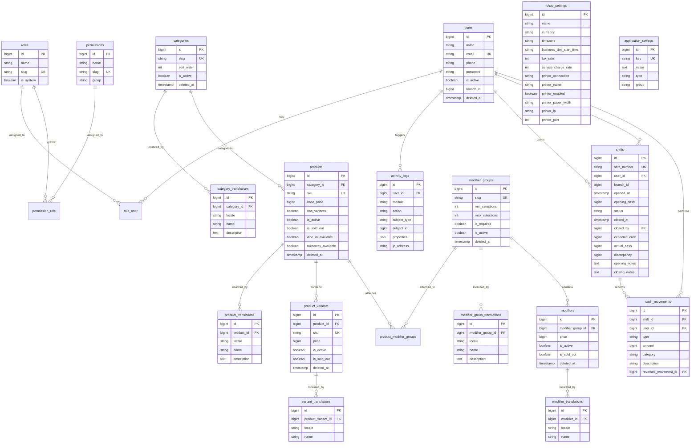
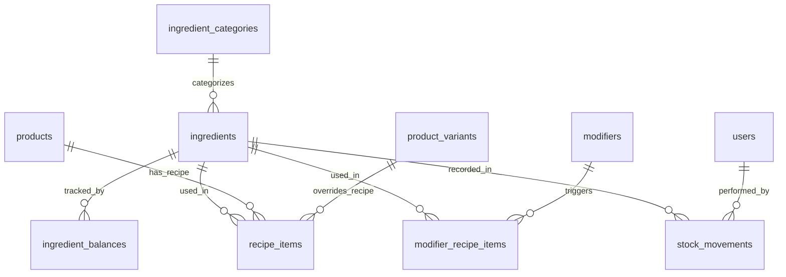

# Temu Pulang — Database Design Specification (Phases 1–6)

## 1. Overview & Core Philosophy

**Temu Pulang** is a local-first Point of Sale (POS) and business management system engineered for a Food & Beverage establishment. This document specifies the relational database schema implemented across **Phases 1 through 6** (Database Foundation, Operational Foundation, Order Engine, Payments & Printing, and Inventory Management).

### Core Tenets:
1. **Financial Precision (Zero Floating-Point Drift)**:
   - Currency: Indonesian Rupiah (IDR).
   - IDR has no fractional cents/sub-units in commercial circulation.
   - All monetary amounts (`base_price`, `price`) are strictly stored as `UNSIGNED BIGINT` integers representing whole Rupiah (e.g., `25000` = Rp 25.000). Floating-point calculation for monetary storage is strictly prohibited.
   - Tax and service rates are stored in basis points as integers to maintain absolute precision (defaults are `0` = 0.00%; e.g. `1000` = 10.00%, `500` = 5.00%). Configurable exclusively by the Owner.
2. **Referential Integrity & Cascades**:
   - Strict foreign key constraints are enforced across all relational tables.
   - Cascading deletes are applied only to dependent translation and modifier child records.
   - Catalog-to-order safety: Category deletions use `nullOnDelete()` to prevent accidental cascading deletion of live catalog products.
3. **Soft Deletes**:
   - Soft deletes (`deleted_at`) are utilized for business entities (`users`, `categories`, `products`, `product_variants`, `modifier_groups`, `modifiers`) to maintain historical integrity for future orders, reporting, and shifts.
4. **Relational Localization**:
   - Dedicated translation tables (`category_translations`, `product_translations`, `variant_translations`, `modifier_group_translations`, `modifier_translations`) normalized per locale code (`id`, `en`).
   - Clean indexing on `['model_id', 'locale']` prevents duplicate translations while enabling high-performance joins.
5. **Future Multi-Branch Readiness**:
   - `branch_id` nullable foreign keys are pre-positioned on `users` and `shop_settings` without introducing multi-tenant operational overhead during single-branch phase 1.
6. **Inventory Quantity Precision (Phase 6)**:
   - Ingredient quantities (`current_stock`, `quantity`, `balance_before`, `balance_after`) are stored as `DECIMAL(12,3)` — three decimal places supporting sub-unit precision (e.g., 1.750 kg, 0.025 L).
   - Quantities are cast as PHP `'string'` in Eloquent — never `'decimal:3'` which would silently introduce PHP float.
   - Integer milli-unit arithmetic helpers (`Ingredient::toMilli()` / `fromMilli()`) enable exact integer math without float drift.
   - `NULL`-safe unique constraints are enforced via MySQL `GENERATED ALWAYS AS (COALESCE(col, 0)) STORED` generated columns, since a standard `UNIQUE INDEX` on nullable columns treats `NULL != NULL`.

---

## 2. Entity-Relationship Diagram (Mermaid)

---

## 3. Data Dictionary

### 3.1. Users & Access Control

#### `users`
Stores system accounts for owners, managers, and cashiers.
| Column | Type | Nullable | Default | Description |
|---|---|---|---|---|
| `id` | `BIGINT UNSIGNED` | No | Auto-inc | Primary key |
| `name` | `VARCHAR(255)` | No | - | User display name |
| `email` | `VARCHAR(255)` | No | - | Unique login email (`UNIQUE`) |
| `phone` | `VARCHAR(30)` | Yes | `NULL` | Operational contact number |
| `email_verified_at` | `TIMESTAMP` | Yes | `NULL` | Verification timestamp |
| `password` | `VARCHAR(255)` | No | - | Bcrypt hashed password |
| `is_active` | `BOOLEAN` | No | `true` | Account active state (`INDEX`) |
| `branch_id` | `BIGINT UNSIGNED` | Yes | `NULL` | Branch assignment for future multi-branch (`INDEX`) |
| `remember_token` | `VARCHAR(100)` | Yes | `NULL` | Auth persistence token |
| `created_at` / `updated_at` | `TIMESTAMP` | Yes | `NULL` | Standard timestamps |
| `deleted_at` | `TIMESTAMP` | Yes | `NULL` | Soft delete timestamp |

#### `roles`
System access roles. Initial active roles are strictly **Owner** and **Cashier** (Supervisor role is reserved for future expansion phases).
| Column | Type | Nullable | Default | Description |
|---|---|---|---|---|
| `id` | `BIGINT UNSIGNED` | No | Auto-inc | Primary key |
| `name` | `VARCHAR(100)` | No | - | Role name (e.g. Owner, Cashier) |
| `slug` | `VARCHAR(50)` | No | - | Unique role identifier (`UNIQUE`) |
| `description` | `VARCHAR(255)` | Yes | `NULL` | Purpose of the role |
| `is_system` | `BOOLEAN` | No | `false` | System flag preventing accidental deletion |
| `created_at` / `updated_at` | `TIMESTAMP` | Yes | `NULL` | Standard timestamps |

#### `permissions`
Granular authorization capabilities.
| Column | Type | Nullable | Default | Description |
|---|---|---|---|---|
| `id` | `BIGINT UNSIGNED` | No | Auto-inc | Primary key |
| `name` | `VARCHAR(100)` | No | - | Human-readable name |
| `slug` | `VARCHAR(100)` | No | - | Unique permission slug (`UNIQUE`, e.g. `pos.access`) |
| `group` | `VARCHAR(50)` | No | - | Permission grouping (`INDEX`, e.g. `pos`, `products`, `refunds`) |
| `description` | `VARCHAR(255)` | Yes | `NULL` | Capability detail |
| `created_at` / `updated_at` | `TIMESTAMP` | Yes | `NULL` | Standard timestamps |

#### `role_user` (Pivot)
| Column | Type | Constraints |
|---|---|---|
| `user_id` | `BIGINT UNSIGNED` | `FOREIGN KEY` -> `users.id` `ON DELETE CASCADE` |
| `role_id` | `BIGINT UNSIGNED` | `FOREIGN KEY` -> `roles.id` `ON DELETE CASCADE` |
| Primary Key | - | `PRIMARY KEY (user_id, role_id)` |

#### `permission_role` (Pivot)
| Column | Type | Constraints |
|---|---|---|
| `permission_id` | `BIGINT UNSIGNED` | `FOREIGN KEY` -> `permissions.id` `ON DELETE CASCADE` |
| `role_id` | `BIGINT UNSIGNED` | `FOREIGN KEY` -> `roles.id` `ON DELETE CASCADE` |
| Primary Key | - | `PRIMARY KEY (permission_id, role_id)` |

#### `activity_logs`
Audit trail of sensitive financial, catalog, and shift events.
| Column | Type | Nullable | Default | Description |
|---|---|---|---|---|
| `id` | `BIGINT UNSIGNED` | No | Auto-inc | Primary key |
| `user_id` | `BIGINT UNSIGNED` | Yes | `NULL` | `FOREIGN KEY` -> `users.id` `ON DELETE SET NULL` |
| `action` | `VARCHAR(100)` | No | - | Action tag (`INDEX`, e.g. `pos.shift_opened`) |
| `description` | `TEXT` | Yes | `NULL` | Plain-text summary |
| `subject_type` | `VARCHAR(255)`| Yes | `NULL` | Polymorphic model class |
| `subject_id` | `BIGINT UNSIGNED` | Yes | `NULL` | Polymorphic model key (`INDEX(subject_type, subject_id)`) |
| `properties` | `JSON` | Yes | `NULL` | Flexible context payload |
| `ip_address` | `VARCHAR(45)` | Yes | `NULL` | Client IP address |
| `user_agent` | `TEXT` | Yes | `NULL` | User agent string |
| `created_at` / `updated_at` | `TIMESTAMP` | Yes | `NULL` | Timestamps (`INDEX(user_id, created_at)`) |

---

### 3.2. Settings

#### `shop_settings`
Physical shop/branch configuration and hardware peripherals.
| Column | Type | Nullable | Default | Description |
|---|---|---|---|---|
| `id` | `BIGINT UNSIGNED` | No | Auto-inc | Primary key |
| `branch_id` | `BIGINT UNSIGNED` | Yes | `NULL` | Branch identifier (`INDEX`) |
| `name` | `VARCHAR(150)` | No | - | Business trading name |
| `address` | `TEXT` | Yes | `NULL` | Physical address printed on receipts |
| `phone` | `VARCHAR(30)` | Yes | `NULL` | Contact phone |
| `email` | `VARCHAR(255)` | Yes | `NULL` | Contact email |
| `logo_path` | `VARCHAR(255)` | Yes | `NULL` | Local path to receipt logo |
| `currency` | `VARCHAR(10)` | No | `'IDR'` | Primary currency code |
| `timezone` | `VARCHAR(50)` | No | `'Asia/Jakarta'` | Operational timezone |
| `business_day_start_time` | `VARCHAR(8)` | No | `'06:00:00'` | Cutoff time when new business day begins |
| `operating_hours` | `JSON` | Yes | `NULL` | Weekly opening schedule |
| `tax_rate` | `INT UNSIGNED` | No | `0` | Tax rate in basis points (`0` = 0.00%, configurable by Owner) |
| `is_tax_inclusive` | `BOOLEAN` | No | `false` | Whether catalog prices include tax |
| `service_charge_rate` | `INT UNSIGNED` | No | `0` | Service charge in basis points (`0` = 0.00%, configurable by Owner) |
| `receipt_header` | `TEXT` | Yes | `NULL` | Receipt top text |
| `receipt_footer` | `TEXT` | Yes | `NULL` | Receipt bottom text |
| `receipt_show_logo` | `BOOLEAN` | No | `true` | Print receipt logo |
| `receipt_show_tax` | `BOOLEAN` | No | `true` | Print itemized tax line |
| `receipt_show_customer_info` | `BOOLEAN` | No | `true` | Print customer name (no table numbers in Temu Pulang) |
| `printer_type` | `VARCHAR(30)` | No | `'thermal'` | Thermal printer |
| `printer_paper_width` | `VARCHAR(20)` | No | `'80mm'` | Paper width (supports `'58mm'` and `'80mm'`) |
| `printer_connection` | `VARCHAR(30)` | No | `'usb'` | Interface (`'usb'`, `'network'`, `'serial'`; default USB) |
| `printer_name` | `VARCHAR(100)` | Yes | `'POS-80'` | Windows USB thermal printer device name |
| `printer_enabled` | `BOOLEAN` | No | `true` | Thermal receipt printer active toggle |
| `kitchen_printer_enabled` | `BOOLEAN` | No | `false` | Optional secondary kitchen printer toggle |
| `kitchen_printer_name` | `VARCHAR(100)` | Yes | `NULL` | Secondary kitchen printer device name |
| `printer_ip` | `VARCHAR(45)` | Yes | `NULL` | LAN IP of POS thermal printer (optional, nullable for USB) |
| `printer_port` | `INT UNSIGNED` | Yes | `NULL` | Raw TCP printing port (optional, nullable for USB) |
| `is_active` | `BOOLEAN` | No | `true` | Active profile flag |
| `created_at` / `updated_at` | `TIMESTAMP` | Yes | `NULL` | Standard timestamps |

#### `application_settings`
Extensible key-value store for application runtime toggles.
| Column | Type | Nullable | Default | Description |
|---|---|---|---|---|
| `id` | `BIGINT UNSIGNED` | No | Auto-inc | Primary key |
| `key` | `VARCHAR(100)` | No | - | Setting key (`UNIQUE`, e.g. `app.default_locale`) |
| `value` | `TEXT` | Yes | `NULL` | Serialized value |
| `type` | `VARCHAR(30)` | No | `'string'` | Cast type (`string`, `boolean`, `integer`, `json`) |
| `group` | `VARCHAR(50)` | No | `'general'` | Category group (`INDEX`) |
| `description` | `VARCHAR(255)` | Yes | `NULL` | Explanation of setting |
| `created_at` / `updated_at` | `TIMESTAMP` | Yes | `NULL` | Standard timestamps |

**Known `application_settings` Keys:**
| Key | Group | Type | Description |
|---|---|---|---|
| `payment.qris_image_path` | `payment` | `string` | Relative public-disk path (e.g. `qris/<hash>.png`) to the shop QRIS image displayed in the POS payment modal, or empty string when unset. |

---

### 3.3. Product Catalog & Variants

#### `categories`
| Column | Type | Nullable | Default | Description |
|---|---|---|---|---|
| `id` | `BIGINT UNSIGNED` | No | Auto-inc | Primary key |
| `slug` | `VARCHAR(100)` | No | - | Unique URL/lookup slug (`UNIQUE`) |
| `sort_order` | `INT` | No | `0` | POS display sorting (`INDEX`) |
| `is_active` | `BOOLEAN` | No | `true` | Display in catalog (`INDEX`) |
| `created_at` / `updated_at` | `TIMESTAMP` | Yes | `NULL` | Standard timestamps |
| `deleted_at` | `TIMESTAMP` | Yes | `NULL` | Soft delete |

#### `category_translations`
| Column | Type | Nullable | Constraints | Description |
|---|---|---|---|---|
| `id` | `BIGINT UNSIGNED` | No | Auto-inc | Primary key |
| `category_id` | `BIGINT UNSIGNED` | No | `FK` -> `categories.id` `ON DELETE CASCADE` | Parent category |
| `locale` | `VARCHAR(10)` | No | `INDEX` | Locale code (`id`, `en`) |
| `name` | `VARCHAR(150)` | No | - | Localized category name |
| `description` | `TEXT` | Yes | - | Localized category description |
| Unique Key | - | - | `UNIQUE (category_id, locale)` | Single translation per locale |

#### `products`
| Column | Type | Nullable | Default | Description |
|---|---|---|---|---|
| `id` | `BIGINT UNSIGNED` | No | Auto-inc | Primary key |
| `category_id` | `BIGINT UNSIGNED` | Yes | `NULL` | `FK` -> `categories.id` `ON DELETE SET NULL` (`INDEX`) |
| `sku` | `VARCHAR(100)` | No | - | Stock Keeping Unit (`UNIQUE`) |
| `base_price` | `BIGINT UNSIGNED` | No | `0` | Base price in whole IDR Rupiah |
| `image_path` | `VARCHAR(255)` | Yes | `NULL` | POS menu thumbnail path |
| `has_variants` | `BOOLEAN` | No | `false` | Flag indicating if product uses variants (`INDEX`) |
| `is_active` | `BOOLEAN` | No | `true` | Active state (`INDEX`) |
| `is_sold_out` | `BOOLEAN` | No | `false` | Manual out-of-stock toggle (`INDEX`) |
| `dine_in_available` | `BOOLEAN` | No | `true` | Dine-in sales permitted |
| `takeaway_available`| `BOOLEAN` | No | `true` | Takeaway sales permitted |
| `sort_order` | `INT` | No | `0` | Display ordering (`INDEX`) |
| `created_at` / `updated_at` | `TIMESTAMP` | Yes | `NULL` | Standard timestamps |
| `deleted_at` | `TIMESTAMP` | Yes | `NULL` | Soft delete |

#### `product_translations`
| Column | Type | Nullable | Constraints | Description |
|---|---|---|---|---|
| `id` | `BIGINT UNSIGNED` | No | Auto-inc | Primary key |
| `product_id` | `BIGINT UNSIGNED` | No | `FK` -> `products.id` `ON DELETE CASCADE` | Parent product |
| `locale` | `VARCHAR(10)` | No | `INDEX` | Locale code (`id`, `en`) |
| `name` | `VARCHAR(200)` | No | - | Localized product title |
| `description` | `TEXT` | Yes | - | Localized description / ingredients |
| Unique Key | - | - | `UNIQUE (product_id, locale)` | Single translation per locale |

#### `product_variants`
Variants for products with multiple sizes, portions, or preparations.
| Column | Type | Nullable | Default | Description |
|---|---|---|---|---|
| `id` | `BIGINT UNSIGNED` | No | Auto-inc | Primary key |
| `product_id` | `BIGINT UNSIGNED` | No | - | `FK` -> `products.id` `ON DELETE CASCADE` |
| `sku` | `VARCHAR(100)` | No | - | Unique variant SKU (`UNIQUE`) |
| `price` | `BIGINT UNSIGNED` | No | - | Specific variant price in IDR |
| `is_active` | `BOOLEAN` | No | `true` | Variant active flag (`INDEX`) |
| `is_sold_out` | `BOOLEAN` | No | `false` | Variant manual sold-out flag (`INDEX`) |
| `sort_order` | `INT` | No | `0` | Order on POS option modal (`INDEX`) |
| `created_at` / `updated_at` | `TIMESTAMP` | Yes | `NULL` | Standard timestamps |
| `deleted_at` | `TIMESTAMP` | Yes | `NULL` | Soft delete |

#### `variant_translations`
| Column | Type | Nullable | Constraints | Description |
|---|---|---|---|---|
| `id` | `BIGINT UNSIGNED` | No | Auto-inc | Primary key |
| `product_variant_id` | `BIGINT UNSIGNED` | No | `FK` -> `product_variants.id` `ON DELETE CASCADE` | Parent variant |
| `locale` | `VARCHAR(10)` | No | `INDEX` | Locale code (`id`, `en`) |
| `name` | `VARCHAR(150)` | No | - | Variant label (e.g. Regular, Large) |
| Unique Key | - | - | `UNIQUE (product_variant_id, locale)` | Single translation per locale |

---

### 3.4. Modifiers & Customization

#### `modifier_groups`
Groups of customizations (e.g., Sugar Level, Ice Level, Extra Add-ons).
| Column | Type | Nullable | Default | Description |
|---|---|---|---|---|
| `id` | `BIGINT UNSIGNED` | No | Auto-inc | Primary key |
| `slug` | `VARCHAR(100)` | No | - | Identifier code (`UNIQUE`, e.g. `sugar-level`) |
| `min_selections` | `INT UNSIGNED` | No | `0` | Minimum required selections (0 for optional) |
| `max_selections` | `INT UNSIGNED` | No | `1` | Maximum allowed selections |
| `is_required` | `BOOLEAN` | No | `false` | Must select before adding to cart |
| `is_active` | `BOOLEAN` | No | `true` | Active flag (`INDEX`) |
| `sort_order` | `INT` | No | `0` | POS display sorting (`INDEX`) |
| `created_at` / `updated_at` | `TIMESTAMP` | Yes | `NULL` | Standard timestamps |
| `deleted_at` | `TIMESTAMP` | Yes | `NULL` | Soft delete |

#### `modifier_group_translations`
| Column | Type | Nullable | Constraints | Description |
|---|---|---|---|---|
| `id` | `BIGINT UNSIGNED` | No | Auto-inc | Primary key |
| `modifier_group_id`| `BIGINT UNSIGNED` | No | `FK` -> `modifier_groups.id` `ON DELETE CASCADE` | Parent modifier group |
| `locale` | `VARCHAR(10)` | No | `INDEX` | Locale code (`id`, `en`) |
| `name` | `VARCHAR(150)` | No | - | Localized group title |
| `description` | `TEXT` | Yes | - | Localized instructions |
| Unique Key | - | - | `UNIQUE (modifier_group_id, locale)` | Unique per locale |

#### `modifiers`
Individual modification options (e.g., Less Sugar, Extra Lemon, Extra Rice).
| Column | Type | Nullable | Default | Description |
|---|---|---|---|---|
| `id` | `BIGINT UNSIGNED` | No | Auto-inc | Primary key |
| `modifier_group_id`| `BIGINT UNSIGNED` | No | - | `FK` -> `modifier_groups.id` `ON DELETE CASCADE` |
| `price` | `BIGINT UNSIGNED` | No | `0` | Added price in whole IDR (`0` = free) |
| `is_active` | `BOOLEAN` | No | `true` | Active flag (`INDEX`) |
| `is_sold_out` | `BOOLEAN` | No | `false` | Out of stock toggle (`INDEX`) |
| `sort_order` | `INT` | No | `0` | Option ordering (`INDEX`) |
| `created_at` / `updated_at` | `TIMESTAMP` | Yes | `NULL` | Standard timestamps |
| `deleted_at` | `TIMESTAMP` | Yes | `NULL` | Soft delete |

#### `modifier_translations`
| Column | Type | Nullable | Constraints | Description |
|---|---|---|---|---|
| `id` | `BIGINT UNSIGNED` | No | Auto-inc | Primary key |
| `modifier_id` | `BIGINT UNSIGNED` | No | `FK` -> `modifiers.id` `ON DELETE CASCADE` | Parent modifier |
| `locale` | `VARCHAR(10)` | No | `INDEX` | Locale code (`id`, `en`) |
| `name` | `VARCHAR(150)` | No | - | Localized option label |
| Unique Key | - | - | `UNIQUE (modifier_id, locale)` | Unique per locale |

#### `product_modifier_groups` (Pivot)
Associates modifier groups with specific products.
| Column | Type | Constraints |
|---|---|---|
| `id` | `BIGINT UNSIGNED` | `PRIMARY KEY` Auto-inc |
| `product_id` | `BIGINT UNSIGNED` | `FK` -> `products.id` `ON DELETE CASCADE` |
| `modifier_group_id`| `BIGINT UNSIGNED` | `FK` -> `modifier_groups.id` `ON DELETE CASCADE` |
| `sort_order` | `INT` | Sort order on product configurator (default `0`) |
| `created_at` / `updated_at` | `TIMESTAMP` | Standard timestamps |
| Unique Key | - | `UNIQUE (product_id, modifier_group_id)` |

---

### 3.5. Operational & Ledger Tables (Phase 3)

#### `shifts`
Tracks the complete lifecycle of register shifts.
| Column | Type | Nullable | Default | Constraints / Indexes | Description |
|---|---|---|---|---|---|
| `id` | `BIGINT UNSIGNED` | No | Auto-inc | `PRIMARY KEY` | Primary key |
| `shift_number` | `VARCHAR(32)` | No | - | `UNIQUE` | Unique code (e.g. `SFT-20261113-0001`) |
| `branch_id` | `BIGINT UNSIGNED` | Yes | `NULL` | `INDEX` | Future multi-branch scope |
| `user_id` | `BIGINT UNSIGNED` | No | - | `FK` -> `users.id` | Cashier who opened the shift |
| `opened_at` | `TIMESTAMP` | No | - | `INDEX` | Exact opening timestamp |
| `opening_cash` | `BIGINT UNSIGNED` | No | `0` | - | Initial cash drawer float (integer IDR) |
| `status` | `VARCHAR(20)` | No | `open` | `INDEX` | `open` or `closed` |
| `closed_at` | `TIMESTAMP` | Yes | `NULL` | - | Exact closing timestamp |
| `closed_by` | `BIGINT UNSIGNED` | Yes | `NULL` | `FK` -> `users.id` | User who finalized the closing |
| `expected_cash` | `BIGINT UNSIGNED` | Yes | `NULL` | - | System expected cash at closing (integer IDR) |
| `actual_cash` | `BIGINT UNSIGNED` | Yes | `NULL` | - | Cashier physically counted cash (integer IDR) |
| `discrepancy` | `BIGINT` | Yes | `NULL` | - | `actual_cash - expected_cash` (can be negative) |
| `opening_notes` | `TEXT` | Yes | `NULL` | - | Optional note recorded at open |
| `closing_notes` | `TEXT` | Yes | `NULL` | - | Mandatory note when discrepancy exists |
| `active_branch_slot` | `INT` | Yes | `NULL` | `UNIQUE (uq_active_shift_per_branch)` | Virtual/generated column (`IF(status='open', COALESCE(branch_id, 0), NULL)`) physically guaranteeing max 1 active shift per branch |
| `created_at` / `updated_at` | `TIMESTAMP` | Yes | `NULL` | - | Standard Laravel timestamps |

#### `cash_movements`
Ledger of non-order cash inflows and outflows for the active drawer.
| Column | Type | Nullable | Default | Constraints / Indexes | Description |
|---|---|---|---|---|---|
| `id` | `BIGINT UNSIGNED` | No | Auto-inc | `PRIMARY KEY` | Primary key |
| `shift_id` | `BIGINT UNSIGNED` | No | - | `FK` -> `shifts.id` | Associated shift |
| `user_id` | `BIGINT UNSIGNED` | No | - | `FK` -> `users.id` | Staff who performed the movement |
| `type` | `VARCHAR(10)` | No | - | `INDEX` | `in` (cash inflow) or `out` (cash outflow) |
| `amount` | `BIGINT UNSIGNED` | No | - | - | Cash amount in whole IDR (> 0) |
| `category` | `VARCHAR(50)` | No | `other` | `INDEX` | Category (e.g. `petty_cash`, `drawer_add`, `expense`) |
| `description` | `VARCHAR(255)` | No | - | - | Human explanation / reason |
| `reversed_movement_id` | `BIGINT UNSIGNED` | Yes | `NULL` | `FK` -> `cash_movements.id`, `UNIQUE (uq_reversed_movement_once)` | Audit link if this movement reverses another; unique constraint prevents duplicate reversals |
| `created_at` / `updated_at` | `TIMESTAMP` | Yes | `NULL` | - | Standard Laravel timestamps |

#### `shop_settings` (Updates in Phase 3)
| Column | Type | Nullable | Default | Description |
|---|---|---|---|---|
| `tax_rate` | `INT UNSIGNED` | No | `0` | Default restaurant tax in basis points (`0` = 0.00%) |
| `service_charge_rate` | `INT UNSIGNED` | No | `0` | Default service charge in basis points (`0` = 0.00%) |
| `printer_connection` | `VARCHAR(30)` | No | `usb` | Confirmed hardware connection (`usb`) |
| `printer_name` | `VARCHAR(100)` | Yes | `POS-80` | Thermal receipt printer identifier |
| `printer_enabled` | `BOOLEAN` | No | `true` | Receipt printer active toggle |
| `kitchen_printer_enabled` | `BOOLEAN` | No | `false` | Secondary kitchen printer toggle |
| `kitchen_printer_name` | `VARCHAR(100)` | Yes | `NULL` | Secondary kitchen printer identifier |
| `printer_port` | `INT UNSIGNED` | Yes | `NULL` | Port (nullable for USB connections) |
| `printer_ip` | `VARCHAR(45)` | Yes | `NULL` | IP address (nullable for USB connections) |

#### `activity_logs` (Updates in Phase 3)
| Column | Type | Nullable | Default | Description |
|---|---|---|---|---|
| `module` | `VARCHAR(50)` | No | `system` | Functional group (`auth`, `shifts`, `cash_movements`, `settings`, `catalog`) (`INDEX`) |

---

## 4. Phase 4 Schema Additions (Order Engine)

#### `orders`
Master order record containing customer identifiers, shift binding, daily sequential numbering, and integer financial totals.
| Column | Type | Nullable | Default | Constraints / Indexes | Description |
|---|---|---|---|---|---|
| `id` | `BIGINT UNSIGNED` | No | Auto-inc | `PRIMARY KEY` | Primary key |
| `ulid` | `CHAR(26)` | No | - | `UNIQUE` | Lexicographically sortable unique identifier |
| `order_number` | `VARCHAR(32)` | No | - | `UNIQUE` | Human-readable order identifier (e.g. `ORD-20261114-001`) |
| `daily_order_number` | `VARCHAR(16)` | No | - | `UNIQUE (uniq_orders_biz_date_num)` | Call number displayed to customer (e.g. `TP-001`), unique per business date |
| `daily_sequence` | `INT UNSIGNED` | No | - | `UNIQUE (uniq_orders_biz_date_seq)` | Sequential integer resetting daily at `business_day_start_time`, unique per business date |
| `business_date` | `DATE` | No | - | `INDEX`, `UNIQUE (composite)` | Accounting business date (accounts for crossing-midnight 06:00 cutoff) |
| `branch_id` | `BIGINT UNSIGNED` | Yes | `NULL` | `INDEX` | Associated branch |
| `shift_id` | `BIGINT UNSIGNED` | No | - | `FK` -> `shifts.id`, `RESTRICT` | Cashier shift during which order was created |
| `user_id` | `BIGINT UNSIGNED` | No | - | `FK` -> `users.id`, `RESTRICT` | Cashier user who recorded the order |
| `order_type` | `VARCHAR(20)` | No | `dine_in` | `INDEX` | Dining mode: `dine_in` or `takeaway` |
| `status` | `VARCHAR(30)` | No | `draft` | `INDEX` | Lifecycle status: `draft`, `awaiting_payment`, `paid`, `queued`, `preparing`, `ready`, `completed`, `cancelled` |
| `subtotal` | `BIGINT UNSIGNED` | No | `0` | - | Sum of all line item subtotals (integer IDR) |
| `tax_rate` | `INT UNSIGNED` | No | `0` | - | Restaurant tax rate applied in basis points |
| `tax_amount` | `BIGINT UNSIGNED` | No | `0` | - | Computed tax amount in whole integer IDR |
| `service_charge_rate` | `INT UNSIGNED` | No | `0` | - | Service charge applied in basis points |
| `service_charge_amount` | `BIGINT UNSIGNED` | No | `0` | - | Computed service charge in whole integer IDR |
| `discount_amount` | `BIGINT UNSIGNED` | No | `0` | - | Discount applied in whole integer IDR |
| `total_amount` | `BIGINT UNSIGNED` | No | `0` | - | Final payable total in whole integer IDR |
| `customer_name` | `VARCHAR(100)` | Yes | `NULL` | - | Customer name for order queue call |
| `idempotency_key` | `VARCHAR(64)` | Yes | `NULL` | `UNIQUE` | Network deduplication UUID |
| `notes` | `TEXT` | Yes | `NULL` | - | Order-level special requests |
| `cancellation_reason` | `TEXT` | Yes | `NULL` | - | Mandatory cancellation explanation |
| `cancelled_by_user_id` | `BIGINT UNSIGNED` | Yes | `NULL` | `FK` -> `users.id` | Owner who authorized cancellation |
| `cancelled_at` | `TIMESTAMP` | Yes | `NULL` | - | Cancellation timestamp |
| `paid_at` | `TIMESTAMP` | Yes | `NULL` | - | Timestamp when payment was confirmed |
| `completed_at` | `TIMESTAMP` | Yes | `NULL` | - | Timestamp when order was marked completed |
| `created_at` / `updated_at` | `TIMESTAMP` | Yes | `NULL` | - | Standard Laravel timestamps |
| `deleted_at` | `TIMESTAMP` | Yes | `NULL` | - | Soft delete timestamp |

#### `order_items`
Frozen historical snapshot of line items. Preserves product names and unit prices permanently regardless of future catalog changes or product deletions.
| Column | Type | Nullable | Default | Constraints / Indexes | Description |
|---|---|---|---|---|---|
| `id` | `BIGINT UNSIGNED` | No | Auto-inc | `PRIMARY KEY` | Primary key |
| `order_id` | `BIGINT UNSIGNED` | No | - | `FK` -> `orders.id`, `CASCADE` | Parent order |
| `product_id` | `BIGINT UNSIGNED` | Yes | `NULL` | `FK` -> `products.id`, `SET NULL` | Referenced catalog product |
| `product_variant_id` | `BIGINT UNSIGNED` | Yes | `NULL` | `FK` -> `product_variants.id`, `SET NULL` | Referenced variant |
| `product_name_id` | `VARCHAR(150)` | No | - | - | Frozen Indonesian product name |
| `product_name_en` | `VARCHAR(150)` | Yes | `NULL` | - | Frozen English product name |
| `variant_name_id` | `VARCHAR(150)` | Yes | `NULL` | - | Frozen Indonesian variant name |
| `variant_name_en` | `VARCHAR(150)` | Yes | `NULL` | - | Frozen English variant name |
| `sku` | `VARCHAR(50)` | Yes | `NULL` | - | Frozen SKU at time of purchase |
| `unit_price` | `BIGINT UNSIGNED` | No | `0` | - | Frozen base/variant price (integer IDR) |
| `modifiers_unit_price` | `BIGINT UNSIGNED` | No | `0` | - | Total price of all modifiers per unit |
| `final_unit_price` | `BIGINT UNSIGNED` | No | `0` | - | `unit_price + modifiers_unit_price` |
| `quantity` | `INT UNSIGNED` | No | `1` | - | Purchased quantity |
| `subtotal` | `BIGINT UNSIGNED` | No | `0` | - | `final_unit_price * quantity` |
| `notes` | `VARCHAR(255)` | Yes | `NULL` | - | Line-item special instructions |
| `created_at` / `updated_at` | `TIMESTAMP` | Yes | `NULL` | - | Standard Laravel timestamps |

#### `order_item_modifiers`
Frozen modifier selections attached to an order item.
| Column | Type | Nullable | Default | Constraints / Indexes | Description |
|---|---|---|---|---|---|
| `id` | `BIGINT UNSIGNED` | No | Auto-inc | `PRIMARY KEY` | Primary key |
| `order_item_id` | `BIGINT UNSIGNED` | No | - | `FK` -> `order_items.id`, `CASCADE` | Parent order line item |
| `modifier_id` | `BIGINT UNSIGNED` | Yes | `NULL` | `FK` -> `modifiers.id`, `SET NULL` | Referenced modifier |
| `modifier_group_id` | `BIGINT UNSIGNED` | Yes | `NULL` | `FK` -> `modifier_groups.id`, `SET NULL` | Referenced group |
| `group_name_id` | `VARCHAR(150)` | No | - | - | Frozen Indonesian group name |
| `group_name_en` | `VARCHAR(150)` | Yes | `NULL` | - | Frozen English group name |
| `modifier_name_id` | `VARCHAR(150)` | No | - | - | Frozen Indonesian modifier name |
| `modifier_name_en` | `VARCHAR(150)` | Yes | `NULL` | - | Frozen English modifier name |
| `unit_price` | `BIGINT UNSIGNED` | No | `0` | - | Frozen price per modifier (0 = free) |
| `created_at` / `updated_at` | `TIMESTAMP` | Yes | `NULL` | - | Standard Laravel timestamps |

#### `order_status_histories`
Append-only audit trail tracking every lifecycle state transition.
| Column | Type | Nullable | Default | Constraints / Indexes | Description |
|---|---|---|---|---|---|
| `id` | `BIGINT UNSIGNED` | No | Auto-inc | `PRIMARY KEY` | Primary key |
| `order_id` | `BIGINT UNSIGNED` | No | - | `FK` -> `orders.id`, `CASCADE` | Target order |
| `from_status` | `VARCHAR(30)` | Yes | `NULL` | - | Previous status (NULL on creation) |
| `to_status` | `VARCHAR(30)` | No | - | - | New status |
| `user_id` | `BIGINT UNSIGNED` | No | - | `FK` -> `users.id`, `RESTRICT` | User who triggered transition |
| `notes` | `TEXT` | Yes | `NULL` | - | Transition explanation or cancellation reason |
| `created_at` | `TIMESTAMP` | No | `CURRENT_TIMESTAMP` | - | Timestamp of transition |

---

## 5. Phase 5 Schema Additions (Payments, Refunds & Print Jobs)

#### `orders` (Phase 5 Addition)
Added column `payment_status` to decouple operational order progress from pure financial settlement:
| Column | Type | Nullable | Default | Constraints / Indexes | Description |
|---|---|---|---|---|---|
| `payment_status` | `VARCHAR(30)` | No | `unpaid` | `INDEX` | Financial settlement state: `unpaid`, `paid`, `partially_refunded`, `refunded` |

#### `qris_confirmations`
Server-persisted QRIS payment verification records stamped exclusively by authenticated cashiers upon inspecting merchant notification.
| Column | Type | Nullable | Default | Constraints / Indexes | Description |
|---|---|---|---|---|---|
| `id` | `BIGINT UNSIGNED` | No | Auto-inc | `PRIMARY KEY` | Primary key |
| `ulid` | `CHAR(26)` | No | - | `UNIQUE` | Lexicographical UUID |
| `order_id` | `BIGINT UNSIGNED` | No | - | `FK -> orders.id (RESTRICT)` | Targeted order |
| `user_id` | `BIGINT UNSIGNED` | No | - | `FK -> users.id (RESTRICT)` | Authenticated cashier confirming merchant notification |
| `expected_amount` | `BIGINT UNSIGNED` | No | - | - | Exact intended QRIS amount (IDR) |
| `reference_number` | `VARCHAR(100)` | Yes | `NULL` | `INDEX` | Merchant RRN / trace reference |
| `confirmed_at` | `TIMESTAMP` | No | - | - | Server-generated verification timestamp |
| `status` | `VARCHAR(20)` | No | `pending` | `INDEX` | Lifecycle status: `pending`, `consumed`, `expired` |
| `consumed_at` | `TIMESTAMP` | Yes | `NULL` | - | Timestamp consumed by payment settlement |
| `created_at` / `updated_at` | `TIMESTAMP` | Yes | `NULL` | - | Standard Laravel timestamps |

#### `payment_transactions`
Parent settlement record enforcing exactly one successful checkout transaction per order.
| Column | Type | Nullable | Default | Constraints / Indexes | Description |
|---|---|---|---|---|---|
| `id` | `BIGINT UNSIGNED` | No | Auto-inc | `PRIMARY KEY` | Primary key |
| `ulid` | `CHAR(26)` | No | - | `UNIQUE` | Lexicographical UUID |
| `payment_transaction_number` | `VARCHAR(32)` | No | - | `UNIQUE` | Formatted identifier (e.g. `PAY-20261114-0001`) |
| `daily_sequence` | `INT UNSIGNED` | No | - | - | Daily counter sequence |
| `business_date` | `DATE` | No | - | `INDEX` | Accounting business date (06:00 cutoff) |
| `order_id` | `BIGINT UNSIGNED` | No | - | `FK -> orders.id (RESTRICT), UNIQUE` | Strictly 1 payment transaction per order |
| `shift_id` | `BIGINT UNSIGNED` | No | - | `FK -> shifts.id (RESTRICT)` | Active cashier shift |
| `user_id` | `BIGINT UNSIGNED` | No | - | `FK -> users.id (RESTRICT)` | Cashier recording payment |
| `cashier_name` | `VARCHAR(100)` | Yes | `NULL` | - | Cashier display name snapshot at settlement |
| `total_amount` | `BIGINT UNSIGNED` | No | - | - | Total order amount settled (IDR) |
| `idempotency_key` | `VARCHAR(64)` | No | - | `UNIQUE` | Client checkout deduplication key |
| `request_fingerprint` | `CHAR(64)` | No | - | `INDEX` | SHA-256 canonical hash of payload & context |
| `status` | `VARCHAR(20)` | No | `completed` | `INDEX` | Immutable status: always `completed` |
| `created_at` / `updated_at` | `TIMESTAMP` | Yes | `NULL` | - | Standard Laravel timestamps |

#### `payments`
Child tender lines representing individual payment methods applied toward a payment transaction.
| Column | Type | Nullable | Default | Constraints / Indexes | Description |
|---|---|---|---|---|---|
| `id` | `BIGINT UNSIGNED` | No | Auto-inc | `PRIMARY KEY` | Primary key |
| `payment_transaction_id` | `BIGINT UNSIGNED` | No | - | `FK -> payment_transactions.id (RESTRICT)` | Parent checkout transaction |
| `order_id` | `BIGINT UNSIGNED` | No | - | `FK -> orders.id (RESTRICT)` | Targeted order |
| `shift_id` | `BIGINT UNSIGNED` | No | - | `FK -> shifts.id (RESTRICT)` | Register shift |
| `payment_method` | `VARCHAR(20)` | No | - | `INDEX` | Tender method: `cash`, `qris`, `debit`, `credit`, `transfer` |
| `amount` | `BIGINT UNSIGNED` | No | - | - | Tender amount applied to order bill (IDR) |
| `tendered_amount` | `BIGINT UNSIGNED` | No | - | - | Tender handed by customer (IDR) |
| `change_amount` | `BIGINT UNSIGNED` | No | `0` | - | Cash change returned (IDR) |
| `reference_number` | `VARCHAR(100)` | Yes | `NULL` | - | EDC trace / approval / RRN reference |
| `qris_confirmed_by_user_id`| `BIGINT UNSIGNED` | Yes | `NULL` | `FK -> users.id (RESTRICT)` | Cashier confirming merchant notification |
| `qris_confirmed_at` | `TIMESTAMP` | Yes | `NULL` | - | Merchant verification timestamp |
| `notes` | `VARCHAR(255)` | Yes | `NULL` | - | Optional cashier notes |
| `created_at` / `updated_at` | `TIMESTAMP` | Yes | `NULL` | - | Standard Laravel timestamps |

#### `refund_transactions`
Parent refund request authorized by Owner with canonical idempotency fingerprinting.
| Column | Type | Nullable | Default | Constraints / Indexes | Description |
|---|---|---|---|---|---|
| `id` | `BIGINT UNSIGNED` | No | Auto-inc | `PRIMARY KEY` | Primary key |
| `ulid` | `CHAR(26)` | No | - | `UNIQUE` | Lexicographical UUID |
| `refund_transaction_number` | `VARCHAR(32)` | No | - | `UNIQUE` | Formatted identifier (e.g. `RFD-20261114-0001`) |
| `daily_sequence` | `INT UNSIGNED` | No | - | - | Daily counter sequence |
| `business_date` | `DATE` | No | - | `INDEX` | Accounting business date (06:00 cutoff) |
| `order_id` | `BIGINT UNSIGNED` | No | - | `FK -> orders.id (RESTRICT)` | Referenced order |
| `authorized_by_user_id` | `BIGINT UNSIGNED` | No | - | `FK -> users.id (RESTRICT)` | Authorizing Owner |
| `total_refunded_amount` | `BIGINT UNSIGNED` | No | - | - | Gross sum of allocations in request (IDR) |
| `reason` | `TEXT` | No | - | - | Mandatory refund justification |
| `idempotency_key` | `VARCHAR(64)` | No | - | `UNIQUE` | Client refund deduplication key |
| `request_fingerprint` | `CHAR(64)` | No | - | `INDEX` | SHA-256 canonical hash of refund request |
| `created_at` / `updated_at` | `TIMESTAMP` | Yes | `NULL` | - | Standard Laravel timestamps |

#### `payment_refunds`
Child explicit refund allocation lines tied to a specific original payment tender.
| Column | Type | Nullable | Default | Constraints / Indexes | Description |
|---|---|---|---|---|---|
| `id` | `BIGINT UNSIGNED` | No | Auto-inc | `PRIMARY KEY` | Primary key |
| `refund_transaction_id` | `BIGINT UNSIGNED` | No | - | `FK -> refund_transactions.id (RESTRICT)` | Parent refund request |
| `payment_id` | `BIGINT UNSIGNED` | No | - | `FK -> payments.id (RESTRICT)` | Targeted original tender |
| `order_id` | `BIGINT UNSIGNED` | No | - | `FK -> orders.id (RESTRICT)` | Referenced order |
| `shift_id` | `BIGINT UNSIGNED` | Yes | `NULL` | `FK -> shifts.id (RESTRICT)` | Nullable: Required ONLY for cash refunds |
| `original_payment_method`| `VARCHAR(20)` | No | - | - | Frozen snapshot of original tender |
| `refund_method` | `VARCHAR(20)` | No | - | `INDEX` | Actual payout method: `cash`, `qris_reversal`, `manual_transfer` |
| `amount` | `BIGINT UNSIGNED` | No | - | - | Amount refunded from this tender (IDR) |
| `created_at` / `updated_at` | `TIMESTAMP` | Yes | `NULL` | - | Standard Laravel timestamps |

#### `print_jobs`
Persistent transactional outbox queue with claim token lease safety and reprint lineage tracking.
| Column | Type | Nullable | Default | Constraints / Indexes | Description |
|---|---|---|---|---|---|
| `id` | `BIGINT UNSIGNED` | No | Auto-inc | `PRIMARY KEY` | Primary key |
| `ulid` | `CHAR(26)` | No | - | `UNIQUE` | Queue tracking ULID |
| `order_id` | `BIGINT UNSIGNED` | No | - | `FK -> orders.id (RESTRICT)` | Targeted order |
| `original_print_job_id` | `BIGINT UNSIGNED` | Yes | `NULL` | `FK -> print_jobs.id (SET NULL)` | Parent job if this is a reprint |
| `job_type` | `VARCHAR(30)` | No | - | `INDEX` | `customer_receipt`, `kitchen_ticket` |
| `printer_destination` | `VARCHAR(100)`| No | - | - | Printer share name / destination |
| `paper_width` | `INT UNSIGNED` | No | `58` | - | `58` or `80` (mm) |
| `is_reprint` | `BOOLEAN` | No | `false` | - | True only for reprints (`*** SALINAN ***`) |
| `status` | `VARCHAR(20)` | No | `pending` | `INDEX` | `pending`, `processing`, `completed`, `failed`, `uncertain` |
| `attempts` | `INT UNSIGNED` | No | `0` | - | Number of dispatch attempts |
| `max_attempts` | `INT UNSIGNED` | No | `3` | - | Retry limit |
| `locked_at` | `TIMESTAMP` | Yes | `NULL` | `INDEX` | Worker concurrency lease timestamp |
| `claim_token` | `CHAR(36)` | Yes | `NULL` | `INDEX` | Unique worker lease token (UUID) |
| `completed_at` | `TIMESTAMP` | Yes | `NULL` | - | Successful completion timestamp |
| `last_error` | `TEXT` | Yes | `NULL` | - | Driver / I/O error message |
| `created_at` / `updated_at` | `TIMESTAMP` | Yes | `NULL` | - | Standard Laravel timestamps |

---

## 6. Phase 6 — Inventory Management Schema (Task 6.1)

Migration: `2026_11_15_000001_create_phase6_inventory_management_tables.php` (Batch 10).

Six new tables and their relationships:

### 6.1 `ingredient_categories`

| Column | Type | Null | Default | Constraint | Notes |
|---|---|---|---|---|---|
| `id` | `BIGINT UNSIGNED` | No | - | `PK` | Auto-increment |
| `name` | `VARCHAR(100)` | No | - | - | Display name |
| `slug` | `VARCHAR(100)` | No | - | `UNIQUE` | URL-safe identifier |
| `sort_order` | `INT` | No | `0` | - | Display ordering |
| `created_at` / `updated_at` | `TIMESTAMP` | Yes | `NULL` | - | Standard timestamps |

### 6.2 `ingredients`

| Column | Type | Null | Default | Constraint | Notes |
|---|---|---|---|---|---|
| `id` | `BIGINT UNSIGNED` | No | - | `PK` | Auto-increment |
| `category_id` | `BIGINT UNSIGNED` | Yes | `NULL` | `FK → ingredient_categories(id) SET NULL` | Nullable category |
| `sku` | `VARCHAR(100)` | No | - | `UNIQUE` | Inventory SKU |
| `name` | `VARCHAR(200)` | No | - | - | Ingredient name |
| `unit` | `VARCHAR(20)` | No | - | - | Base unit (g, ml, pcs, kg, L…) |
| `cost_per_unit` | `BIGINT UNSIGNED` | No | `0` | - | IDR cost per 1 base unit |
| `min_stock_alert` | `DECIMAL(12,3)` | No | `0.000` | - | Low-stock threshold in base units |
| `is_active` | `BOOLEAN` | No | `true` | `INDEX` | Soft toggle |
| `created_at` / `updated_at` | `TIMESTAMP` | Yes | `NULL` | - | Standard timestamps |
| `deleted_at` | `TIMESTAMP` | Yes | `NULL` | - | Soft delete |

**Indexes**: `idx_ingredients_category_id`, `idx_ingredients_is_active`

### 6.3 `ingredient_balances`

Tracks current on-hand stock per branch (NULL = default single store).

| Column | Type | Null | Default | Constraint | Notes |
|---|---|---|---|---|---|
| `id` | `BIGINT UNSIGNED` | No | - | `PK` | Auto-increment |
| `branch_id` | `BIGINT UNSIGNED` | Yes | `NULL` | `INDEX` | NULL = single/default store |
| `ingredient_id` | `BIGINT UNSIGNED` | No | - | `FK → ingredients(id) CASCADE` | |
| `current_stock` | `DECIMAL(12,3)` | No | `0.000` | `INDEX` | Current on-hand quantity |
| `branch_slot` | `BIGINT UNSIGNED` | Stored | Generated | — | `COALESCE(branch_id, 0)` — NULL-safe slot |
| `created_at` / `updated_at` | `TIMESTAMP` | Yes | `NULL` | - | Standard timestamps |

**Unique**: `uk_branch_ingredient (branch_slot, ingredient_id)` — enforces one balance row per ingredient per branch, with `branch_slot = COALESCE(branch_id, 0)` collapsing NULL to `0` to prevent duplicate NULL-branch rows.

> [!IMPORTANT]
> **Why a generated column?** MySQL's standard `UNIQUE INDEX` on a nullable column treats `NULL != NULL`, allowing unlimited duplicate rows with `branch_id = NULL`. The `branch_slot` generated column collapses `NULL → 0` so the unique index fires correctly. The same pattern is used by the existing `shifts.active_branch_slot` constraint.

### 6.4 `recipe_items`

Bill of Materials (BOM): ingredients consumed per unit of a product or variant.

| Column | Type | Null | Default | Constraint | Notes |
|---|---|---|---|---|---|
| `id` | `BIGINT UNSIGNED` | No | - | `PK` | Auto-increment |
| `product_id` | `BIGINT UNSIGNED` | No | - | `FK → products(id) CASCADE` | |
| `product_variant_id` | `BIGINT UNSIGNED` | Yes | `NULL` | `FK → product_variants(id) CASCADE` | NULL = base recipe (applies to all variants) |
| `ingredient_id` | `BIGINT UNSIGNED` | No | - | `FK → ingredients(id) CASCADE` | |
| `quantity` | `DECIMAL(12,3)` | No | - | - | Quantity consumed per unit |
| `variant_slot` | `BIGINT UNSIGNED` | Stored | Generated | — | `COALESCE(product_variant_id, 0)` — NULL-safe slot |
| `created_at` / `updated_at` | `TIMESTAMP` | Yes | `NULL` | - | Standard timestamps |

**Unique**: `uk_recipe_item (product_id, variant_slot, ingredient_id)` — prevents duplicate ingredient entries in the same recipe. Base recipe (NULL variant) and each variant-override are distinct by `variant_slot`.

### 6.5 `modifier_recipe_items`

Ingredient changes triggered when a modifier option is selected.

| Column | Type | Null | Default | Constraint | Notes |
|---|---|---|---|---|---|
| `id` | `BIGINT UNSIGNED` | No | - | `PK` | Auto-increment |
| `modifier_id` | `BIGINT UNSIGNED` | No | - | `FK → modifiers(id) CASCADE` | |
| `ingredient_id` | `BIGINT UNSIGNED` | No | - | `FK → ingredients(id) CASCADE` | The ingredient to add/replace |
| `action` | `VARCHAR(20)` | No | `'add'` | - | `'add'` or `'replace'` |
| `replaces_ingredient_id` | `BIGINT UNSIGNED` | Yes | `NULL` | `FK → ingredients(id) SET NULL` | For `replace` action only |
| `quantity` | `DECIMAL(12,3)` | No | - | - | Quantity delta |
| `created_at` / `updated_at` | `TIMESTAMP` | Yes | `NULL` | - | Standard timestamps |

**Unique**: `uk_modifier_ingredient (modifier_id, ingredient_id)` — one entry per modifier-ingredient combination.

### 6.6 `stock_movements`

Append-only audit ledger of all inventory changes. No `updated_at` column.

| Column | Type | Null | Default | Constraint | Notes |
|---|---|---|---|---|---|
| `id` | `BIGINT UNSIGNED` | No | - | `PK` | Auto-increment |
| `ulid` | `CHAR(26)` | No | - | `UNIQUE` | ULID for external reference |
| `branch_id` | `BIGINT UNSIGNED` | Yes | `NULL` | `INDEX` | NULL = default single store |
| `ingredient_id` | `BIGINT UNSIGNED` | No | - | `FK → ingredients(id)` | No cascade (preserve history) |
| `user_id` | `BIGINT UNSIGNED` | No | - | `FK → users(id)` | Actor performing the movement |
| `movement_type` | `VARCHAR(30)` | No | - | - | `stock_in`, `adjustment`, `order_deduction`, `refund_credit`, `wastage`, `opening_stock` |
| `quantity` | `DECIMAL(12,3)` | No | - | - | Positive = in; negative = out |
| `balance_before` | `DECIMAL(12,3)` | No | - | - | Stock snapshot before movement |
| `balance_after` | `DECIMAL(12,3)` | No | - | - | Stock snapshot after movement |
| `unit_cost` | `BIGINT UNSIGNED` | No | `0` | - | IDR cost per unit at movement time |
| `reference_type` | `VARCHAR(50)` | Yes | `NULL` | `INDEX` | Polymorphic reference (e.g. `'orders'`) |
| `reference_id` | `BIGINT UNSIGNED` | Yes | `NULL` | `INDEX` | Referenced record ID |
| `idempotency_key` | `VARCHAR(100)` | Yes | `NULL` | Composite UNIQUE | Caller-supplied deduplication key |
| `notes` | `VARCHAR(255)` | Yes | `NULL` | - | Human note |
| `created_at` | `TIMESTAMP` | Yes | `NULL` | - | Append-only: no `updated_at` |

**Unique**: `uk_stock_idempotency_ingredient (idempotency_key, ingredient_id)` — enforces idempotent deductions. MySQL allows multiple rows with `idempotency_key = NULL` (non-idempotent manual adjustments), but rejects duplicate `(key, ingredient_id)` pairs for keyed operations.

**Indexes**: `idx_movements_ingredient_date (ingredient_id, created_at)`, `idx_movements_reference (reference_type, reference_id)`, `idx_movements_branch_id`.

**Active Movement Types (Task 6.3):** `stock_in`, `wastage`, and `adjustment` are written by `App\Services\Inventory\StockAdjustmentService` (in addition to `opening_stock` from Task 6.2). `order_deduction` and `refund_credit` remain reserved for Tasks 6.4 and 6.7.

> [!NOTE]
> `StockMovement::booted()` registers `updating` and `deleting` listeners that throw `DomainException`, making records application-level immutable as well as structurally append-only (no `updated_at` column).
