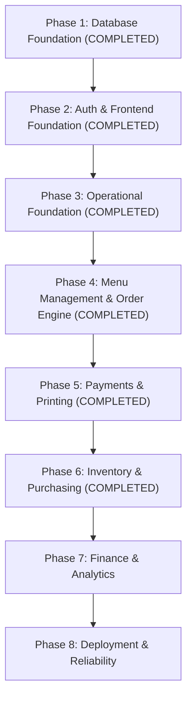

# Temu Pulang — Project Roadmap & Development Plan

## Project Overview

**Temu Pulang** is a local-first Point of Sale (POS) and business management solution specifically tailored for Food & Beverage establishments. It is designed to operate seamlessly on a local network (LAN) with robust data integrity, auditability, and ease of use.

---

## Roadmap Phases

---

## Detailed Phase Breakdown

### Phase 1: Database Foundation (COMPLETED)
- [x] **Inspection & Environment Setup**:
  - Validated PHP 8.5.12, Composer 2.11.1, Laravel 13.42.0, Livewire 4.4.8, Tailwind CSS 4.3.5.
  - Installed Laravel Boost guidelines and Pint code standards.
  - Configured timezone (`Asia/Jakarta`) and locales (`id` primary, `en` fallback).
  - Configured database (`temu_pulang`) on MySQL.
- [x] **Access Control & Auditing**:
  - Implemented `users`, `roles`, `permissions`, `role_user`, `permission_role`, `activity_logs`.
  - Configured Owner (unrestricted) and Cashier (POS & inventory view only) roles.
  - Implemented `Gate::before` integration for seamless `$user->can(...)` checks.
- [x] **Shop & Application Settings**:
  - Implemented `shop_settings` with business hours, tax basis points, receipt, and thermal printer parameters.
  - Implemented `application_settings` key-value store with typed values (`string`, `boolean`, `integer`, `json`).
- [x] **Product Catalog & Localization**:
  - Implemented normalized categories (`categories`, `category_translations`).
  - Implemented products (`products`, `product_translations`) supporting both variant and non-variant items.
  - Implemented variants (`product_variants`, `variant_translations`).
  - Enforced unique SKU constraints on products and variants.
  - Implemented integer Rupiah monetary storage (`BIGINT UNSIGNED`).
- [x] **Modifiers & Customizations**:
  - Implemented `modifier_groups`, `modifier_group_translations`, `modifiers`, `modifier_translations`, `product_modifier_groups`.
  - Supported required vs optional groups, min/max selection bounds, and free (Rp 0) vs paid add-ons.
- [x] **Seeders & Factories**:
  - Built idempotent seeders for roles, permissions, dev accounts, settings, categories, products, variants, and modifiers.
  - Tested running `db:seed` multiple times with zero duplicate records.
- [x] **Automated Testing Suite**:
  - Built 30 automated feature tests covering all relationships, permissions, translations, constraints, and settings with 100% passing results on isolated in-memory test database.
- [x] **Documentation**:
  - Authored comprehensive `DATABASE_DESIGN.md`, `ARCHITECTURE.md`, and `PROJECT_PLAN.md`.

---

### Phase 2: Authentication & Frontend Foundation (COMPLETED)
- [x] **Authentication System**:
  - Implemented `AuthController` with `showLogin`, `login`, `logout`, and `setLocale` methods.
  - Owner redirects to `/dashboard`; Cashier redirects to `/pos` on login.
  - Invalid credentials and inactive user handling with translated flash messages.
- [x] **Role-Based Access Control**:
  - `EnsureUserHasRole` middleware: protects Owner-only routes, redirects Cashier to `/pos`.
  - `SetLocale` middleware: reads `session('locale')` and sets `app()->setLocale()` on every request.
  - `Gate::before` in `AppServiceProvider`: Owner bypasses all permission checks.
- [x] **Localization (ID/EN)**:
  - Full Indonesian (`lang/id/messages.php`) and English (`lang/en/messages.php`) translations.
  - Language switcher in header (pill toggle) and login page (top-right corner).
  - Locale persisted in session via `/locale/{locale}` route.
- [x] **Application Layout**:
  - `layouts/app.blade.php`: sidebar + header layout with Livewire integration.
  - `layouts/guest.blade.php`: centered card layout for auth pages.
  - Responsive sidebar with hamburger collapse for mobile.
  - Header: Temu Pulang logo, shift indicator, user profile, language selector.
- [x] **Reusable Blade Components**:
  - `x-button`: variants (primary, secondary, outline, caramel, danger, ghost), sizes (xs/sm/md/lg).
  - `x-input`: label, error, hint, icon prefix support.
  - `x-card`: title, subtitle, action, footer slots.
  - `x-badge`: variants (primary, caramel, success, warning, danger, neutral).
  - `x-modal`: Alpine.js open/close events, backdrop, animated transitions.
  - `x-notification`: toast with Alpine.js, session flash, Livewire dispatch events.
  - `x-table`: headers prop, row slot.
- [x] **Login Page**:
  - Branded login form with TP logo, shop tagline.
  - Quick demo account buttons (owner & cashier) for fast access.
  - Remember me checkbox, animated validation feedback.
- [x] **Owner Dashboard (Livewire)**:
  - `OwnerDashboard` component: KPI cards (revenue, transactions, active shift, catalog count).
  - Recent orders table with payment method badges and status badges.
  - Top products bar chart visualization.
  - Hardware status card (printer, LAN status).
  - Prominent "SIMULASI DEMO" banner distinguishing placeholder from real data.
  - Real DB data: product count, category count, active cashier shift from seeded data.
- [x] **Cashier POS Terminal (Livewire)**:
  - `CashierPos` component: two-panel layout (product grid + cart sidebar).
  - Category filter pills from real DB categories.
  - Real DB products shown alongside clearly-labelled "Simulasi Demo" placeholder products.
  - Cart: add/remove items, quantity stepper, item customization (variants + modifiers + notes).
  - Dine-in / Takeaway toggle (table assignment removed to reflect actual single-counter business requirements).
  - Subtotal, tax (configured from shop settings, defaulting to 0%), and total calculation.
  - Payment modal (QRIS / Cash / Debit) — simulation only, no real payment processing.
  - No real inventory deduction.
- [x] **Automated Tests**:
  - 12 feature tests in `AuthenticationAndFrontendTest.php` covering login, RBAC, locale, Livewire renders.
  - 42 total tests, 165 assertions — all passing.
  - Pint: clean, no formatting issues.
- [x] **Screenshots**:
  - `docs/screenshots/login.png` — login page (ID locale).
  - `docs/screenshots/owner-dashboard.png` — Owner dashboard with KPI cards.
  - `docs/screenshots/pos-owner.png` — POS terminal as Owner.
  - `docs/screenshots/pos-cashier.png` — POS terminal as Cashier (sidebar shows "KASIR" role).

---

### Phase 3: Operational Foundation (COMPLETED)
**Objectives & Delivered Capabilities**:
- [x] **Shift Management Lifecycle (`ShiftService`)**:
  - Open shift modal with initial float count input (integer Rupiah).
  - Enforced single active shift per branch via atomic transactions & pessimistic locking (`lockForUpdate()`).
  - Active shift summary with 4 KPI cards (Opening Cash, Inflows, Outflows, Current Expected Cash).
  - Shift closing interface with physical cash count input and automatic discrepancy calculation (`actual_cash - expected_cash`).
  - Strict mandatory closing note whenever a discrepancy occurs.
  - Closed shifts are strictly immutable and cannot be reopened.
- [x] **Cash Movement Ledger (`CashMovementService`)**:
  - Cash In (`in`) and Cash Out (`out`) records associated with the active shift.
  - Full audit trail recording user, timestamp, category, and human description.
  - Positive integer Rupiah validation (`amount > 0`).
  - Audited reversal system (`reverseMovement()`) linking the original and compensating movements without silent edits.
- [x] **Shop Settings Administration (`ShopSettingsManager`)**:
  - Owner-only access (`role:owner`).
  - 5-tab interface: Profil Usaha, Jam Operasional (crossing midnight supported), Pajak & Finansial, Printer Thermal USB, and Template Struk.
  - Confirmed business requirements applied: **0% Tax**, **0% Service Charge**, and **USB Printer** defaults.
- [x] **Activity Log Interface (`ActivityLogIndex`)**:
  - Owner-only audit review page (`role:owner`).
  - Search, filter by user, module (`auth`, `shifts`, `cash_movements`, `settings`, `catalog`), and date range.
  - Detail modal for inspecting JSON before/after snapshots and client IPs.
  - Activity logs are strictly immutable and cannot be modified or deleted via web routes.
- [x] **POS Corrections**:
  - Removed table assignment controls (Dine-in / Takeaway toggle only).
  - Display tax as 0% (Rp 0) reflecting updated shop settings.
- [x] **Automated Tests**:
  - 35 new operational feature tests across 4 test suites:
    - `ShiftManagementOperationalTest.php` (15 tests)
    - `CashMovementOperationalTest.php` (9 tests)
    - `ShopSettingsOperationalTest.php` (7 tests)
    - `ActivityLogOperationalTest.php` (4 tests)
  - Full suite status: **77 tests, 280 assertions — 100% passing**.
- [x] **Screenshots**:
  - `phase3-dashboard.png` — Owner dashboard with active shift indicator.
  - `phase3-pos.png` — Cashier POS terminal with 0% tax and no table assignment.
  - `phase3-shifts-active.png` — Active shift overview with KPI cards and cash movements.
  - `phase3-shifts-modal-in.png` — Cash in modal interaction.
  - `phase3-settings-profile.png` — Shop Settings (Profil Usaha tab).
  - `phase3-settings-hours.png` — Shop Settings (Jam Operasional tab).
  - `phase3-settings-finance.png` — Shop Settings (Pajak & Finansial tab showing 0% defaults).
  - `phase3-settings-printer.png` — Shop Settings (Printer Thermal USB tab showing USB mode).
  - `phase3-activity-logs.png` — Activity Logs audit trail viewer.

---

### Phase 4: Menu Management & Order Engine (COMPLETED)
**Objectives & Delivered Capabilities**:
- [x] **Database Schema & Eloquent Models (`orders`, `order_items`, `order_item_modifiers`, `order_status_histories`)**:
  - Additive migration creating tables with explicit foreign keys and non-destructive schema design.
  - ULID and business-date daily sequential call numbers (`TP-001`, `TP-002`).
  - Frozen line-item snapshots preserving catalog name, variant, SKU, and unit prices even after product deletion or edits.
  - Immutability guards on financial fields in `Order::booted()`.
- [x] **Menu Management Backoffice (Owner Only)**:
  - `CategoryManager`: category CRUD, bilingual translation, sorting, and soft deletion.
  - `ModifierManager`: modifier groups, min/max selection validation, required toggle, and nested modifier options repeater.
  - `ProductIndex` & `ProductForm`: product CRUD with variants, modifier group assignments, image uploads to `storage/app/public/products`, and instant `toggleSoldOut()` toggle.
- [x] **Order Engine Service (`OrderService`)**:
  - `calculateBusinessDate()` with rollover at `ShopSetting::business_day_start_time` (`06:00:00`, `Asia/Jakarta`).
  - `getNextDailySequence()` serialized with pessimistic lock on active `ShopSetting`.
  - `createOrder()`: idempotency protection, frozen snapshots, active shift prerequisite check, and integer Rupiah calculations.
  - `advanceStatus()`: lifecycle transitions (`draft` -> `awaiting_payment` -> `paid` -> `queued` -> `preparing` -> `ready` -> `completed`).
  - `cancelOrder()`: Owner-only authorization with required cancellation reason.
- [x] **POS Terminal & Live Kitchen Board**:
  - Wired `CashierPos` to real `OrderService` with active shift validation.
  - `OrderIndex`: real-time kitchen queue board with 10s Livewire polling, status tabs, and lifecycle action buttons.
- [x] **Automated Tests**:
  - 4 test suites covering Phase 4: `OrderModelAndSchemaTest.php` (5 tests), `CategoryAndMenuManagementTest.php` (5 tests), `OrderEngineAndLifecycleTest.php` (8 tests), `OrderConcurrencyAndNumberingTest.php` (3 tests).
  - Total test suite: **98 tests, 375 assertions — 100% passing**.
- [x] **Phase 4 Hardening (Post-Audit)**:
  - Additive migration `2026_11_14_000022_add_unique_constraints_to_orders_table` enforcing database UNIQUE constraints on `(business_date, daily_sequence)` and `(business_date, daily_order_number)`.
  - Idempotency key lifecycle managed in `CashierPos`: key preserved across modal retries for the same cart, renewed only for a genuinely new cart.
  - Active register shift re-validated inside `OrderService::createOrder()` transaction with pessimistic row lock (`lockForUpdate()`) to prevent TOCTOU race conditions.
  - Cancellation restriction enforced server-side: paid and post-payment orders (`paid`, `queued`, `preparing`, `ready`, `completed`) cannot be cancelled through `advanceStatus()` or `cancelOrder()` without Phase 5 refund workflows.
  - Hardening test suite `OrderHardeningTest.php` (11 tests). Full test suite: **109 tests, 407 assertions — 100% passing**.

---

### Phase 5: Payments & Printing
**Objectives & Delivered Capabilities**:
1. Multiple payment method support: Cash (with quick change calculator), Static/Dynamic QRIS, and Debit/Credit cards.
2. Split payment capabilities (e.g. partial cash + partial QRIS).
3. Direct Windows USB ESC/POS thermal printing service (58mm and 80mm).
4. Receipt generation with customizable header, footer, and tax breakdown.
5. Optional secondary kitchen printer ticket routing.

**Task Breakdown & Status**:
- [x] **Task 5.1 — Database Foundation (COMPLETED)**:
  - Additive migration for `qris_confirmations`, `payment_transactions`, `payments`, `refund_transactions`, `payment_refunds`, `print_jobs`, and `orders.payment_status`.
  - Immutable models (`PaymentTransaction`, `Payment`, `RefundTransaction`, `PaymentRefund`).
  - Mass assignment protection on `Order.payment_status` and `Payment.order_id`.
  - Automated tests: `Phase5DatabaseFoundationTest.php` (12 tests, 36 assertions).
- [x] **Task 5.2 — PaymentService & Settlement Engine (COMPLETED)**:
  - Transactional settlement service supporting single and split payments.
  - Strict integer Rupiah validation (floats/strings rejected).
  - Cash change calculation; non-cash exact tender validation.
  - Server-authoritative QRIS confirmation verification, cashier ownership checks, and atomic single-use consumption.
  - Canonical request fingerprinting (`order_id`, `shift_id`, `cashier_user_id`, `total_amount`, sorted tenders); duplicate request detection with HTTP 409 Conflict.
  - Concurrency-safe sequential numbering (`PAY-YYYYMMDD-0001`).
  - Automated tests: `PaymentServiceSettlementTest.php` (20 tests, 85 assertions).
- [x] **Task 5.3 — Shift Cash Integration (COMPLETED)**:
  - Cash payment integration into shift expected-cash balance (`totalCashPayments()`).
  - Cash change correctly handled (`tendered - change = net cash received`).
  - Non-cash payment isolation from physical cash drawer balance (`totalNonCashPayments()`).
  - Forward-compatible cash refund deduction (`totalCashRefunds()`).
  - Preserved opening float and manual `CashMovement` entries without duplicate sales movement records.
  - Updated shift closing reconciliation and detailed audit log tracking.
  - Automated tests: `ShiftCashIntegrationTest.php` (7 tests, 38 assertions).
- [x] **Task 5.4 — RefundService & Refund Allocation Engine (COMPLETED)**:
  - Owner-only refund authorization (cashiers unconditionally rejected).
  - Partial and full refunds with explicit allocation to original `Payment` records.
  - Supported refund payout methods: `cash`, `qris_reversal`, `manual_transfer`.
  - Original payment method preserved separately from refund payout method on each `PaymentRefund` record.
  - Deterministic SHA-256 request fingerprint (`order_id`, `authorizer_user_id`, `total_refunded_amount`, sorted allocations, `reason`).
  - Idempotent retries return existing `RefundTransaction`; fingerprint mismatch → HTTP 409 Conflict.
  - Locking order: Shift → Order → Payments (ascending `id`) to prevent deadlocks.
  - Duplicate allocations (same `payment_id` + method) safely combined; conflicting methods rejected.
  - `Payment::remainingRefundableBalance()` enforced per allocation.
  - Cash refunds require active, open shift; non-cash refunds proceed without shift.
  - Cash refunds reduce expected cash via `PaymentRefund` records (no duplicate `CashMovement` entries).
  - `Order.payment_status` transitions: `paid → partially_refunded → refunded` (never in `$fillable`).
  - Fully refunded `completed` orders remain `completed`; other statuses → `cancelled` with history.
  - Concurrency-safe daily sequence numbering (`RFD-YYYYMMDD-0001`).
  - Comprehensive audit logging via `ActivityLog::record(action: 'refund.processed', module: 'payments', ...)`.
  - Original payment records never modified (append-only architecture preserved).
  - Automated tests: `RefundServiceTest.php` (49 tests, 130 assertions).
- [x] **Task 5.5 — Printing Infrastructure & Spooler (COMPLETED ✅)**
  - Native Windows RAW print helper (`storage/bin/tp-rawprint.exe`) compiled from `RawPrinterHelper.cs` with precise exit codes (0: completed, 1-4: safe failed, 5-7/99: uncertain).
  - ESC/POS builder (`App\Services\Printing\EscPosBuilder`) with multibyte UTF-8 sanitization (`/u` flag) for 80mm thermal printers; cutter and cash drawer excluded per v1 scope.
  - Receipt renderer (`ReceiptRendererService`) with cashier fallback chain, frozen tax snapshots, and reprint watermark.
  - Kitchen ticket renderer (`KitchenTicketRendererService`) displaying items, variants, modifiers, and preparation instructions without financial amounts.
  - Print lifecycle service (`PrintService`) for atomic job queuing, safe manual retries, explicit reprints with audit logging, and owner resolution of uncertain jobs.
  - Single-instance print worker (`PrintWorkerCommand`, `php artisan print:work`) with startup crash recovery, claim-token fencing, and safe failure vs uncertain state transitions.
  - Test print command (`PrintTestCommand`, `php artisan print:test`) for hardware verification without creating database records.
  - Additive migration adding `cashier_name` to `payment_transactions`.
  - Comprehensive automated test suite: 7 test classes (Unit + Feature), 245 total suite tests, 861 assertions, 100% passing.
- [x] **Task 5.6 — POS Checkout UI Integration (COMPLETED ✅)**
  - *Delivered*:
    - Livewire `CashierPos` wired to `OrderService::createOrder()` and `PaymentService::settlePayment()` (`PosCheckoutIntegrationTest.php`: 23 tests, 122 assertions).
    - Full POS localization (`lang/id` & `lang/en`) and exception masking (`CashierPos::mapPaymentExceptionToMessage()`).
    - Owner-only print-job resolution UI (`App\Livewire\Printing\PrintJobIndex` at `/printing/jobs`, `OwnerPrintJobResolutionTest.php`: 13 tests, 36 assertions).
    - Owner-only QRIS image upload/preview/replace/remove in `ShopSettingsManager` (`payment.qris_image_path`, `storage/app/public/qris`, `QrisImageSettingsTest.php`: 8 tests, 45 assertions) and QRIS modal display in `CashierPos`.
    - Computed integer quick-cash suggestion buttons (`CashierPos::suggestCashAmounts()`, `PosCashSuggestionTest.php`: 3 tests) and Alpine-formatted typed cash received input (`PosCashQuickButtonsTest.php`: 2 tests).
    - Owner-only refund screen (`App\Livewire\Orders\OrderRefund` at `/orders/{order}/refund`, `OrderRefundScreenTest.php`: 9 tests, 30 assertions).
  - *Deliberate Deferrals & Known Cleanup (Not Done)*:
    - (a) Split-payment UI and credit/transfer tender buttons are out of v1 scope.
- [x] **Task 5.7 — Full Phase 5 Verification & Hardening (COMPLETED ✅)**
  - Continuous end-to-end lifecycle test (`tests/Feature/Phase5EndToEndTest.php`: 1 test, 37 assertions) covering open shift -> manual cash movements -> order creation -> split payment settlement -> fake spooler print job completion -> partial cash refund -> full refund -> shift close.
  - Full Phase 5 verification: **367 tests, 1361 assertions — 100% passing**, Pint clean, Vite build passing.

---

### Phase 6: Inventory & Purchasing
**Objectives**:
1. Raw material inventory tracking (coffee beans, fresh milk, syrups, cups, straws).
2. Product recipes / Bill of Materials (BOM) linking menu items to raw ingredients.
3. Automated inventory deduction upon completed orders.
4. Waste, spoilage, and stock adjustment logging.
5. Supplier records and purchase order intake ledger.

**Tasks:**
- [x] **Task 6.1 — Inventory Database Foundation & Models (COMPLETED ✅)**
  - Migration batch 10: 6 new tables (`ingredient_categories`, `ingredients`, `ingredient_balances`, `recipe_items`, `modifier_recipe_items`, `stock_movements`).
  - 6 new Eloquent models with milli-unit helpers, append-only guards, and correct casts (`'string'` for `DECIMAL` — never `float`).
  - 6 new model factories; `Product`, `ProductVariant`, `Modifier` updated with inventory relationships.
  - `NULL`-safe uniqueness via MySQL generated columns (`COALESCE(branch_id, 0)`, `COALESCE(product_variant_id, 0)`).
  - `UNIQUE(idempotency_key, ingredient_id)` on `stock_movements` for idempotent order deductions.
  - Automated tests: `InventoryFoundationTest.php` (38 tests, 72 assertions — 100% passing).
  - Full suite: 317 tests, 1077 assertions — 100% passing.
  - Pint: ✅ clean.
- [x] **Task 6.2 — Ingredient & Recipe Management UI (COMPLETED ✅)**
  - Livewire `IngredientManager` (`/inventory/ingredients`): full CRUD for raw ingredients and categories, minimum stock alert configuration, initial opening balance posting via atomic transaction + `StockMovement`, search and category filtering, active/inactive toggle, soft deletion, and activity audit logging.
  - Livewire `RecipeManager` (`/inventory/recipes`): overview of all catalog products with Bill of Materials (BOM) status, per-serving raw ingredient breakdown, real-time COGS calculation (`cost_per_unit * quantity`), and Gross Margin percentage reporting against base selling price.
  - Livewire `ProductForm` (`/menu/products/{id}/edit`): integrated Tab 5 ("Resep Bahan / BOM") allowing interactive configuration of base product recipe items and variant-specific recipe overrides with quantity repeater and ingredient selection.
  - Livewire `ModifierManager` (`/menu/modifiers`): integrated modifier ingredient recipe delta rules (`add` / `replace` actions, target ingredient, replacement ingredient, delta quantity).
  - Web routes protected by `role:owner` middleware and linked in sidebar under "Inventaris & Bahan".
  - Automated tests: `IngredientAndRecipeManagementTest.php` (14 tests, 41 assertions — 100% passing).
  - Full suite: 331 tests, 1118 assertions — 100% passing.
  - Pint: ✅ clean.
- [x] **Task 6.3 — Stock-In & Adjustment Interface (COMPLETED ✅)**
  - `App\Services\Inventory\StockAdjustmentService`: atomic `stockIn()`, `recordWastage()`, and `adjust()` (`counted` and `difference` modes) with `Ingredient::toMilli()`/`fromMilli()` integer arithmetic, `lockForUpdate()` on `ingredient_balances`, idempotent `(idempotency_key, ingredient_id)` deduplication, and typed exceptions (`App\Exceptions\Inventory\*`).
  - `App\Livewire\Inventory\StockAdjustmentManager` (`/inventory/stock`, `role:owner` middleware + per-action checks, sidebar link under `Inventaris & Bahan`): ingredient search picker, comma/dot decimal input (up to 3 decimals, no thousand separators), Alpine-formatted Rupiah unit cost for stock-in, stable idempotency keys, and `ActivityLog` auditing (`stock_in`, `stock_wastage`, `stock_adjustment`).
  - Automated tests: `StockQuantityParsingTest.php` (3 tests, 18 assertions) & `StockAdjustmentTest.php` (7 tests, 52 assertions) — 100% passing.
  - Full suite: **377 tests, 1431 assertions — 100% passing**; Pint clean; Vite build passing.
- [x] **Task 6.4 — Automatic Order Deduction (COMPLETED ✅)**
  - `App\Services\Inventory\RecipeResolutionService`: resolves per-ingredient milli-units from base recipes, variant overrides, and modifier `add`/`replace` rules multiplied by item quantity; skips deleted products/variants with warning logs.
  - `App\Services\Inventory\InventoryService::deductForPayment()`: post-commit deduction locking `ingredient_balances` in ascending `ingredient_id` order, writing `order_deduction` `StockMovement` rows keyed by `PaymentTransaction.ulid` (allowing negative balances, never blocking payment).
  - Minimal post-commit & replay-branch hook in `PaymentService` (`attemptInventoryDeduction()`) logging `order_deduction_failed` on failure, plus `php artisan inventory:retry-deductions {--apply}` for recovery.
  - Automated tests: `RecipeResolutionServiceTest.php` (4 tests, 14 assertions) & `OrderDeductionTest.php` (5 tests, 26 assertions) — 100% passing.
  - Full suite: **386 tests, 1471 assertions — 100% passing**; Pint clean; Vite build passing.
- [x] **Task 6.5 — Low-Stock Alerts (COMPLETED ✅)**
  - `App\Services\Inventory\LowStockService`: read-only SQL/milli-unit low-stock query (`lowStockIngredients()` ordered `out` first, smallest margin, `name`; single-query uncached `count()`), excluding `min_stock_alert = 0`, inactive, and soft-deleted ingredients.
  - Owner-only UI integration: 3-state stock-level badges (`OK` / `Low` / `Out`) and 3-way filter (`all` / `low_or_out` / `out`) in `IngredientManager`, Owner-only sidebar count badge on `/inventory/stock` (hidden at 0), and Owner-only `Low Stock` dashboard card (top 5 + `"View all"` link + empty state).
  - Automated tests: `LowStockServiceTest.php` (1 test, 11 assertions) & `LowStockAlertTest.php` (4 tests, 37 assertions) — 100% passing.
  - Full suite: **391 tests, 1519 assertions — 100% passing**; Pint clean; Vite build passing.
- [x] **Task 6.6 — Stock Movement History Viewer (COMPLETED ✅)**
  - `App\Livewire\Inventory\StockMovementHistory` (`/inventory/movements`, `role:owner` middleware + `isOwner()` re-checks, sidebar link `messages.nav.stock_history`, per-row `History` link from `IngredientManager`): newest-first (`created_at desc, id desc`), 25 per page, URL-persisted filters (`ingredient`, `type`, `from`, `to`, `actor`) with graceful invalid-input handling, `withTrashed()` for soft-deleted ingredients/users, single bulk query for `Order` references, and single-ingredient exact milli-unit summary (`total in`, `total out`, `net`).
  - Automated tests: `StockMovementHistoryTest.php` (5 tests, 43 assertions) — 100% passing.
  - Full suite: **396 tests, 1562 assertions — 100% passing**; Pint clean; Vite build passing.
- [x] **Task 6.7 — Refund & Cancellation Inventory Rules (COMPLETED ✅)**
  - `App\Services\Inventory\InventoryService::restockForRefund()`: post-refund restock for completed full refunds (`payment_status === 'refunded'`), crediting back exact uncredited `order_deduction` quantities (`refund_credit`, positive `quantity`, `unit_cost` copied from deduction, `idempotency_key = RefundTransaction.ulid`, ascending `ingredient_id` `lockForUpdate()`).
  - `OrderRefund` UI checkbox (`returnToStock`): shown only for full-refund allocations when uncredited `order_deduction` movements exist; defaults checked for `paid`/`queued`, unchecked for `preparing`/`ready`/`completed`; non-blocking `try/catch(\Throwable)` logging `refund_restock_failed` on error; `php artisan inventory:retry-restocks {--apply}` recovery command.
  - Automated tests: `RefundRestockTest.php` (6 tests, 51 assertions) — 100% passing.
  - Full suite: **402 tests, 1613 assertions — 100% passing**; Pint clean; Vite build passing.
  - *Deliberate Deferrals & Known Cleanup (Not Done)*:
    - (a) Supplier records and purchase orders are not implemented (the supplier name goes in the `stock_in` note).
    - (b) Restock exists only through the Owner refund screen and only for full refunds; partial refunds need a manual stock-in or adjustment.
    - (c) UI localization cleanup across all 43 files in `app/Livewire` and `resources/views` is complete (Parts A, C1, C2, and D — **452 tests, 2379 assertions — 100% passing**). Genuine deliberate leftovers: historical `activity_logs.description` rows remain in the language written at record time (Indonesian for catalog/shift/cash/order/refund/print events; English for auth login/logout, QRIS image updates, stock movements, and deduction/restock failure logs), and default `CashierPos` internal cart fallback `'Standar'` for non-variant product rows.

---

### Phase 7: Finance & Analytics
**Objectives**:
1. Daily Register Close (Z-Report) and mid-shift summary (X-Report).
2. Revenue, COGS, and gross profit margin analytics.
3. Best-seller and hourly sales volume visualizations.
4. Export operational and financial reports to Excel and PDF formats.

---

### Phase 8: Deployment & Reliability
**Objectives**:
1. Windows 11 local LAN offline-first hardening.
2. Automated local MySQL backup scripts with scheduled retention.
3. Multi-device LAN cashier terminal discovery and configuration.
4. Network failure handling and robust printer reconnection logic.

