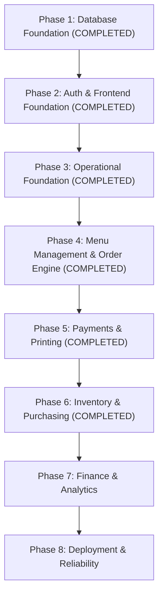

# Temu Pulang — Project Roadmap & Development Plan

## Project Overview

**Temu Pulang** is a local-first Point of Sale (POS) and business management solution specifically tailored for Food & Beverage establishments. It is designed to operate seamlessly on a local network (LAN) with robust data integrity, auditability, and ease of use.

---

## Roadmap Phases

---

## Detailed Phase Breakdown

### Phase 1: Database Foundation (COMPLETED)
- [x] **Inspection & Environment Setup**:
  - Validated PHP 8.5.12, Composer 2.11.1, Laravel 13.42.0, Livewire 4.4.8, Tailwind CSS 4.3.5.
  - Installed Laravel Boost guidelines and Pint code standards.
  - Configured timezone (`Asia/Jakarta`) and locales (`id` primary, `en` fallback).
  - Configured database (`temu_pulang`) on MySQL.
- [x] **Access Control & Auditing**:
  - Implemented `users`, `roles`, `permissions`, `role_user`, `permission_role`, `activity_logs`.
  - Configured Owner (unrestricted) and Cashier (POS & inventory view only) roles.
  - Implemented `Gate::before` integration for seamless `$user->can(...)` checks.
- [x] **Shop & Application Settings**:
  - Implemented `shop_settings` with business hours, tax basis points, receipt, and thermal printer parameters.
  - Implemented `application_settings` key-value store with typed values (`string`, `boolean`, `integer`, `json`).
- [x] **Product Catalog & Localization**:
  - Implemented normalized categories (`categories`, `category_translations`).
  - Implemented products (`products`, `product_translations`) supporting both variant and non-variant items.
  - Implemented variants (`product_variants`, `variant_translations`).
  - Enforced unique SKU constraints on products and variants.
  - Implemented integer Rupiah monetary storage (`BIGINT UNSIGNED`).
- [x] **Modifiers & Customizations**:
  - Implemented `modifier_groups`, `modifier_group_translations`, `modifiers`, `modifier_translations`, `product_modifier_groups`.
  - Supported required vs optional groups, min/max selection bounds, and free (Rp 0) vs paid add-ons.
- [x] **Seeders & Factories**:
  - Built idempotent seeders for roles, permissions, dev accounts, settings, categories, products, variants, and modifiers.
  - Tested running `db:seed` multiple times with zero duplicate records.
- [x] **Automated Testing Suite**:
  - Built 30 automated feature tests covering all relationships, permissions, translations, constraints, and settings with 100% passing results on isolated in-memory test database.
- [x] **Documentation**:
  - Authored comprehensive `DATABASE_DESIGN.md`, `ARCHITECTURE.md`, and `PROJECT_PLAN.md`.

---

### Phase 2: Authentication & Frontend Foundation (COMPLETED)
- [x] **Authentication System**:
  - Implemented `AuthController` with `showLogin`, `login`, `logout`, and `setLocale` methods.
  - Owner redirects to `/dashboard`; Cashier redirects to `/pos` on login.
  - Invalid credentials and inactive user handling with translated flash messages.
- [x] **Role-Based Access Control**:
  - `EnsureUserHasRole` middleware: protects Owner-only routes, redirects Cashier to `/pos`.
  - `SetLocale` middleware: reads `session('locale')` and sets `app()->setLocale()` on every request.
  - `Gate::before` in `AppServiceProvider`: Owner bypasses all permission checks.
- [x] **Localization (ID/EN)**:
  - Full Indonesian (`lang/id/messages.php`) and English (`lang/en/messages.php`) translations.
  - Language switcher in header (pill toggle) and login page (top-right corner).
  - Locale persisted in session via `/locale/{locale}` route.
- [x] **Application Layout**:
  - `layouts/app.blade.php`: sidebar + header layout with Livewire integration.
  - `layouts/guest.blade.php`: centered card layout for auth pages.
  - Responsive sidebar with hamburger collapse for mobile.
  - Header: Temu Pulang logo, shift indicator, user profile, language selector.
- [x] **Reusable Blade Components**:
  - `x-button`: variants (primary, secondary, outline, caramel, danger, ghost), sizes (xs/sm/md/lg).
  - `x-input`: label, error, hint, icon prefix support.
  - `x-card`: title, subtitle, action, footer slots.
  - `x-badge`: variants (primary, caramel, success, warning, danger, neutral).
  - `x-modal`: Alpine.js open/close events, backdrop, animated transitions.
  - `x-notification`: toast with Alpine.js, session flash, Livewire dispatch events.
  - `x-table`: headers prop, row slot.
- [x] **Login Page**:
  - Branded login form with TP logo, shop tagline.
  - Quick demo account buttons (owner & cashier) for fast access.
  - Remember me checkbox, animated validation feedback.
- [x] **Owner Dashboard (Livewire)**:
  - `OwnerDashboard` component: KPI cards (revenue, transactions, active shift, catalog count).
  - Recent orders table with payment method badges and status badges.
  - Top products bar chart visualization.
  - Hardware status card (printer, LAN status).
  - Prominent "SIMULASI DEMO" banner distinguishing placeholder from real data.
  - Real DB data: product count, category count, active cashier shift from seeded data.
- [x] **Cashier POS Terminal (Livewire)**:
  - `CashierPos` component: two-panel layout (product grid + cart sidebar).
  - Category filter pills from real DB categories.
  - Real DB products shown alongside clearly-labelled "Simulasi Demo" placeholder products.
  - Cart: add/remove items, quantity stepper, item customization (variants + modifiers + notes).
  - Dine-in / Takeaway toggle (table assignment removed to reflect actual single-counter business requirements).
  - Subtotal, tax (configured from shop settings, defaulting to 0%), and total calculation.
  - Payment modal (QRIS / Cash / Debit) — simulation only, no real payment processing.
  - No real inventory deduction.
- [x] **Automated Tests**:
  - 12 feature tests in `AuthenticationAndFrontendTest.php` covering login, RBAC, locale, Livewire renders.
  - 42 total tests, 165 assertions — all passing.
  - Pint: clean, no formatting issues.
- [x] **Screenshots**:
  - `docs/screenshots/login.png` — login page (ID locale).
  - `docs/screenshots/owner-dashboard.png` — Owner dashboard with KPI cards.
  - `docs/screenshots/pos-owner.png` — POS terminal as Owner.
  - `docs/screenshots/pos-cashier.png` — POS terminal as Cashier (sidebar shows "KASIR" role).

---

### Phase 3: Operational Foundation (COMPLETED)
**Objectives & Delivered Capabilities**:
- [x] **Shift Management Lifecycle (`ShiftService`)**:
  - Open shift modal with initial float count input (integer Rupiah).
  - Enforced single active shift per branch via atomic transactions & pessimistic locking (`lockForUpdate()`).
  - Active shift summary with 4 KPI cards (Opening Cash, Inflows, Outflows, Current Expected Cash).
  - Shift closing interface with physical cash count input and automatic discrepancy calculation (`actual_cash - expected_cash`).
  - Strict mandatory closing note whenever a discrepancy occurs.
  - Closed shifts are strictly immutable and cannot be reopened.
- [x] **Cash Movement Ledger (`CashMovementService`)**:
  - Cash In (`in`) and Cash Out (`out`) records associated with the active shift.
  - Full audit trail recording user, timestamp, category, and human description.
  - Positive integer Rupiah validation (`amount > 0`).
  - Audited reversal system (`reverseMovement()`) linking the original and compensating movements without silent edits.
- [x] **Shop Settings Administration (`ShopSettingsManager`)**:
  - Owner-only access (`role:owner`).
  - 5-tab interface: Profil Usaha, Jam Operasional (crossing midnight supported), Pajak & Finansial, Printer Thermal USB, and Template Struk.
  - Confirmed business requirements applied: **0% Tax**, **0% Service Charge**, and **USB Printer** defaults.
- [x] **Activity Log Interface (`ActivityLogIndex`)**:
  - Owner-only audit review page (`role:owner`).
  - Search, filter by user, module (`auth`, `shifts`, `cash_movements`, `settings`, `catalog`), and date range.
  - Detail modal for inspecting JSON before/after snapshots and client IPs.
  - Activity logs are strictly immutable and cannot be modified or deleted via web routes.
- [x] **POS Corrections**:
  - Removed table assignment controls (Dine-in / Takeaway toggle only).
  - Display tax as 0% (Rp 0) reflecting updated shop settings.
- [x] **Automated Tests**:
  - 35 new operational feature tests across 4 test suites:
    - `ShiftManagementOperationalTest.php` (15 tests)
    - `CashMovementOperationalTest.php` (9 tests)
    - `ShopSettingsOperationalTest.php` (7 tests)
    - `ActivityLogOperationalTest.php` (4 tests)
  - Full suite status: **77 tests, 280 assertions — 100% passing**.
- [x] **Screenshots**:
  - `phase3-dashboard.png` — Owner dashboard with active shift indicator.
  - `phase3-pos.png` — Cashier POS terminal with 0% tax and no table assignment.
  - `phase3-shifts-active.png` — Active shift overview with KPI cards and cash movements.
  - `phase3-shifts-modal-in.png` — Cash in modal interaction.
  - `phase3-settings-profile.png` — Shop Settings (Profil Usaha tab).
  - `phase3-settings-hours.png` — Shop Settings (Jam Operasional tab).
  - `phase3-settings-finance.png` — Shop Settings (Pajak & Finansial tab showing 0% defaults).
  - `phase3-settings-printer.png` — Shop Settings (Printer Thermal USB tab showing USB mode).
  - `phase3-activity-logs.png` — Activity Logs audit trail viewer.

---

### Phase 4: Menu Management & Order Engine (COMPLETED)
**Objectives & Delivered Capabilities**:
- [x] **Database Schema & Eloquent Models (`orders`, `order_items`, `order_item_modifiers`, `order_status_histories`)**:
  - Additive migration creating tables with explicit foreign keys and non-destructive schema design.
  - ULID and business-date daily sequential call numbers (`TP-001`, `TP-002`).
  - Frozen line-item snapshots preserving catalog name, variant, SKU, and unit prices even after product deletion or edits.
  - Immutability guards on financial fields in `Order::booted()`.
- [x] **Menu Management Backoffice (Owner Only)**:
  - `CategoryManager`: category CRUD, bilingual translation, sorting, and soft deletion.
  - `ModifierManager`: modifier groups, min/max selection validation, required toggle, and nested modifier options repeater.
  - `ProductIndex` & `ProductForm`: product CRUD with variants, modifier group assignments, image uploads to `storage/app/public/products`, and instant `toggleSoldOut()` toggle.
- [x] **Order Engine Service (`OrderService`)**:
  - `calculateBusinessDate()` with rollover at `ShopSetting::business_day_start_time` (`06:00:00`, `Asia/Jakarta`).
  - `getNextDailySequence()` serialized with pessimistic lock on active `ShopSetting`.
  - `createOrder()`: idempotency protection, frozen snapshots, active shift prerequisite check, and integer Rupiah calculations.
  - `advanceStatus()`: lifecycle transitions (`draft` -> `awaiting_payment` -> `paid` -> `queued` -> `preparing` -> `ready` -> `completed`).
  - `cancelOrder()`: Owner-only authorization with required cancellation reason.
- [x] **POS Terminal & Live Kitchen Board**:
  - Wired `CashierPos` to real `OrderService` with active shift validation.
  - `OrderIndex`: real-time kitchen queue board with 10s Livewire polling, status tabs, and lifecycle action buttons.
- [x] **Automated Tests**:
  - 4 test suites covering Phase 4: `OrderModelAndSchemaTest.php` (5 tests), `CategoryAndMenuManagementTest.php` (5 tests), `OrderEngineAndLifecycleTest.php` (8 tests), `OrderConcurrencyAndNumberingTest.php` (3 tests).
  - Total test suite: **98 tests, 375 assertions — 100% passing**.
- [x] **Phase 4 Hardening (Post-Audit)**:
  - Additive migration `2026_11_14_000022_add_unique_constraints_to_orders_table` enforcing database UNIQUE constraints on `(business_date, daily_sequence)` and `(business_date, daily_order_number)`.
  - Idempotency key lifecycle managed in `CashierPos`: key preserved across modal retries for the same cart, renewed only for a genuinely new cart.
  - Active register shift re-validated inside `OrderService::createOrder()` transaction with pessimistic row lock (`lockForUpdate()`) to prevent TOCTOU race conditions.
  - Cancellation restriction enforced server-side: paid and post-payment orders (`paid`, `queued`, `preparing`, `ready`, `completed`) cannot be cancelled through `advanceStatus()` or `cancelOrder()` without Phase 5 refund workflows.
  - Hardening test suite `OrderHardeningTest.php` (11 tests). Full test suite: **109 tests, 407 assertions — 100% passing**.

---

### Phase 5: Payments & Printing
**Objectives & Delivered Capabilities**:
1. Multiple payment method support: Cash (with quick change calculator), Static/Dynamic QRIS, and Debit/Credit cards.
2. Split payment capabilities (e.g. partial cash + partial QRIS).
3. Direct Windows USB ESC/POS thermal printing service (58mm and 80mm).
4. Receipt generation with customizable header, footer, and tax breakdown.
5. Optional secondary kitchen printer ticket routing.

**Task Breakdown & Status**:
- [x] **Task 5.1 — Database Foundation (COMPLETED)**:
  - Additive migration for `qris_confirmations`, `payment_transactions`, `payments`, `refund_transactions`, `payment_refunds`, `print_jobs`, and `orders.payment_status`.
  - Immutable models (`PaymentTransaction`, `Payment`, `RefundTransaction`, `PaymentRefund`).
  - Mass assignment protection on `Order.payment_status` and `Payment.order_id`.
  - Automated tests: `Phase5DatabaseFoundationTest.php` (12 tests, 36 assertions).
- [x] **Task 5.2 — PaymentService & Settlement Engine (COMPLETED)**:
  - Transactional settlement service supporting single and split payments.
  - Strict integer Rupiah validation (floats/strings rejected).
  - Cash change calculation; non-cash exact tender validation.
  - Server-authoritative QRIS confirmation verification, cashier ownership checks, and atomic single-use consumption.
  - Canonical request fingerprinting (`order_id`, `shift_id`, `cashier_user_id`, `total_amount`, sorted tenders); duplicate request detection with HTTP 409 Conflict.
  - Concurrency-safe sequential numbering (`PAY-YYYYMMDD-0001`).
  - Automated tests: `PaymentServiceSettlementTest.php` (20 tests, 85 assertions).
- [x] **Task 5.3 — Shift Cash Integration (COMPLETED)**:
  - Cash payment integration into shift expected-cash balance (`totalCashPayments()`).
  - Cash change correctly handled (`tendered - change = net cash received`).
  - Non-cash payment isolation from physical cash drawer balance (`totalNonCashPayments()`).
  - Forward-compatible cash refund deduction (`totalCashRefunds()`).
  - Preserved opening float and manual `CashMovement` entries without duplicate sales movement records.
  - Updated shift closing reconciliation and detailed audit log tracking.
  - Automated tests: `ShiftCashIntegrationTest.php` (7 tests, 38 assertions).
- [x] **Task 5.4 — RefundService & Refund Allocation Engine (COMPLETED)**:
  - Owner-only refund authorization (cashiers unconditionally rejected).
  - Partial and full refunds with explicit allocation to original `Payment` records.
  - Supported refund payout methods: `cash`, `qris_reversal`, `manual_transfer`.
  - Original payment method preserved separately from refund payout method on each `PaymentRefund` record.
  - Deterministic SHA-256 request fingerprint (`order_id`, `authorizer_user_id`, `total_refunded_amount`, sorted allocations, `reason`).
  - Idempotent retries return existing `RefundTransaction`; fingerprint mismatch → HTTP 409 Conflict.
  - Locking order: Shift → Order → Payments (ascending `id`) to prevent deadlocks.
  - Duplicate allocations (same `payment_id` + method) safely combined; conflicting methods rejected.
  - `Payment::remainingRefundableBalance()` enforced per allocation.
  - Cash refunds require active, open shift; non-cash refunds proceed without shift.
  - Cash refunds reduce expected cash via `PaymentRefund` records (no duplicate `CashMovement` entries).
  - `Order.payment_status` transitions: `paid → partially_refunded → refunded` (never in `$fillable`).
  - Fully refunded `completed` orders remain `completed`; other statuses → `cancelled` with history.
  - Concurrency-safe daily sequence numbering (`RFD-YYYYMMDD-0001`).
  - Comprehensive audit logging via `ActivityLog::record(action: 'refund.processed', module: 'payments', ...)`.
  - Original payment records never modified (append-only architecture preserved).
  - Automated tests: `RefundServiceTest.php` (49 tests, 130 assertions).
- [x] **Task 5.5 — Printing Infrastructure & Spooler (COMPLETED ✅)**
  - Native Windows RAW print helper (`storage/bin/tp-rawprint.exe`) compiled from `RawPrinterHelper.cs` with precise exit codes (0: completed, 1-4: safe failed, 5-7/99: uncertain).
  - ESC/POS builder (`App\Services\Printing\EscPosBuilder`) with multibyte UTF-8 sanitization (`/u` flag) for 80mm thermal printers; cutter and cash drawer excluded per v1 scope.
  - Receipt renderer (`ReceiptRendererService`) with cashier fallback chain, frozen tax snapshots, and reprint watermark.
  - Kitchen ticket renderer (`KitchenTicketRendererService`) displaying items, variants, modifiers, and preparation instructions without financial amounts.
  - Print lifecycle service (`PrintService`) for atomic job queuing, safe manual retries, explicit reprints with audit logging, and owner resolution of uncertain jobs.
  - Single-instance print worker (`PrintWorkerCommand`, `php artisan print:work`) with startup crash recovery, claim-token fencing, and safe failure vs uncertain state transitions.
  - Test print command (`PrintTestCommand`, `php artisan print:test`) for hardware verification without creating database records.
  - Additive migration adding `cashier_name` to `payment_transactions`.
  - Comprehensive automated test suite: 7 test classes (Unit + Feature), 245 total suite tests, 861 assertions, 100% passing.
- [x] **Task 5.6 — POS Checkout UI Integration (COMPLETED ✅)**
  - *Delivered*:
    - Livewire `CashierPos` wired to `OrderService::createOrder()` and `PaymentService::settlePayment()` (`PosCheckoutIntegrationTest.php`: 23 tests, 122 assertions).
    - Full POS localization (`lang/id` & `lang/en`) and exception masking (`CashierPos::mapPaymentExceptionToMessage()`).
    - Owner-only print-job resolution UI (`App\Livewire\Printing\PrintJobIndex` at `/printing/jobs`, `OwnerPrintJobResolutionTest.php`: 13 tests, 36 assertions).
    - Owner-only QRIS image upload/preview/replace/remove in `ShopSettingsManager` (`payment.qris_image_path`, `storage/app/public/qris`, `QrisImageSettingsTest.php`: 8 tests, 45 assertions) and QRIS modal display in `CashierPos`.
    - Computed integer quick-cash suggestion buttons (`CashierPos::suggestCashAmounts()`, `PosCashSuggestionTest.php`: 3 tests) and Alpine-formatted typed cash received input (`PosCashQuickButtonsTest.php`: 2 tests).
    - Owner-only refund screen (`App\Livewire\Orders\OrderRefund` at `/orders/{order}/refund`, `OrderRefundScreenTest.php`: 9 tests, 30 assertions).
  - *Deliberate Deferrals & Known Cleanup (Not Done)*:
    - (a) Split-payment UI and credit/transfer tender buttons are out of v1 scope.
- [x] **Task 5.7 — Full Phase 5 Verification & Hardening (COMPLETED ✅)**
  - Continuous end-to-end lifecycle test (`tests/Feature/Phase5EndToEndTest.php`: 1 test, 37 assertions) covering open shift -> manual cash movements -> order creation -> split payment settlement -> fake spooler print job completion -> partial cash refund -> full refund -> shift close.
  - Full Phase 5 verification: **367 tests, 1361 assertions — 100% passing**, Pint clean, Vite build passing.

---

### Phase 6: Inventory & Purchasing
**Objectives**:
1. Raw material inventory tracking (coffee beans, fresh milk, syrups, cups, straws).
2. Product recipes / Bill of Materials (BOM) linking menu items to raw ingredients.
3. Automated inventory deduction upon completed orders.
4. Waste, spoilage, and stock adjustment logging.
5. Supplier records and purchase order intake ledger.

**Tasks:**
- [x] **Task 6.1 — Inventory Database Foundation & Models (COMPLETED ✅)**
  - Migration batch 10: 6 new tables (`ingredient_categories`, `ingredients`, `ingredient_balances`, `recipe_items`, `modifier_recipe_items`, `stock_movements`).
  - 6 new Eloquent models with milli-unit helpers, append-only guards, and correct casts (`'string'` for `DECIMAL` — never `float`).
  - 6 new model factories; `Product`, `ProductVariant`, `Modifier` updated with inventory relationships.
  - `NULL`-safe uniqueness via MySQL generated columns (`COALESCE(branch_id, 0)`, `COALESCE(product_variant_id, 0)`).
  - `UNIQUE(idempotency_key, ingredient_id)` on `stock_movements` for idempotent order deductions.
  - Automated tests: `InventoryFoundationTest.php` (38 tests, 72 assertions — 100% passing).
  - Full suite: 317 tests, 1077 assertions — 100% passing.
  - Pint: ✅ clean.
- [x] **Task 6.2 — Ingredient & Recipe Management UI (COMPLETED ✅)**
  - Livewire `IngredientManager` (`/inventory/ingredients`): full CRUD for raw ingredients and categories, minimum stock alert configuration, initial opening balance posting via atomic transaction + `StockMovement`, search and category filtering, active/inactive toggle, soft deletion, and activity audit logging.
  - Livewire `RecipeManager` (`/inventory/recipes`): overview of all catalog products with Bill of Materials (BOM) status, per-serving raw ingredient breakdown, real-time COGS calculation (`cost_per_unit * quantity`), and Gross Margin percentage reporting against base selling price.
  - Livewire `ProductForm` (`/menu/products/{id}/edit`): integrated Tab 5 ("Resep Bahan / BOM") allowing interactive configuration of base product recipe items and variant-specific recipe overrides with quantity repeater and ingredient selection.
  - Livewire `ModifierManager` (`/menu/modifiers`): integrated modifier ingredient recipe delta rules (`add` / `replace` actions, target ingredient, replacement ingredient, delta quantity).
  - Web routes protected by `role:owner` middleware and linked in sidebar under "Inventaris & Bahan".
  - Automated tests: `IngredientAndRecipeManagementTest.php` (14 tests, 41 assertions — 100% passing).
  - Full suite: 331 tests, 1118 assertions — 100% passing.
  - Pint: ✅ clean.
- [x] **Task 6.3 — Stock-In & Adjustment Interface (COMPLETED ✅)**
  - `App\Services\Inventory\StockAdjustmentService`: atomic `stockIn()`, `recordWastage()`, and `adjust()` (`counted` and `difference` modes) with `Ingredient::toMilli()`/`fromMilli()` integer arithmetic, `lockForUpdate()` on `ingredient_balances`, idempotent `(idempotency_key, ingredient_id)` deduplication, and typed exceptions (`App\Exceptions\Inventory\*`).
  - `App\Livewire\Inventory\StockAdjustmentManager` (`/inventory/stock`, `role:owner` middleware + per-action checks, sidebar link under `Inventaris & Bahan`): ingredient search picker, comma/dot decimal input (up to 3 decimals, no thousand separators), Alpine-formatted Rupiah unit cost for stock-in, stable idempotency keys, and `ActivityLog` auditing (`stock_in`, `stock_wastage`, `stock_adjustment`).
  - Automated tests: `StockQuantityParsingTest.php` (3 tests, 18 assertions) & `StockAdjustmentTest.php` (7 tests, 52 assertions) — 100% passing.
  - Full suite: **377 tests, 1431 assertions — 100% passing**; Pint clean; Vite build passing.
- [x] **Task 6.4 — Automatic Order Deduction (COMPLETED ✅)**
  - `App\Services\Inventory\RecipeResolutionService`: resolves per-ingredient milli-units from base recipes, variant overrides, and modifier `add`/`replace` rules multiplied by item quantity; skips deleted products/variants with warning logs.
  - `App\Services\Inventory\InventoryService::deductForPayment()`: post-commit deduction locking `ingredient_balances` in ascending `ingredient_id` order, writing `order_deduction` `StockMovement` rows keyed by `PaymentTransaction.ulid` (allowing negative balances, never blocking payment).
  - Minimal post-commit & replay-branch hook in `PaymentService` (`attemptInventoryDeduction()`) logging `order_deduction_failed` on failure, plus `php artisan inventory:retry-deductions {--apply}` for recovery.
  - Automated tests: `RecipeResolutionServiceTest.php` (4 tests, 14 assertions) & `OrderDeductionTest.php` (5 tests, 26 assertions) — 100% passing.
  - Full suite: **386 tests, 1471 assertions — 100% passing**; Pint clean; Vite build passing.
- [x] **Task 6.5 — Low-Stock Alerts (COMPLETED ✅)**
  - `App\Services\Inventory\LowStockService`: read-only SQL/milli-unit low-stock query (`lowStockIngredients()` ordered `out` first, smallest margin, `name`; single-query uncached `count()`), excluding `min_stock_alert = 0`, inactive, and soft-deleted ingredients.
  - Owner-only UI integration: 3-state stock-level badges (`OK` / `Low` / `Out`) and 3-way filter (`all` / `low_or_out` / `out`) in `IngredientManager`, Owner-only sidebar count badge on `/inventory/stock` (hidden at 0), and Owner-only `Low Stock` dashboard card (top 5 + `"View all"` link + empty state).
  - Automated tests: `LowStockServiceTest.php` (1 test, 11 assertions) & `LowStockAlertTest.php` (4 tests, 37 assertions) — 100% passing.
  - Full suite: **391 tests, 1519 assertions — 100% passing**; Pint clean; Vite build passing.
- [x] **Task 6.6 — Stock Movement History Viewer (COMPLETED ✅)**
  - `App\Livewire\Inventory\StockMovementHistory` (`/inventory/movements`, `role:owner` middleware + `isOwner()` re-checks, sidebar link `messages.nav.stock_history`, per-row `History` link from `IngredientManager`): newest-first (`created_at desc, id desc`), 25 per page, URL-persisted filters (`ingredient`, `type`, `from`, `to`, `actor`) with graceful invalid-input handling, `withTrashed()` for soft-deleted ingredients/users, single bulk query for `Order` references, and single-ingredient exact milli-unit summary (`total in`, `total out`, `net`).
  - Automated tests: `StockMovementHistoryTest.php` (5 tests, 43 assertions) — 100% passing.
  - Full suite: **396 tests, 1562 assertions — 100% passing**; Pint clean; Vite build passing.
- [x] **Task 6.7 — Refund & Cancellation Inventory Rules (COMPLETED ✅)**
  - `App\Services\Inventory\InventoryService::restockForRefund()`: post-refund restock for completed full refunds (`payment_status === 'refunded'`), crediting back exact uncredited `order_deduction` quantities (`refund_credit`, positive `quantity`, `unit_cost` copied from deduction, `idempotency_key = RefundTransaction.ulid`, ascending `ingredient_id` `lockForUpdate()`).
  - `OrderRefund` UI checkbox (`returnToStock`): shown only for full-refund allocations when uncredited `order_deduction` movements exist; defaults checked for `paid`/`queued`, unchecked for `preparing`/`ready`/`completed`; non-blocking `try/catch(\Throwable)` logging `refund_restock_failed` on error; `php artisan inventory:retry-restocks {--apply}` recovery command.
  - Automated tests: `RefundRestockTest.php` (6 tests, 51 assertions) — 100% passing.
  - Full suite: **402 tests, 1613 assertions — 100% passing**; Pint clean; Vite build passing.
  - *Deliberate Deferrals & Known Cleanup (Not Done)*:
    - (a) Supplier records and purchase orders are not implemented (the supplier name goes in the `stock_in` note).
    - (b) Restock exists only through the Owner refund screen and only for full refunds; partial refunds need a manual stock-in or adjustment.
    - (c) UI localization cleanup across all 43 files in `app/Livewire` and `resources/views` is complete (Parts A, C1, C2, and D — **452 tests, 2379 assertions — 100% passing**). Genuine deliberate leftovers: historical `activity_logs.description` rows remain in the language written at record time (Indonesian for catalog/shift/cash/order/refund/print events; English for auth login/logout, QRIS image updates, stock movements, and deduction/restock failure logs), and default `CashierPos` internal cart fallback `'Standar'` for non-variant product rows.

---

### Phase 7: Finance & Analytics
**Objectives**:
1. Daily Register Close (Z-Report) and mid-shift summary (X-Report).
2. Revenue, COGS, and gross profit margin analytics.
3. Best-seller and hourly sales volume visualizations.
4. Export operational and financial reports to Excel and PDF formats.

**Tasks:**
- [x] **Task 7.1 — Shift X-Report (Live) & Z-Report (Final) (COMPLETED ✅)**
  - **Read-Only Shift Report Engine (`App\Services\ShiftReportService::buildReport()`)**: builds the complete mid-shift X-Report or closed-shift Z-Report as a plain array of integers and strings in a constant number of SQL aggregate queries (zero per-row queries, zero float math):
    - **Sales**: paid orders settled in the shift (`payment_transactions.shift_id = $shift->id`, `orders.payment_status IN ('paid', 'partially_refunded', 'refunded')`), returning `gross_sales`, `subtotal_sales`, `tax_total`, `service_charge_total`, `paid_orders_count`, `avg_ticket` (`intdiv`), and `net_sales` (`gross_sales - refunds.total`).
    - **Excluded Orders**: count of unpaid (`payment_status = 'unpaid'` and `status != 'cancelled'`) and unpaid-cancelled (`payment_status = 'unpaid'` and `status = 'cancelled'`) orders created in the shift (`orders.shift_id = $shift->id`).
    - **Payments by Method**: `SUM(payments.amount)` (bill amount applied, net of change) where `payments.shift_id = $shift->id` grouped by `payment_method` (`cash`, `qris`, `debit`, plus `other` for `credit`/`transfer` shown in UI only when `> 0`), summing to `total` payments received.
    - **Refunds Recorded in Shift**: `COUNT(*)` and `SUM(payment_refunds.amount)` where `payment_refunds.shift_id = $shift->id` split by `refund_method` (`cash`, `qris_reversal`, `manual_transfer`).
    - **Cash Drawer Reconciliation & Tie-Out**: reuses the exact `Shift::currentExpectedCash()` formula (`opening_cash + manual_cash_in - manual_cash_out + cash_sales - cash_refunds`) with reversals netted identically to `Shift::totalCashIn()` and `Shift::totalCashOut()`, plus `counted_cash` (`actual_cash`), `variance` (`discrepancy`), and `closing_note` for closed shifts.
    - **Z-Report Immutability**: strictly scoped to `shift_id = $shift->id` so subsequent shifts, orders, or refunds never alter a closed shift's Z-Report.
  - **Livewire Report Screen (`App\Livewire\Reports\ShiftReport` at `/reports/shift/{shift}`, route `reports.shift`)**: Owner may view any shift; Cashier may view only their own shift (`403` otherwise); displays `"X-Report (Live)"` with Refresh action for open shifts and `"Z-Report"` for closed shifts; includes browser Print button (`window.print()`) and `@media print` stylesheet; linked from `ShiftManager` (`/shifts`) on the active shift header (`X-Report`), every closed-shift history row (`Z-Report`), and the post-close empty-shift banner.
  - **Automated Tests**: `ShiftReportServiceTest.php` (1 unit test, 8 assertions) & `ShiftReportTest.php` (5 feature tests, 74 assertions) — 100% passing.
  - **Full Suite**: **481 tests, 7137 assertions — 100% passing**; Pint clean; Vite build passing.
  - *Known Follow-Ups (Step 4 & Step 5 Audit Findings — Reported Only, Not Changed in Task 7.1)*:
    - (a) **Thermal ESC/POS Z-Report Printing**: requires extending `PrintService` and `PrintWorkerCommand` with a new job type (`shift_z_report`), adding a nullable `shift_id` (and making `order_id` nullable) on `print_jobs`, and adding a `ShiftReportRendererService` using `EscPosBuilder`.
    - (b) **Refunds Without a Shift (`payment_refunds.shift_id IS NULL`)**: `RefundService::processRefund()` (`app/Services/RefundService.php:214`) assigns `payment_refunds.shift_id = $lockedShift->id` **only** when `refund_method === 'cash'`, and sets `shift_id = null` for all non-cash refunds (`qris_reversal` and `manual_transfer`), even when an active shift is passed (as well as when processed after shift close). Additionally, `RefundTransaction` has no `shift_id` column. Consequently, non-cash refunds are recorded in business-day reports (`DashboardMetricsService`) by `refund_transactions.created_at`, not in shift-level X/Z reports.
    - (c) **Orders Paid in One Shift and Refunded After Shift Close**: if an order paid in Shift A is refunded in cash during a later open Shift B, `payment_refunds.shift_id` is set to Shift B (`$shiftB->id`), reducing Shift B's expected drawer cash and Shift B's net sales while leaving closed Shift A's Z-Report unchanged; if refunded via non-cash (`qris_reversal` / `manual_transfer`) after Shift A closes, `payment_refunds.shift_id` is `null` and neither Shift A's nor Shift B's Z-Report is modified.
    - (d) **Expected Cash Component Alignment**: `Shift::currentExpectedCash()`, `ShiftService::calculateExpectedCash()`, and `ShiftReportService::buildReport()` all use the identical 5-component formula (`opening_cash + manual_cash_in - manual_cash_out + cash_sales - cash_refunds`) where reversals are opposite-type `CashMovement` rows included in both `manual_cash_in` and `manual_cash_out`, so expected cash never differs from the sum of the displayed components.

---

### Phase 8: Deployment & Reliability
**Objectives**:
1. Windows 11 local LAN offline-first hardening.
2. Automated local MySQL backup scripts with scheduled retention.
3. Multi-device LAN cashier terminal discovery and configuration.
4. Network failure handling and robust printer reconnection logic.

**Tasks:**
- [x] **Go-Live Hardening, Part 1 — Demo Access Gating, Account Tools, Preflight Check & Deployment Runbook (COMPLETED ✅)**
  - **Environment-Gated Demo Login (`AuthController`, `routes/web.php`, `resources/views/auth/login.blade.php`)**: Quick-demo-login switcher (`POST /login/demo/{role?}`) and pre-filled demo credentials on `/login` are restricted to `app()->environment(['local', 'testing'])`. In `production` (or any other environment), `AuthController::demoLogin()` aborts with `404` on the server and the login view hides the demo block and default credentials.
  - **Environment-Gated Seeders (`DatabaseSeeder`, `UserSeeder`, `ProductCategorySeeder`, `ProductSeeder`, `ModifierSeeder`)**: Demo accounts and demo catalog data seed only in `local` and `testing`. In any other environment, `DatabaseSeeder` runs only `RoleAndPermissionSeeder` and `ShopSettingSeeder` and creates zero user records.
  - **Account Management Commands (`app/Console/Commands`)**:
    - `temupulang:create-user {--role=} {--name=} {--email=}`: interactive `owner`/`cashier` account creation reading password exclusively via hidden prompt (`$this->secret()`, min 10 chars, with confirmation; never accepted via argument/option, never printed/logged).
    - `temupulang:set-password {email}`: interactive hidden password rotation (min 10 chars) with confirmation.
    - `temupulang:deactivate-user {email} {--reactivate}`: deactivates/reactivates user accounts, blocks deactivated login, refuses to deactivate the last active `owner`, and logs `user.deactivated` / `user.reactivated` in `ActivityLog` (`module: 'auth'`).
  - **Go-Live Preflight Command (`temupulang:preflight`)**: read-only 12-check production readiness audit (`[PASS]`, `[WARN]`, `[FAIL]`) covering `APP_ENV`, `APP_DEBUG`, `APP_KEY`, DB connection, writable `storage` & `bootstrap/cache`, `public/storage` link, demo login disabled, active `owner` presence, no active user with demo email or demo password hash, `shop_settings` row, `printer_name`, and cache/queue/session drivers; exits with `1` on any `FAIL` (`0` otherwise).
  - **Single-Shop Production Runbook (`docs/DEPLOYMENT.md`)**: complete Windows 11 / XAMPP / LAN deployment and operations guide.
  - **Automated Tests**: `GoLiveHardeningPart1Test.php` (6 tests, 85 assertions — 100% passing).
  - **Full Suite**: **458 tests, 2464 assertions — 100% passing**; Pint clean; Vite build passing.
  - *Known Follow-Ups (Step 5 Audit Findings — Reported Only, Not Changed in Part 1)*:
    - (a) **Login `POST` Throttle / Rate Limit**: `POST /login` (`routes/web.php:39`, `AuthController::login()` at `app/Http/Controllers/AuthController.php:34-75`) has no `throttle` middleware or `RateLimiter` protection applied.
    - (b) **Session Lifetime & Cookie Settings**: `config/session.php:35` and `.env.example:31` default `SESSION_LIFETIME` to `120` minutes (2 hours, shorter than an 8–10 hour cashier shift); `config/session.php:50` defaults `SESSION_ENCRYPT` to `false`; `config/session.php:172` leaves `SESSION_SECURE_COOKIE` as `null` (not explicitly pinned to `false` in `.env.example` for HTTP-only LAN operation).
    - (c) **Remaining Demo / Development Artifacts Exposed in Production**:
      - `app/Livewire/Dashboard/OwnerDashboard.php:35-104` and `resources/views/livewire/dashboard/owner-dashboard.blade.php:4-24,45-47`: Owner dashboard displays hardcoded simulated KPIs (`Rp 3.420.000`, `86` orders), fake recent order numbers (`TP-0104`..`TP-0100`), fake product sales quantities/revenues, and an unconditional `"SIMULASI DEMO"` banner until Phase 7 real analytics replace them.
      - `database/seeders/ShopSettingSeeder.php:21-25,41-42`: seeds placeholder shop address (`Jl. Boulevard Raya Blok A No. 12, Jakarta`), phone (`0812-3456-7890`), email (`halo@temupulang.local`), and receipt footer (`WiFi: TemuPulang | Pass: kopienak`) until edited by the Owner in `/settings`.
      - `routes/console.php:6-8`: default Laravel `inspire` artisan command.
      - `resources/views/welcome.blade.php:1-383`: default Laravel welcome view file (unrouted).
      - `.env.example:1-5,21,23`: development defaults (`APP_NAME=Laravel`, `APP_ENV=local`, `APP_DEBUG=true`, `DB_CONNECTION=sqlite`).
      - `README.md:1-58`: generic Laravel skeleton README.
- [x] **Go-Live Hardening, Part 2B — Real Owner Dashboard & `DashboardMetricsService` (COMPLETED ✅)**
  - **Read-Only Metrics Engine (`App\Services\DashboardMetricsService`)**: SQL-aggregate service using `shop_settings.business_day_start_time` (`'06:00:00'` fallback) and `shop_settings.timezone` (`'Asia/Jakarta'` fallback) with optional `$now` parameter and zero float math:
    - `grossSales`: `SUM(orders.total_amount)` for orders paid within `[start, end)` (`paid_at`) with `payment_status IN ('paid', 'partially_refunded', 'refunded')`.
    - `refundsTotal`: `SUM(refund_transactions.total_refunded_amount)` for refunds created within `[start, end)` (`created_at`).
    - `netSales`: `gross_sales - refunds`; `paidOrdersCount`: count of paid orders; `averageTicket`: `intdiv(gross_sales, paid_orders)` (`0` when `0`).
    - `paymentMix`: `SUM(payments.amount)` (bill amount applied, never cash tendered) grouped by `payment_method` (`cash`, `qris`, `debit`, plus `other` for `credit`/`transfer` shown when `> 0`, labelled as money received without subtracting refunds).
    - `percentChangeInTenths`: integer-only half-up change of today's net sales vs previous business day's net sales in tenths of a percent (`—` when previous day net sales `<= 0`).
    - `recentOrders`: last 5 orders created in the business day (any status, newest first).
    - `bestSellers`: top 4 products by `SUM(order_items.quantity)` from orders paid in the business day with `payment_status IN ('paid', 'partially_refunded')` (excluding `refunded`), using `order_items` snapshot names and line subtotals.
  - **Rebuilt Owner Dashboard (`App\Livewire\Dashboard\OwnerDashboard`, `resources/views/livewire/dashboard/owner-dashboard.blade.php`)**: removed the demo simulation banner, all hardcoded KPIs (`Rp 3.420.000`, `86` orders, `↑ 14.2%`, `Rp 2.990.000`), fake orders (`TP-0100`..`TP-0104`), and fake best sellers; added localized empty states and integer basis-point tax/service formatting while keeping the active shift card and Low Stock card intact.
  - **Automated Tests**: `OwnerDashboardMetricsTest.php` (8 tests, 70 assertions — 100% passing).
  - **Full Suite**: **466 tests, 2534 assertions — 100% passing**; Pint clean; Vite build passing.
- [x] **UI Text Hardening — Raw Machine Keys, Escaped HTML Entities & `{!! !!}` Placeholder Escaping (COMPLETED ✅)**
  - **Order Detail Status History (`resources/views/livewire/orders/order-index.blade.php:383-414`)**: replaced double-escaped `" &rarr; "` and raw `from_status` / `to_status` keys (`awaiting_payment`, `queued`, `partially_refunded`, etc.) with translated labels from `messages.orders.badge_*`, `messages.owner_dashboard.badge_draft`, and `messages.refund.status_*` joined by the real Unicode arrow `→`. Also added a `draft` badge branch on order cards (`order-index.blade.php:155-156`) and replaced remaining `&rarr;` entities in `owner-dashboard.blade.php`, `stock-adjustment-manager.blade.php`, and `stock-movement-history.blade.php` with `→`.
  - **Raw Machine Keys Across Views**:
    - `resources/views/livewire/shifts/shift-manager.blade.php:169-183`: replaced `{{ ucfirst(str_replace('_', ' ', $m->category)) }}` with translated category labels (`messages.shifts.cat_*`).
    - `resources/views/livewire/pos/cashier-pos.blade.php:881-896`: replaced raw `{{ $lastPaymentMethod }}` in the POS payment success modal with translated payment method labels (`messages.pos.payment_*`).
    - `resources/views/livewire/orders/order-refund.blade.php:75-90`: replaced `strtoupper($payment->payment_method)` in `messages.refund.payment_label` with translated payment method labels (`messages.pos.payment_*`).
    - `resources/views/livewire/printing/print-job-index.blade.php:57,79-91`: mapped `customer_receipt` (as well as `receipt`) to `messages.printing.job_type_receipt` and mapped fallback `$job->status` values (`pending`, `processing`, `completed`) to `messages.printing.status_*`.
  - **Explicit `e()` Escaping on All `{!! __('...') !!}` Placeholders**: wrapped dynamic placeholders in `e(...)` in `cashier-pos.blade.php:729,756` and `shift-manager.blade.php:25,125`.
  - **Automated Tests**: `RawKeysAndEntitiesUiTest.php` (5 tests, 4176 assertions — 100% passing).
  - **Full Suite**: **471 tests, 6710 assertions — 100% passing**; Pint clean; Vite build passing.
  - *Known Follow-Ups (Step 5 Audit Findings — Stored Free Text Written by Services, Reported Only, Not Changed)*:
    - `order_status_histories.notes` written at status-transition time in `OrderService.php:269` (`'Pesanan baru dibuat melalui kasir.'`), `OrderService.php:432` (`"Status diperbarui menjadi {$newStatus}."` — embeds raw target status key), `OrderService.php:505` (`"Dibatalkan oleh Owner. Alasan: {$reason}"`), `PaymentService.php:450` (`'Pembayaran lunas diterima ('.implode(', ', array_column($normalizedTenders, 'payment_method')).').'` — embeds raw payment method keys), `RefundService.php:255` (`'Pesanan dibatalkan akibat refund penuh oleh Owner. Alasan: '.trim($reason)`), and `RefundService.php:268` (`"Status pembayaran diperbarui menjadi {$newPaymentStatus} setelah refund {$refundTransaction->refund_transaction_number}."` — embeds raw payment status key).
    - `orders.cancellation_reason` written on full refund in `RefundService.php:244` (`'Refund penuh telah diproses. Alasan: '.trim($reason)`).
    - `stock_movements.notes` written in English by `InventoryService.php:87` (`"Order {$order->order_number} ({$transaction->payment_transaction_number})"`) and `InventoryService.php:164` (`"Refund {$refund->refund_transaction_number}"`).
    - `activity_logs.description` rows written at record time in Indonesian (`EnsureUserHasRole.php:47`, `IngredientManager.php:215,235,260,328,354`, `CategoryManager.php:121,153,176`, `ModifierManager.php:261,283,315`, `ProductIndex.php:35,59,91`, `PrintJobIndex.php:83`, `ShopSettingsManager.php:187`, `CashMovementService.php:78,170` [line 78 embeds raw `$category` key], `OrderService.php:277,437,510` [line 437 embeds raw `$currentStatus`/`$newStatus` keys], `PaymentService.php:456`, `PrintService.php:102,176` [line 176 embeds raw `$resolution` key], `RefundService.php:275`, `ShiftService.php:86,187`) or English (`DeactivateUserCommand.php:35,68`, `AuthController.php:113,134`, `StockAdjustmentManager.php:217` [embeds raw `$auditAction` key], `OrderRefund.php:166`, `ShopSettingsManager.php:256,293`, `PaymentService.php:507`).
- [x] **Go-Live Hardening, Part 2A — Login Throttling, Session Lifetime, Production Env Template, Seeder Placeholders, Preflight Additions & Shift Modal Empty Defaults (COMPLETED ✅)**
  - **Login Throttling (`AuthController::login`, `lang/id/messages.php`, `lang/en/messages.php`)**: limits failed attempts to 5 per minute per `strtolower(trim($email)).'|'.$request->ip()` using `Illuminate\Support\Facades\RateLimiter` (`tooManyAttempts` before `Auth::attempt`, `hit($key, 60)` on failure, `clear($key)` on success). Blocked attempts return localized `messages.auth.too_many_attempts` with `:seconds` remaining and record `ActivityLog` (`module: 'auth'`, `action: 'auth.login_throttled'`) without secrets.
  - **Session Lifetime & `.env.production.example`**: updated `SESSION_LIFETIME=720` in `.env.example` (leaving `config/session.php` defaults unchanged) and created `.env.production.example` with documented production settings and empty `APP_KEY`/`DB_PASSWORD`.
  - **Environment-Aware `ShopSettingSeeder` Placeholders**: defined `SAMPLE_ADDRESS`, `SAMPLE_PHONE`, `SAMPLE_EMAIL`, `SAMPLE_RECEIPT_HEADER`, `SAMPLE_RECEIPT_FOOTER`, and `GENERIC_RECEIPT_FOOTER` constants; seeds sample values only in `local` and `testing`, and seeds empty `address`/`phone`/`email` + generic footer (`Terima kasih atas kunjungan Anda`) in other environments.
  - **Preflight Additions (`PreflightCommand`)**: `[FAIL]` if `shop_settings` still contains any sample seeder placeholder (`address`, `phone`, `email`, or WiFi `receipt_footer`); `[WARN]` if `address` or `phone` is empty; `[WARN]` if `SESSION_LIFETIME < 480`; `[WARN]` if `LOG_LEVEL=debug` while `APP_ENV=production`, with remediation hints for each.
  - **Shift Modal Empty Defaults (`ShiftManager`)**: changed `$openingCash` and `$movementAmount` from pre-filled `200000` / `50000` to `null` (empty) so cashiers must enter counted amounts while preserving existing validation rules and error messages.
  - **Automated Tests**: `GoLiveHardeningPart2ATest.php` (4 tests, 85 assertions — 100% passing).
  - **Full Suite**: **475 tests, 6795 assertions — 100% passing**; Pint clean; Vite build passing.
- [x] **Manual Browser Testing Bug-Fix Pack — Whole-Rupiah Number Input Steps, Stale Checkout Key Lifecycle, Live QRIS/Debit Confirmation Bindings, QRIS Panel Height/Hint, Plain-Element `@disabled` Fix & Delegated Owner-Shift Payment Access (COMPLETED ✅)**
  - **BUG 1 — Whole-Rupiah `<input type="number">` Step Attributes**: replaced `step="1000"` and `step="500"` with `step="1"` on all 6 whole-Rupiah `<input type="number">` elements (`shift-manager.blade.php` lines `395`, `525`, `729`; `product-form.blade.php` lines `83`, `274`; `modifier-manager.blade.php` line `280`) so browsers accept any legitimate integer Rupiah value (including `20000` when `min="1"`).
  - **BUG 2 — POS Checkout Key Lifecycle & Live Confirmation Checkbox Bindings (`CashierPos.php`, `cashier-pos.blade.php`)**:
    - Changed `wire:model="qrisCashierConfirmed"` (`cashier-pos.blade.php:725`) and `wire:model="debitCashierConfirmed"` (`cashier-pos.blade.php:752`) to `wire:model.live` so ticking either confirmation checkbox in Livewire 4 immediately triggers a server round-trip and removes the `disabled` attribute (`disabled:cursor-not-allowed`) from the Pay button.
    - Hardened `CashierPos` idempotency key lifecycle (`addItemToCart()`, `resetDraftIdempotencyKey()`, `openCheckout()`, `processPayment()`, `recoverPendingPayment()`, `currentCartMatchesExistingOrder()`, `hasConflictingExistingOrder()`) so a session-restored `checkoutIdempotencyKey` pointing to a stale unpaid order with different items is automatically released when the cart changes or checkout is opened/submitted (without cancelling or altering the old order), while retrying the exact same cart still reuses its key.
  - **BUG 3 — QRIS Panel Height Constraints & Confirmation Hint (`cashier-pos.blade.php`, `lang/id/messages.php`, `lang/en/messages.php`)**: constrained the QRIS image to `max-h-56 h-auto w-auto object-contain` inside a `max-h-72 overflow-hidden` container so the QR image, amount to pay, and confirmation checkbox fit without scrolling on a `1366x768` screen, and added the translated hint `messages.pos.confirm_to_enable_pay` next to the Pay button whenever QRIS or Debit confirmation is unchecked.
  - **BUG 4 — Plain-HTML `:disabled="$paymentInFlight"` Browser JavaScript ReferenceError (`cashier-pos.blade.php:196,264,285,296`)**: replaced `:disabled="$paymentInFlight"` on the 4 plain `<button>` elements (`clearCart`, `removeItem`, `decreaseQty`, `increaseQty`) with Blade `@disabled($paymentInFlight)` so Alpine.js never attempts to evaluate a non-existent `$paymentInFlight` JavaScript variable in the browser.
  - **BUG 5 — Delegated Shift Payment Access for Cashiers in Owner-Opened Shifts (`PaymentService.php`, `ShiftAccessDeniedException.php`, `CashierPos.php`)**: added pure `PaymentService::userMayTakePaymentInShift(User $user, Shift $shift): bool` allowing payment when `(1)` the user opened the shift, `(2)` the user is an Owner, or `(3)` the shift was opened by an Owner and the user has the `cashier` role (while denying Cashier B in Cashier A's shift); replaced the two shift-access `InvalidArgumentException` throws in `PaymentService::settlePayment()` with `App\Exceptions\Payment\ShiftAccessDeniedException extends InvalidArgumentException`; mapped `ShiftAccessDeniedException` to `messages.pos.shift_access_denied` in `CashierPos` and pre-checked `userMayTakePaymentInShift()` before `OrderService::createOrder()` so denied attempts create zero orphan unpaid orders.
  - **Automated Tests**: `ManualBrowserBugFixPackTest.php` (7 tests, 115 assertions — 100% passing).
  - **Full Suite**: **488 tests, 7252 assertions — 100% passing**; Pint clean; Vite build passing.

